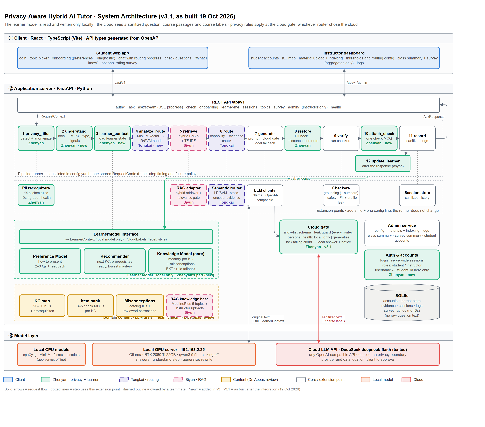
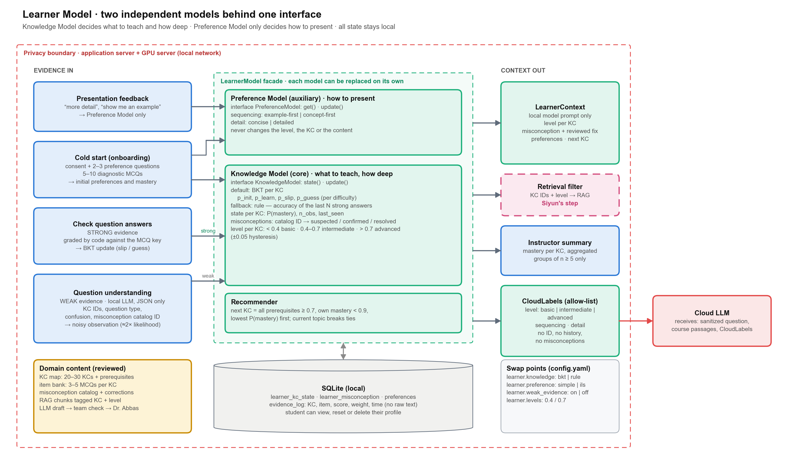
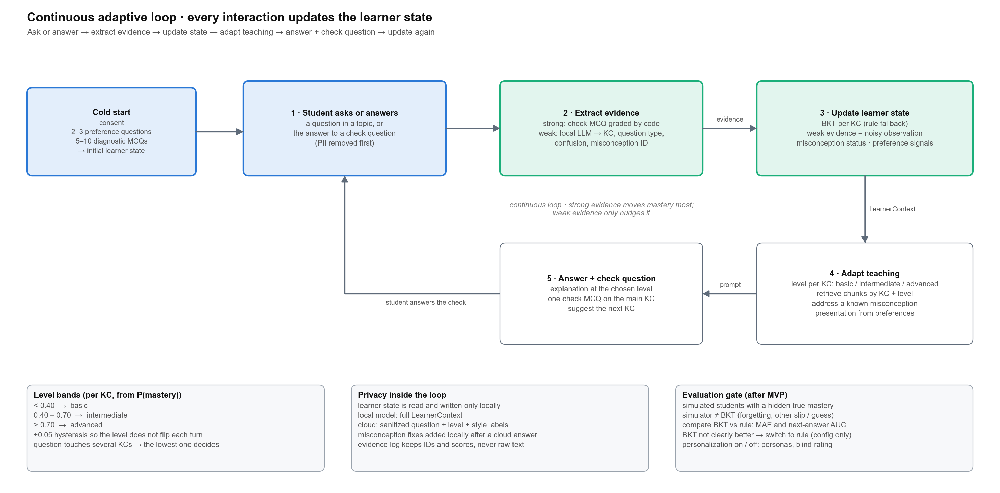

# Privacy-Aware Hybrid AI Tutor: System Design v3 (Adaptive Learner Modelling)

Oct 11, 2026 · Zhenyan Xing · ELG 5902, Group 1
Replaces System Plan v2 (Oct 6, 2026). Diagrams: [`docs/diagrams/`](diagrams/) (`.drawio` files are editable in draw.io; `.png` files are exports).
**Revision Oct 12, 2026:** student and instructor accounts. The instructor manages student accounts, and identity is kept apart from the learner profile (§2, §7.5, §8.1, §8.3, §9).

---

## 0. What changed from v2

v2 was a privacy-aware question-answering tutor: it removed PII, routed each question to a local or cloud model, and answered with RAG. The professor and the client asked for **continuous student modelling and adaptive teaching**. v3 keeps the v2 pipeline and adds a learner model:

> The system tracks each student's mastery of every knowledge component (KC) and uses it to decide **what to teach and how deep**. Learning preferences only change **how the answer is presented**. The full learner profile is read and written only inside the privacy boundary.

| Area | v2 | v3 |
|---|---|---|
| Student model | `ProfileProvider` with static background fields | **Learner Model** with two independent parts: a Knowledge Model (core) and a Preference Model (auxiliary), behind one interface |
| Content | 5 topics, RAG chunks per topic | 5 topics → **20–30 KCs** with prerequisites; chunks tagged with KC + difficulty; check-question **item bank**; **misconception catalog** |
| Pipeline | 7 steps | 10 steps + 1 post-response step (`learner_context`, `understand`, `attach_check`, `update_learner` are new) |
| API | ask, sessions, topics, admin | + `check`, `onboarding`, `learner/me`, `admin/class-summary`, `auth/*`, `admin/students` |
| Identity | none (an anonymous browser token was planned) | **Accounts**: many students and one instructor, with no self-registration. The instructor adds, resets, deactivates and deletes student accounts. Login uses server-side sessions. Only the `account` table links a username to the pseudonymous `student_id`. |
| Cloud payload | sanitized text, by convention | sanitized text + **coarse labels only**, enforced by an allow-list schema (`CloudRequest`, `extra="forbid"`) |
| Evaluation | privacy + answer quality | + KC tagging accuracy, simulated-student knowledge tracing, personalization on/off, cloud-payload audit |

### 0.1 Changes made to the learner-modelling proposal, and why

The draft learner-modelling proposal was sound. The changes below make it implementable in the time we have, testable, and safe under the privacy rule.

| # | Draft proposal | Change in v3 | Reason |
|---|---|---|---|
| 1 | "Full profile is stored only locally" | "Local" means **inside the privacy boundary**: the application server and the GPU server on the local network, not the student's browser | One source of truth that the instructor summary and the local model can both read. The student can still view, reset and delete the profile. |
| 2 | LLM extracts misconceptions as free text | Misconceptions come from a **closed, reviewed catalog per KC**. The LLM only selects catalog IDs, and MCQ distractors are tagged with misconception IDs. | Free text cannot be tracked, counted or evaluated, and may contain personal details. Catalog entries come with a correction text reviewed by Dr. Abbas. |
| 3 | Weak evidence "adjusts the profile with a lower weight" | Weak evidence is a **noisy BKT observation**: a likelihood ratio of about 2 instead of about 7 for a graded MCQ. There is no learning transition, and at most one weak update per KC per turn. In the MVP, weak signals can only lower mastery. | "Lower weight" is not defined in BKT. A noisy observation is principled and has one tunable parameter. Positive signals from free questions are unreliable. |
| 4 | Misconception correction appears in the answer | Local route: the correction goes in the prompt. Cloud route: the reviewed correction is **appended locally** in the `restore` step. | The cloud never learns what a student misunderstands, and the correction text is the reviewed one, not a generated one. |
| 5 | Mastery thresholds 0.4 / 0.7 | Same thresholds, plus **±0.05 hysteresis**. A question that touches several KCs uses the **lowest** mastery. | Stops the level from flipping between turns, and handles multi-KC questions. |
| 6 | Check questions of any type | Check questions are **MCQs graded by code** against a key | Strong evidence must be reliable and free. This reuses the grading approach of the model boundary test, and needs no LLM and no cloud. |
| 7 | Simulated students to compare BKT with the rule method | The simulator must **not** be BKT with the same parameters: it adds forgetting and different slip/guess values. The decision rule is fixed **before** the experiment (§11). | Otherwise BKT is tested on its own assumptions and wins by construction. |
| 8 | Preferences as a simplified FSLSM | Two dimensions: **sequencing** (example-first / concept-first) and **detail** (concise / detailed). Set by 2–3 onboarding questions and changed by explicit feedback buttons. The full ILS questionnaire stays optional. | Research does not support teaching to learning styles (Pashler et al., 2008). Preferences therefore only affect presentation, and we evaluate them by perceived fit, not by learning gain. |
| 9 | Pipeline integration not specified | New steps with failure policies (§7). The learner model never blocks an answer: if it fails, the student gets an unpersonalized answer. | The tutor keeps working if the learner model is broken or empty. |
| 10 | MVP on Oct 21 includes BKT for 1–2 topics | MVP covers **one topic fully** (High Blood Pressure), and a second only if its content is reviewed. Both BKT and the rule method are built behind the interface (both are small). | The bottleneck is reviewed content (KCs, items, misconceptions), not code. Ten days are left. |

---

## 1. Overview and scope

The system is a health-education tutor. A student picks one of five topics (High Blood Pressure, Type 2 Diabetes, Asthma, Migraine, Pneumonia) and asks questions or answers check questions. Before any model sees the question, the system removes private information locally. A routing score then decides whether a local or a cloud model answers. The answer is grounded in course material (RAG) and adapted to the student's current knowledge.

**Goals of v3**
1. Track mastery per KC continuously, from both graded answers and free questions.
2. Adapt the explanation level, retrieved material, misconception handling and next-step recommendation to that mastery.
3. Adapt presentation (example-first vs concept-first, concise vs detailed) to stated preferences.
4. Keep the full learner profile inside the privacy boundary. The cloud sees only a sanitized question and coarse labels.
5. Keep every model replaceable through an interface, so a component can be swapped by changing configuration (for example BKT ↔ rule method, simple preferences ↔ full ILS).
6. Give every student a personal account, so the learner profile follows the student across devices and sessions. One instructor account manages the student accounts.

**Out of scope:** personal diagnosis or treatment advice, which the system never gives at any level. Grading for credit. Real student data before ethics and consent are settled.

**Owners.** The internals of the routing score (Tongkai) and of retrieval and chunking (Siyun) remain black boxes. v3 only adds fields to their interfaces (§9).

---

## 2. Design principles

1. **Raw PII and the learner profile never leave the privacy boundary.** The cloud receives only a sanitized question, course passages and a fixed set of coarse labels. Logs, session history and the evidence log never store raw question text.
2. **Identity is kept apart from learning data.**
   - Usernames, display names and password hashes exist only in the `account` table.
   - Learner state, evidence, logs, sessions, prompts and cloud payloads use only the random `student_id`.
   - The **server** decides who the student is, from the login session. A `student_id` in a request body or query string is never trusted.
3. **Knowing what to teach comes before how to present it.** The Knowledge Model decides content and depth. The Preference Model only changes presentation and can never change level, KC or content.
4. **Every model sits behind an interface.** Each of `KnowledgeModel`, `PreferenceModel` and `Recommender` can be replaced by changing `config.yaml`.
5. **Degrade, don't fail.** If any learner step fails, the student still gets a correct, unpersonalized answer.
6. **Extend by adding files, not by editing existing code** (unchanged from v2). A new step, checker, recognizer, model or topic is a new file plus a config entry.
7. **Reviewed content over generated content.** Check questions, misconception corrections and KC definitions are drafted by an LLM and then reviewed by the team and, where possible, Dr. Abbas.
8. **Safety does not depend on the level.** A basic-level answer may be simpler, but it must not be less accurate. The medical-safety checker runs at every level.

---

## 3. Architecture



The system has three layers, as in v2: a React client, a FastAPI application server with a step-based pipeline, and a model layer (local Ollama and a cloud API). v3 adds a **Learner Model** module and a **Domain content** store to the application server, and puts a **Cloud request guard** in front of the cloud client.

| Component | Responsibility | Input → Output | Owner |
|---|---|---|---|
| Web frontend (React) | Login, chat, onboarding, check questions, "What I know" view; instructor dashboard including student accounts | user actions → `/api/v1/*` | Zhenyan |
| API service | Versioned routes, validation; identity from the login session | HTTP → `RequestContext` | Zhenyan |
| **Auth & accounts** | Login, server-side sessions (httpOnly cookie), roles (`student`, `instructor`), password hashing (argon2), lockout after failed logins, the instructor's student-account management, deletion of a student's data | credentials → `CurrentUser` | Zhenyan |
| Pipeline runner | Runs steps from `config.yaml`, timing, failure policy | `RequestContext` → `RequestContext` | Zhenyan |
| Privacy filter (step 1) | Presidio + custom recognizers | question → `PIIResult` | Zhenyan |
| **Learner context (step 2)** | Loads knowledge state and preferences | `student_id` → `LearnerContext` | Zhenyan |
| **Understand (step 3)** | Local LLM, JSON output: KC IDs, question type, confusion, misconception IDs | question → `Understanding` | Zhenyan |
| RAG retrieval (step 4, black box) | Passages for topic, filtered by KC and level | query, topic, kc_ids, level, k → `list[Chunk]` | Siyun |
| Routing score (step 5, black box) | Score 0–1, compared with the threshold | `RouteInput` → `RouteScore` | Tongkai |
| Prompt builder + model access (step 6) | Level-aware, preference-aware prompt; one `LLMClient` interface | context → `LLMResult` | Siyun (as in v2; to be confirmed) |
| Restore (step 7) | Puts PII back into cloud answers; appends the reviewed misconception correction | answer → answer | Zhenyan |
| Response verification (step 8) | Checkers: grounding, medical safety, PII leak, **profile leak** | answer + passages → `VerifyResult` | Siyun (as in v2; to be confirmed) |
| **Attach check (step 9)** | Picks one check MCQ for the main KC | context → `CheckItem` | Zhenyan |
| Record (step 10) | Sanitized logs, timings, tokens | context → DB | Zhenyan |
| **Update learner (post-response)** | Applies weak evidence asynchronously | `Understanding` → state | Zhenyan |
| **Learner Model** | Knowledge Model, Preference Model, Recommender behind `LearnerModel` | §5 | Zhenyan |
| **Cloud request guard** | Allow-list schema for everything sent to the cloud | context → `CloudRequest` | Zhenyan |
| **Domain content** | KC map, item bank, misconception catalog | YAML files, reviewed | Team + Dr. Abbas |
| Admin service | Config, materials, logs, class summary (aggregates), student accounts; instructor role only | admin requests → config / DB | Zhenyan |

---

## 4. Domain model (knowledge structure)

### 4.1 Knowledge components

Each topic is split into **4–6 KCs**, for **20–30 KCs** in total. Every KC has an ID, a short definition, a difficulty and its prerequisites. The KCs and prerequisites form a directed acyclic graph per topic. A CI test rejects cycles and unknown IDs.

Draft example (High Blood Pressure, **to be reviewed by Dr. Abbas**; thresholds and recommendations differ between guidelines, so each topic states the guideline it follows):

```yaml
# content/topics/high_blood_pressure/kcs.yaml
topic: high_blood_pressure
guideline: "TBD with Dr. Abbas (e.g. Hypertension Canada)"
kcs:
  - id: HBP.1
    name: What blood pressure numbers mean
    definition: Systolic vs diastolic pressure, units, a single reading vs an average
    difficulty: basic
    prerequisites: []
  - id: HBP.2
    name: How hypertension is classified and diagnosed
    difficulty: basic
    prerequisites: [HBP.1]
  - id: HBP.3
    name: Risk factors and causes
    difficulty: basic
    prerequisites: [HBP.1]
  - id: HBP.4
    name: Why it matters (heart, stroke, kidney complications)
    difficulty: intermediate
    prerequisites: [HBP.2]
  - id: HBP.5
    name: Lifestyle management (salt, diet, activity, alcohol)
    difficulty: intermediate
    prerequisites: [HBP.3]
  - id: HBP.6
    name: Medication and adherence (general principles only)
    difficulty: advanced
    prerequisites: [HBP.2, HBP.4]
```

### 4.2 RAG chunk tagging

Every RAG chunk carries `kc_ids` (one or more) and `level` (`basic` / `intermediate` / `advanced`). The RAG owner tags chunks: the LLM proposes the tags, and the RAG owner checks a sample. If a KC/level filter returns fewer than `k` chunks, retrieval falls back to the topic only, so tagging gaps never produce empty context.

### 4.3 Item bank (check questions)

Each KC has **3–5 multiple-choice items**. Each distractor can be tagged with the misconception it reveals, so that one wrong answer is strong evidence for that misconception.

```yaml
# content/topics/high_blood_pressure/items.yaml
- id: HBP.6-q1
  kc: HBP.6
  level: basic
  stem: "A person's blood pressure has been normal for three months on medication. What is generally recommended?"
  options:
    A: { text: "Stop the medication, because blood pressure is now normal", misconception: HBP.MC2 }
    B: { text: "Keep taking it, and discuss any change with their doctor" }
    C: { text: "Take half the dose from now on", misconception: HBP.MC2 }
    D: { text: "Take it only on days with headaches", misconception: HBP.MC3 }
  answer: B
  explanation: "Normal readings usually mean the medication is working. Changes should be decided with a clinician."
  reviewed_by: null        # set when reviewed; unreviewed items are disabled outside development
```

### 4.4 Misconception catalog

```yaml
# content/topics/high_blood_pressure/misconceptions.yaml
- id: HBP.MC2
  kc: HBP.6
  statement: "Blood pressure medication can be stopped once readings are normal."
  correction: "Normal readings usually show that the treatment is working. Stopping or changing it should be discussed with a clinician."
  reviewed_by: null
- id: HBP.MC3
  kc: HBP.1
  statement: "High blood pressure always causes symptoms such as headaches."
  correction: "High blood pressure often causes no symptoms, which is why regular measurement matters."
  reviewed_by: null
```

### 4.5 Content workflow and volume

| Item | Count (5 topics) | Workflow |
|---|---|---|
| KCs + prerequisites | 20–30 | Team drafts → Dr. Abbas confirms the structure |
| Check MCQs | 80–120 (3–5 per KC) | LLM draft → team check (answer key, one correct option, distractor tags) → Dr. Abbas samples |
| Misconceptions | ~2 per KC (40–60) | LLM draft from common patient misunderstandings → Dr. Abbas reviews the corrections (highest priority) |
| Chunk tags | all chunks | LLM tags → RAG owner checks a sample |

Only items and catalog entries with `reviewed_by` set are served in the showcase and in the final evaluation.

---

## 5. Learner model



### 5.1 Knowledge Model (core): what to teach and how deep

**State per student and KC:** `p_mastery` (P(L)), `n_obs`, `last_seen`, `level` (with hysteresis), and the misconception statuses for the KC.

**Default implementation: Bayesian Knowledge Tracing** (Corbett & Anderson, 1995), one model per KC.

For an observation with slip `s` and guess `g`:

```
correct:   P(L | obs) = P(L)(1−s) / [ P(L)(1−s) + (1−P(L)) g ]
incorrect: P(L | obs) = P(L) s     / [ P(L) s     + (1−P(L)) (1−g) ]
learning (strong evidence only):  P(L)_next = P(L | obs) + (1 − P(L | obs)) · T
```

| Parameter | Default | Note |
|---|---|---|
| `p_init` | 0.20 | Replaced by the diagnostic result where one is available |
| `T` (learn) | 0.10 | Applied after strong evidence only |
| `s` (slip) | 0.10 | |
| `g` (guess) | 0.25 | 4-option MCQ |
| Weak evidence | P(signal \| L) = 0.30, P(signal \| ¬L) = 0.60 | Likelihood ratio 2, vs ≈7.5 for a wrong MCQ; no `T` step; at most one weak update per KC per turn |

There is no real student data to fit these parameters. They are expert defaults set per difficulty in `config.yaml`, and the simulation in §11 checks how sensitive the results are to them.

**Fallback implementation: rule method.** `p_mastery = (correct + 1) / (n + 2)` over the last N = 5 strong answers for the KC (Laplace smoothing). Each weak negative signal subtracts 0.05, with a floor of 0. Both implementations produce the same state shape, so everything downstream is unchanged.

**Misconception tracking** (catalog IDs only):

| Status | Set when |
|---|---|
| `suspected` | one weak signal (the understand step picked this ID) |
| `confirmed` | a distractor tagged with this ID was chosen, or two weak signals |
| `resolved` | a later correct answer on an item that targets this misconception |

### 5.2 Preference Model (auxiliary): how to present

| Dimension | Values | Default | Set by |
|---|---|---|---|
| `sequencing` | `example_first` / `concept_first` | `example_first` | onboarding question; "Show me an example first" / "Explain the idea first" buttons |
| `detail` | `concise` / `detailed` | `concise` | onboarding question; "More detail" / "Shorter" buttons |

- Explicit feedback changes a preference immediately. Implicit signals (for example, always clicking "Show example") change it only after three consistent signals.
- This is loosely based on the FSLSM dimensions that AMI uses (sensing/intuitive, sequential/global). If the client wants the full Index of Learning Styles questionnaire, it is added as a new `PreferenceModel` implementation (`learner.preference: ils`).
- **Invariant:** preferences change prompt formatting only. They never change the KC, level, retrieved content or safety rules.

### 5.3 Recommender

The next KC is chosen as follows:
- **Candidates:** KCs whose prerequisites all have `p_mastery ≥ 0.70` (ready), and whose own `p_mastery < 0.90` (not yet mastered).
- **Order:** lowest `p_mastery` first. Ties prefer the current topic, then fewer observations.
- **When no KC qualifies:** suggest the prerequisite with the lowest mastery, or "review" when every KC is mastered.

### 5.4 One interface for both models

The answer generator never calls the two models directly. It reads one `LearnerContext` built by the `LearnerModel` facade, and the cloud path reads only `CloudLabels`:

```python
class KnowledgeModel(Protocol):
    def state(self, student_id: str, kc_ids: list[str] | None = None) -> KnowledgeState: ...
    def update(self, student_id: str, evidence: Evidence) -> KnowledgeState: ...

class PreferenceModel(Protocol):
    def get(self, student_id: str) -> Preferences: ...
    def update(self, student_id: str, signal: PreferenceSignal) -> Preferences: ...

class Recommender(Protocol):
    def next_kc(self, student_id: str, topic: str) -> KcRecommendation | None: ...

class LearnerModel:                       # facade; implementations chosen in config.yaml
    def context(self, student_id: str, kc_ids: list[str]) -> LearnerContext: ...
    def observe(self, student_id: str, evidence: Evidence) -> None: ...
```

### 5.5 Cold start

0. **First login.** The student logs in with the temporary password from the instructor and must set their own password before doing anything else.
1. **Consent screen.** It explains what is stored (mastery per KC, misconception IDs, preferences), where it is stored (locally), and how to view, reset or delete it. Without consent, the tutor runs unpersonalized and stores nothing about the student.
2. **2–3 preference questions** (sequencing, detail).
3. **5–10 diagnostic MCQs** for the chosen topic, one per KC, starting with KCs that have no prerequisites. If the student misses a prerequisite, its dependent KCs are skipped and keep `p_init`. The answers update mastery through BKT without the learning step.
4. Every step can be skipped, and defaults are used for anything skipped.

---

## 6. Adaptive teaching



The loop: **student asks or answers → extract evidence → update learner state → adapt teaching → answer + check question → update again.**

| Adaptation | Rule |
|---|---|
| Explanation level | Per KC: `< 0.40` basic, `0.40–0.70` intermediate, `> 0.70` advanced, with ±0.05 hysteresis. A multi-KC question uses the lowest level among its KCs. |
| Retrieved material | `retrieve(query, topic, kc_ids, level, k)` filters by KC and level, then falls back to topic only |
| Misconception correction | If a related misconception is `suspected` or `confirmed`: on the local route, it goes into the prompt as "address this misunderstanding"; on the cloud route, the reviewed `correction` is appended locally in `restore` |
| Check of understanding | After an explanation, one MCQ for the main KC. Prefer an unseen item; prefer items that target an open misconception. No item is repeated within 24 h. |
| Next step | Recommender output (§5.3), shown as "Suggested next: …" |
| Presentation | Prompt template chosen by `sequencing × detail`. It does not change content. |

**Prompt templates** live in `prompts/` as `{level}.{sequencing}.{detail}` partials around one base template. The base template carries the safety rules (education only, no personal diagnosis or treatment advice, advice to consult a clinician), so those rules are identical at every level.

---

## 7. Request flows

### 7.1 Ask (`POST /api/v1/ask`)

The caller must be a logged-in student. The request body has no `student_id`. The API fills `AskRequest.student_id` from the session, and a `session_id` that belongs to another student is rejected (404).

```yaml
pipeline: [privacy_filter, understand, learner_context, analyze_route, retrieve, route, generate, restore, verify, attach_check, record]
post_response: [update_learner]
```

| # | Step | What it does | On error |
|---|---|---|---|
| 1 | privacy_filter | Finds PII; stores `PIIResult` (entities, is_sensitive, cloud_safe, sanitized text) | **stop** |
| 2 | understand | Local model, JSON output limited to the topic's KC IDs and catalog misconception IDs: `{kc_ids, question_type, confusion, misconception_ids}`; thinking off; model `llm.understand.model` (default: the already-loaded local model) | skip → topic-only retrieval, no weak evidence |
| 3 | learner_context | Loads `LearnerContext`; the focus level is the lowest level among the question's KCs from step 2 (topic level when there are none) | skip → default intermediate level, no personalization |
| 3b | analyze_route | As built (Tongkai): local MiniLM embedding of the sanitized question (+ recent sanitized turns) → LR/SVM heads: cloud need, evidence needed, fresh evidence needed | stop (encoder or classifier failures are handled inside → cloud) |
| 4 | retrieve | Sanitized query + `kc_ids` + level. As built (Siyun): hybrid BM25 + word/char TF-IDF over MedlinePlus (5 topics) and instructor uploads, with a relevance gate | skip → no passages (the answer says so) |
| 5 | route | As built: semantic router (capability + cross-encoder evidence check) decides local or cloud; no privacy branch. The answer's passages are chosen separately (`select_passages`: relevant passages, or unverified ones if the evidence models are missing). The stub router keeps `cloud_safe = false` → local | skip → local |
| 6 | generate | Local: full `LearnerContext`. Cloud: a `CloudRequest` built by the guard, through the **cloud gate** (every router): personal health → `privacy.health_detail_policy` (`local_only` / `generalize`), leak guard, missing or failing cloud → local answer with a notice | stop |
| 7 | restore | Placeholders → original values (cloud answers); appends the reviewed misconception correction (cloud route); discards the mapping | stop |
| 8 | verify | grounding, medical_safety, pii_leak, profile_leak | warn |
| 9 | attach_check | Picks an MCQ for the main KC | skip |
| 10 | record | Sanitized logs, route score, timings, tokens | skip (logged) |
| post | update_learner | Applies weak evidence from step 2 to the Knowledge Model and preference signals to the Preference Model | log only |

**Latency budget.** The learner steps may add at most **0.8 s at p50**. Step 3 is the only new model call. In the boundary test, a short JSON classification took 0.37 s on qwen3.5:9b and 0.21 s on gemma4:e4b with thinking off. Thinking must stay off here: in the boundary test it raised the router-style latency to 11–48 s.

### 7.2 Check answer (`POST /api/v1/check`)

`{session_id, item_id, choice}` (the student comes from the login session) → graded by code against the key → strong `Evidence` → `KnowledgeModel.update` → the misconception status is updated from the chosen distractor → response `{correct, explanation, kc_level, next_kc}`. No LLM and no cloud are involved, so the answer is immediate.

### 7.3 Onboarding (`GET/POST /api/v1/onboarding`)

The GET returns the consent text, the preference questions and the diagnostic items for a topic. The POST stores the answers and initializes state (§5.5).

### 7.4 Learner view (`GET/DELETE /api/v1/learner/me`)

The student is taken from the login session; there is no ID parameter. GET shows each KC as a band (basic / intermediate / advanced / mastered) and the open misconceptions in plain language. Raw probabilities are not shown. DELETE resets the learning profile and removes the evidence log; the account stays.

### 7.5 Accounts and login

| Flow | Rule |
|---|---|
| Bootstrap | On first start, if no instructor exists, one is created from `INSTRUCTOR_USERNAME` / `INSTRUCTOR_INITIAL_PASSWORD` in `.env`. It must change that password at first login. A CLI command creates or resets an instructor if access is lost. |
| Student accounts | **No self-registration.** The instructor adds a student (username + display name), and the system generates a one-time temporary password that is shown once. The student must change it at first login. |
| Login | `POST /api/v1/auth/login`. Passwords are hashed with argon2. The server creates a session token and stores only its SHA-256 hash; the browser gets the token in an httpOnly, SameSite=Lax cookie (Secure behind HTTPS). Sessions expire after `auth.session_ttl_hours`. |
| Failed logins | One generic error ("invalid username or password"). After `auth.max_failed_logins` failures the account is locked for `auth.lockout_minutes`. |
| Must change password | Until the password is changed, the account can only call `auth/*`. Everything else returns 403. |
| Reset / deactivate | The instructor can generate a new temporary password or deactivate a student. Both end all of that student's sessions **immediately**, which is why server-side sessions are used instead of JWTs. |
| Delete | The instructor can delete a student. See §8.3 for exactly what is removed. |
| Roles | Student endpoints accept only `student` accounts; `admin/*` accepts only `instructor` accounts. The student-management endpoints act only on student accounts, so the instructor cannot delete itself or the last instructor through them. |
| Usernames | 3–32 characters from `a-z 0-9 . _ -`, case-insensitive. The instructor should **not** use real student numbers as usernames. |

---

## 8. Privacy design

### 8.1 What goes where

| Data | Stored (local SQLite) | Local model sees | Cloud sees |
|---|---|---|---|
| Raw question | no | yes | **no** (sanitized version only) |
| Sanitized question | yes (logs) | yes | yes |
| Student ID | random pseudonymous ID; linked to the username only in `account` | no | **no** |
| Username, display name, password hash | `account` table only | **no** | **no** |
| Mastery per KC | yes | level per KC | **one coarse label** for this question (`level`) |
| Misconceptions | catalog IDs + status | reviewed statement + correction | **no** (correction added locally) |
| Preferences | yes | yes | 2 labels (`sequencing`, `detail`) |
| Answer history / evidence log | IDs, scores, weights, times; no text | no | **no** |
| Session history | sanitized turns | sanitized turns | no (`cloud.history_turns: 0`) |

The coarse labels have 3 × 2 × 2 = 12 possible values, so they cannot identify a student.

### 8.2 Enforcement

The privacy rule is enforced by types, not by convention:

```python
class CloudLabels(BaseModel):
    model_config = ConfigDict(extra="forbid")
    level: Literal["basic", "intermediate", "advanced"]
    sequencing: Literal["example_first", "concept_first"]
    detail: Literal["concise", "detailed"]

class CloudRequest(BaseModel):            # the ONLY type the cloud client accepts
    model_config = ConfigDict(extra="forbid")
    sanitized_question: str
    topic: str
    passages: list[str]                   # course material, not student data
    labels: CloudLabels
    language: str = "en"
```

- `CloudClient.complete()` accepts only `CloudRequest`. A unit test asserts that its signature does not change.
- The `pii_leak` checker runs Presidio again on the serialized `CloudRequest`. The `profile_leak` checker fails if the payload contains a student ID, an item ID or a misconception statement.
- In the end-to-end tests, every cloud request is intercepted and audited (§11, E4).
- As built (19 Oct 2026): the generate step is the single cloud gate for every router. Before anything is sent it re-checks the `CloudRequest` (PII, `student_id`, item IDs, misconception text); a question with a personal health detail follows `privacy.health_detail_policy` (`local_only` by default, or a checked hypothetical rewrite with `generalize`). See `docs/report/privacy_subsystem.md`.

### 8.3 Instructor view, accounts and student rights

- The instructor dashboard shows **aggregates only**: the mastery distribution per KC, the most common misconceptions, and usage. Any group smaller than **n = 5** is suppressed.
- **Student-account management** shows account data only: username, display name, active, must-change-password, created, last login. It shows no learning data.
- **Individual learning views are off by default.** `learner.instructor_individual_view: false` keeps them off. They are built only if the client requires them and the student consents during onboarding.
- **Deleting a student** removes:
  - the account and all its login sessions;
  - the learning profile (mastery, misconceptions, preferences, evidence log, consent);
  - the student's session history.

  Request-log rows are **kept but anonymized**: their `student_id` is replaced with `deleted`. Class-level statistics stay correct, but nothing links them to the person any more. Deletion is implemented generically: every table with a `student_id` column is purged, and `request_log` is anonymized. Tables added later are therefore covered automatically, and a test checks this.
- Students can view or reset their learning profile at any time (`learner/me`). Deleting the whole account goes through the instructor. The retention period (for example, deleting all students at the end of the course) is an open item for the client.

---

## 9. Interfaces and data formats

All shared models are in `backend/app/core/schemas.py`. The new and changed models:

```python
class Evidence(BaseModel):
    kc_id: str
    kind: Literal["strong", "weak", "diagnostic"]
    correct: bool | None = None                 # strong / diagnostic
    signal: Literal["confusion", "misconception"] | None = None   # weak
    misconception_id: str | None = None
    item_id: str | None = None
    source: Literal["check", "understand", "onboarding"]

class KcState(BaseModel):
    kc_id: str
    p_mastery: float
    level: Literal["basic", "intermediate", "advanced"]
    n_obs: int
    last_seen: datetime | None

class LearnerContext(BaseModel):                # local only
    kc_states: dict[str, KcState]
    focus_level: Literal["basic", "intermediate", "advanced"]
    misconceptions: list[MisconceptionRef]      # id, statement, correction, status
    preferences: Preferences
    next_kc: KcRecommendation | None
    def to_cloud_labels(self) -> CloudLabels: ...

class Understanding(BaseModel):                 # output of the understand step
    kc_ids: list[str]
    question_type: Literal["definition", "how_why", "self_management", "check_my_answer", "other"]
    confusion: bool
    misconception_ids: list[str]

class RequestContext(BaseModel):                # v2 fields kept; new fields marked
    request: AskRequest
    learner: LearnerContext | None = None       # new
    understanding: Understanding | None = None  # new
    pii: PIIResult | None = None
    passages: list[Chunk] = []
    route: RouteScore | None = None
    target: Literal["local", "cloud"] | None = None
    answer: str | None = None
    check_item: CheckItem | None = None         # new
    checks: list[CheckResult] = []
    timings_ms: dict[str, float] = {}

# black-box interfaces: only fields were added
def retrieve(query: str, topic: str, k: int = 4,
             kc_ids: list[str] | None = None, level: str | None = None) -> list[Chunk]: ...
class RouteInput(BaseModel):                    # + optional level and kc_ids, if Tongkai wants them
    sanitized_question: str; topic: str; pii: PIIResult; passage_count: int
    level: str | None = None; kc_ids: list[str] = []
```

`Chunk` gains `kc_ids` and `level`. `AskResponse` gains `check_item`, `kc_level` and `next_kc`.

**Identity.** `AskRequest.student_id` stays in the internal schema, which teammates use, but clients never send it. The public request body is `AskBody` (session_id, course_id, topic, question, language), and the API fills `student_id` from the login session.

**Database tables** (SQLModel):
- `account` (id, username, display_name, role, password_hash, student_id, active, must_change_password, failed_logins, locked_until, created_at, last_login_at)
- `auth_session` (token_hash, account_id, created_at, expires_at)
- `learner_kc_state`, `learner_misconception`, `learner_preference`
- `evidence_log` (student_id, kc_id, kind, item_id, correct, weight, created_at; no text)
- `consent`
- the v2 tables: logs, sessions (`session_turn` now has a `student_id` for ownership checks), config history.

**REST API v1**

| Method | Path | Purpose | Caller |
|---|---|---|---|
| POST | `/api/v1/auth/login` · `/auth/logout` | Start / end a session (httpOnly cookie) | Login page |
| GET | `/api/v1/auth/me` | Current account (username, display name, role, must-change-password) | All pages |
| POST | `/api/v1/auth/change-password` | Change own password; ends the account's other sessions | All users |
| GET / POST | `/api/v1/admin/students` | List student accounts / add one (returns a one-time temporary password) | Dashboard |
| PATCH / DELETE | `/api/v1/admin/students/{id}` | Rename or (de)activate / delete a student and their data | Dashboard |
| POST | `/api/v1/admin/students/{id}/reset-password` | New temporary password; ends the student's sessions | Dashboard |
| POST | `/api/v1/ask` | Ask a question; returns the answer + check item + next KC | Chat |
| POST | `/api/v1/check` | Answer a check question | Chat |
| GET / POST | `/api/v1/onboarding` | Consent, preference questions, diagnostic | Onboarding |
| GET / DELETE | `/api/v1/learner/me` | View or reset own profile | "What I know" |
| GET | `/api/v1/sessions/{id}` | Sanitized history | Chat |
| GET | `/api/v1/topics` | Topics, KCs, material counts | Chat |
| GET / PUT | `/api/v1/admin/config` | Thresholds, models, steps, checkers, learner settings | Dashboard |
| GET | `/api/v1/admin/class-summary` | Mastery per KC and misconception counts, n ≥ 5 | Dashboard |
| GET | `/api/v1/admin/logs` | Sanitized logs and statistics | Dashboard |
| POST | `/api/v1/admin/topics/{topic}/materials` | Upload materials | Dashboard |
| GET | `/api/v1/health` | Ollama, cloud, DB | Monitoring |

**config.yaml (additions)**

```yaml
pipeline: [privacy_filter, understand, learner_context, retrieve, route, generate, restore, verify, attach_check, record]
post_response: [update_learner]
verify:
  checkers: [grounding, medical_safety, pii_leak, profile_leak]
learner:
  knowledge: bkt                  # bkt | rule
  preference: simple              # simple | ils
  weak_evidence: true             # false in the MVP
  levels: { basic_below: 0.40, advanced_above: 0.70, hysteresis: 0.05 }
  recommender: { ready: 0.70, mastered: 0.90 }
  bkt_defaults: { p_init: 0.20, learn: 0.10, slip: 0.10, guess: 0.25 }
  weak_likelihood: { given_mastered: 0.30, given_not_mastered: 0.60 }
  rule: { last_n: 5, weak_penalty: 0.05 }
  class_summary_min_group: 5
  instructor_individual_view: false # individual learning views stay off unless the client requires them
auth:
  session_ttl_hours: 12
  cookie_name: tutor_session
  cookie_secure: false            # true behind HTTPS
  min_password_length: 10
  max_failed_logins: 5
  lockout_minutes: 15
# .env: INSTRUCTOR_USERNAME, INSTRUCTOR_INITIAL_PASSWORD (bootstrap of the first instructor)
llm:
  local: { base_url: "http://192.168.2.25:11434/v1", model: "qwen3.5:9b", think: false, timeout_s: 60 }
  understand: { model: "qwen3.5:9b", think: false, format: json, timeout_s: 5 }
  cloud: { base_url: "https://api.openai.com/v1", model: "<TBD>", timeout_s: 30, fallback_to_local: true, history_turns: 0 }
content:
  dir: content/topics
  serve_unreviewed: false         # true only in development
```

---

## 10. Repository structure (changes from v2)

```
ai-tutor/
├── content/topics/<topic>/        # NEW: kcs.yaml, items.yaml, misconceptions.yaml (reviewed)
├── backend/app/
│   ├── auth/                      # NEW: passwords, sessions, account service, deps (roles), purge, CLI
│   ├── pipeline/steps/            # + learner_context.py, understand.py, attach_check.py, update_learner.py
│   ├── learner/                   # NEW
│   │   ├── facade.py              # LearnerModel, LearnerContext, to_cloud_labels()
│   │   ├── knowledge/             # interface.py, bkt.py, rule.py, misconceptions.py
│   │   ├── preference/            # interface.py, simple.py  (later: ils.py)
│   │   ├── recommender.py
│   │   └── content.py             # loads + validates the KC graph, items, catalog
│   ├── llm/cloud_guard.py         # NEW: CloudRequest, the only cloud entry point
│   ├── verify/checkers/           # + profile_leak.py
│   └── prompts/                   # base + {level}.{sequencing}.{detail} partials
├── frontend/src/pages/            # + Login.tsx, ChangePassword.tsx, Onboarding.tsx, WhatIKnow.tsx,
│                                  #   admin/ClassSummary.tsx, admin/Students.tsx
└── eval/
    ├── model-boundary-test/       # done (Oct 6)
    ├── understand-tagging/        # NEW: E1
    ├── learner-sim/               # NEW: E2 simulated students
    ├── personalization/           # NEW: E3 personas, on/off
    └── privacy-audit/             # NEW: E4 cloud payload audit
```

---

## 11. Evaluation and fallback criteria

The decision rules are fixed here, **before** the experiments run.

| ID | Question | Method | Metric and target (ideal / marginal) | Decision |
|---|---|---|---|---|
| **E1** | Can the local model tag questions reliably? | 120–150 labelled student-style questions (~25 per topic, including paraphrases and off-topic questions); run the `understand` step | KC top-1 accuracy ≥ 85% / 75%; misconception-ID precision ≥ 80% / 70%; p50 ≤ 0.6 s | Below marginal → turn off weak evidence (`weak_evidence: false`) and use topic-only retrieval |
| **E2** | Does BKT estimate mastery better than the rule method? | 200 simulated students × 40 interactions per topic. Each has a hidden true mastery with learning, **forgetting (0.02/step)** and slip/guess drawn **differently** from BKT's defaults. Weak signals have noise at the E1 error rate. | MAE between estimate and true mastery; next-answer AUC; level-band accuracy | Keep BKT only if its MAE is lower by **≥ 0.03** and its AUC is not lower; otherwise switch to `rule`. Also run weak evidence on/off: keep it only if it lowers MAE. Also run a parameter sensitivity sweep. |
| **E3** | Does personalization give better-fitting answers without losing accuracy? | 4 personas (novice; intermediate with a misconception; advanced; mixed prerequisites) × 20 questions × personalization on/off = 160 answers. Blind pairwise judgement by an LLM judge; Dr. Abbas rates a sample of 30. | Win rate on "level fits this student" ≥ 65% / 55%; no drop in correctness or rise in critical errors; known misconception addressed ≥ 80% / 70%; preference respected ≥ 90% | Below marginal → keep only level adaptation and the misconception note; turn off preference templates |
| **E4** | Does any profile or identity data reach the cloud? | Intercept every cloud request during E3 and the end-to-end runs; also check that usernames and display names never appear in prompts, logs or payloads | Fields outside the allow-list: **0**; profile or identity leak: **0**; PII leak ≤ 1% / 5% (as in v2) | Any profile or identity leak blocks the release |
| **E5** | Is the default local model good on the actual topics? | 20–30 questions per topic (the boundary test used medical-AI course questions, not these topics); local / cloud / hybrid, as in v2 | v2 quality targets; learner steps add ≤ 0.8 s p50 | Weak topic → raise the routing threshold for it, or extend RAG |

The v2 privacy and end-to-end tests (detection recall, leakage, semantic preservation, verification accuracy) are unchanged.

**Access-control tests**, which run in CI:
- a student cannot read another student's session or profile;
- a student cannot call `admin/*`;
- an account that must change its password can only call `auth/*`;
- deactivating, resetting or deleting a student ends that student's sessions at once;
- deleting a student purges every table with a `student_id` column and anonymizes `request_log`.

---

## 12. Milestones and responsibilities

| Milestone | Date | Deliverables (learner modelling) | Depends on |
|---|---|---|---|
| **MVP** | Oct 21 | Accounts and login (instructor bootstrap, student-account API, login and change-password pages); schemas + `LearnerModel` facade; BKT **and** rule implementations; consent + onboarding (preferences + diagnostic); level-aware prompts; `attach_check` + `/check`; `CloudRequest` guard; **High Blood Pressure** content complete (second topic only if reviewed); v2 MVP items (step runner, Presidio, local + cloud, chat page) | Stub routing and RAG; HBP content |
| Decision | Nov 1 | E2 simulation → BKT or rule; parameter sensitivity | MVP |
| **Beta** | Nov 11 | Student-account management page in the dashboard; all five topics' content; `understand` step + weak evidence (E1 first); misconception catalog + tracking; recommender; "What I know" view; instructor class summary; `profile_leak` checker; E4 audit | Real RAG with KC/level tags; Dr. Abbas review of corrections |
| Showcase | Nov 25 | E3 personalization on/off; E5 per-topic quality; demo with personas | Final routing threshold |
| Final presentation | Dec 3 | Results and comparison | |
| Final report + handoff | Dec 13 | Report, deployment guide, content-authoring guide, code cleanup | |

**Proposed ownership (to be confirmed with the team):** learner model, onboarding, check flow, cloud guard and KC/item drafting: Zhenyan. Chunk KC/level tagging and the KC/level filter in retrieval: Siyun. Optional `level` / `kc_ids` input to the route score: Tongkai. Content review: Dr. Abbas.

---

## 13. Risks

| Risk | Impact | Mitigation |
|---|---|---|
| Content volume (25 KCs, ~100 items, ~50 misconceptions) and review time | Adaptive features have nothing reviewed to serve | LLM drafts; MVP limited to one topic; Dr. Abbas reviews corrections first; unreviewed items are disabled outside development |
| BKT parameters are guesses without data | Wrong levels | Conservative defaults, sensitivity sweep in E2, rule fallback by config, hysteresis |
| KC tagging errors in `understand` | Wrong retrieval filter, noisy weak evidence | Closed label set + JSON mode; topic-only fallback; weak evidence is low-weight and can be turned off (E1) |
| Over-personalization (wrong level shown persistently) | Frustration, missing content | "Explain more simply / go deeper" buttons override the level for the turn and count as evidence; the student can reset the profile |
| Simplified answers become inaccurate | Health misinformation | One base safety template for all levels; medical_safety and grounding checkers at every level; Dr. Abbas samples basic-level answers in E3 |
| Profile data leaks to the cloud through prompts | Breaks the core privacy promise | Allow-list schema, `profile_leak` checker, E4 audit as a release gate |
| Extra latency from the `understand` step | Slower answers | Thinking off, same loaded model, 5 s timeout with skip; weak-evidence update after the response |
| Ten days to MVP | MVP slips | Learner MVP excludes weak evidence, misconceptions, recommender and the instructor view; those come in Beta |
| Black-box interfaces gain fields | Integration rework | Fields are optional with defaults; one contract test per interface, as in v2 |
| Weak account security (guessed or shared passwords) | One student sees or changes another's profile | argon2 hashes; minimum length; lockout after failed logins; forced change of temporary passwords; httpOnly SameSite cookies; server-side sessions revoked on reset, deactivation and deletion; access-control tests in CI |
| Usernames chosen as real student numbers | Identity data spreads | The guidance in the dashboard says not to; usernames live only in `account`; E4 checks prompts, logs and payloads |

---

## 14. Relation to AMI

| | AMI | This system |
|---|---|---|
| Core of the student model | Learning preferences (FSLSM) | Continuously updated **knowledge state** per KC (BKT, rule fallback) |
| Preferences | Main input, mostly static | Secondary; presentation only; 2 dimensions, full ILS optional |
| Updates | Mostly at the start | After every check answer (strong) and every question (weak) |
| Misconceptions | not modelled | Reviewed catalog, tracked per student, corrected in answers |
| Where the profile is processed | Cloud LLM | Locally only; the cloud sees a sanitized question + coarse labels |
| Architecture | n/a | Interfaces per model; BKT ↔ rule and simple ↔ ILS by configuration |

---

## 15. Open items (decisions needed)

- ☐ Client confirms the five topics, the KC lists and the guideline each topic follows (Dr. Abbas).
- ☐ How much review time Dr. Abbas has (items, misconception corrections).
- ☐ Whether instructors may see individual students' learning data, with consent. Default: aggregates only (`learner.instructor_individual_view: false`).
- ☐ Profile retention period, and the wording of the consent text.
- ☐ Inform the professor of the deletion rule: a deleted student's data is purged, and request logs are kept anonymized (§8.3).
- ☐ Whether the client wants the full ILS questionnaire.
- ☑ `cloud_safe = false`: decided Oct 19. Enforced at the cloud gate for every router (`local_only` default, `generalize` optional); the router has no privacy branch. Still open: whether the route score uses `level`.
- ☐ Cloud provider and model, and who pays. Tested with DeepSeek (Oct 19); its data location (China) needs the client's approval (`docs/隐私升级.md` §1).
- ☑ Student login: decided Oct 12. The instructor creates student accounts, students log in with a password, and identity is kept apart from the profile (§7.5).

## 16. As built (19 Oct 2026): differences from this design

The design above is kept as the plan; this section lists what the integrated system (main after PR #3) does
differently. Architecture figure: `docs/diagrams/architecture-v3.png` (v3.1).

| Area | Design (this document) | As built |
|---|---|---|
| Routing | Black-box `route_score()` vs threshold (stub until Tongkai's router) | Semantic router: MiniLM embedding, LR/SVM heads (cloud need, evidence, freshness), cross-encoder evidence check (`docs/ROUTING_PATCH.md`); new step `analyze_route`; `/ask/stream` sends progress events; the student can pick LR or SVM |
| Retrieval | TF-IDF over course chunks tagged with KC and level | Medical hybrid retrieval (BM25 + word/char TF-IDF), MedlinePlus pages for the five topics plus instructor uploads (PDF, DOCX, HTML, TXT, MD) indexed on upload (`docs/RAG_INTEGRATION.md`, `docs/RAG_MVP_VALIDATION.md`) |
| Passages for the answer | Retrieved passages | Chosen separately from routing: relevant passages when the evidence models ran, retrieved passages marked unverified otherwise |
| Privacy enforcement | `cloud_safe = false` forces local in the route step; pre-send guard | One cloud gate in the generate step for every router: health policy (`local_only` / `generalize`), leak guard, local fallback with a notice; 14 custom recognizers (`docs/report/privacy_subsystem.md`) |
| Cloud model | Provider to be decided | Any OpenAI-compatible API in `.env`; tested with DeepSeek `deepseek-flash`; `max_tokens: 2000` for reasoning models |
| Grounding check | Content-word overlap | Also warns when no material was found, and when a sentence's numbers are not in any passage |
| Feedback | – | Optional student rating survey (4 scores, no IDs, no free text), instructor sees aggregates of 3 or more |
| Local assets | spaCy model, Ollama | Also MiniLM and two cross-encoders, downloaded once with `python -m app.routing.prepare` |

---

### References

- Corbett, A. T., & Anderson, J. R. (1995). Knowledge tracing: Modeling the acquisition of procedural knowledge. *User Modeling and User-Adapted Interaction*, 4, 253–278.
- Felder, R. M., & Silverman, L. K. (1988). Learning and teaching styles in engineering education. *Engineering Education*, 78(7), 674–681.
- Pashler, H., McDaniel, M., Rohrer, D., & Bjork, R. (2008). Learning styles: Concepts and evidence. *Psychological Science in the Public Interest*, 9(3), 105–119.
- Group 1 model boundary test, round 1 + 2 analysis (Oct 6, 2026): `eval/model-boundary-test/results/ANALYSIS.md`.
