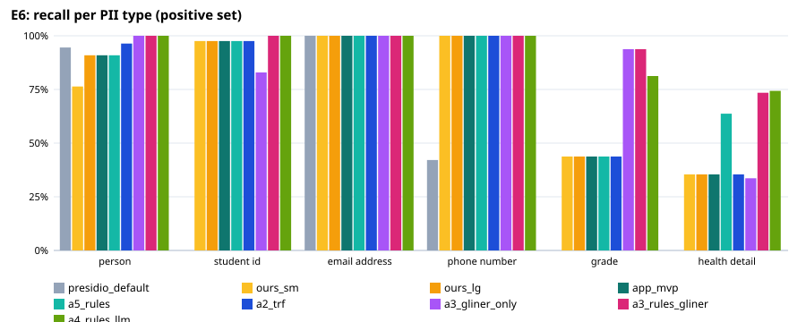
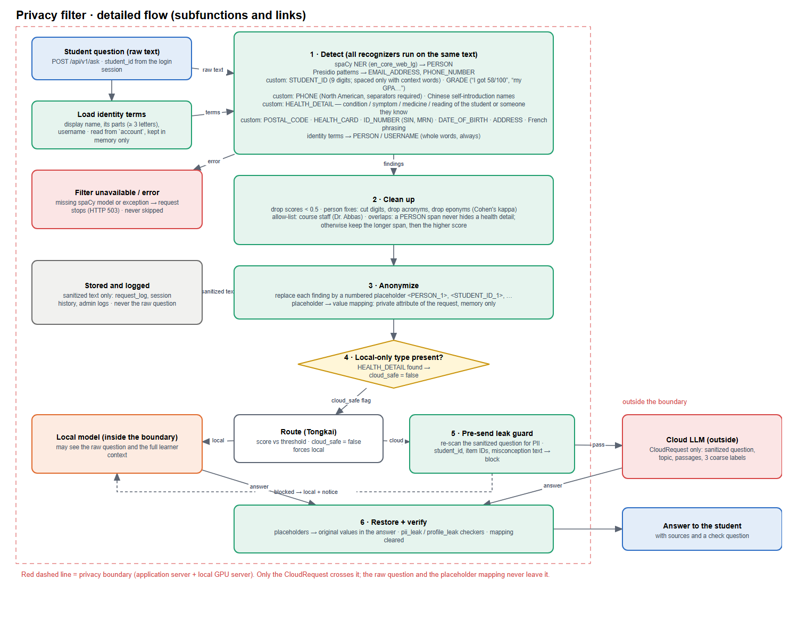

# Privacy subsystem: problem definition, concepts, detailed design and MVP test

Report section for Deliverable B (GNG/ELG 5902, Group 1). Covers B1–B4 for the privacy subsystem of the
Privacy-Aware Hybrid AI Tutor. All test data is fictional. Numbers come from `eval/privacy-filter/` (E6) and
`eval/privacy-audit/` (E4), run on 2026-10-19; see `eval/privacy-filter/README.md` to re-run them.

**Test sets.** E6 uses three sets, because a filter tuned on one set always looks better on that set:

| Set | Size | Made by | Used for |
|---|---|---|---|
| Main set | 404 questions: 208 positive, 112 negative, 30 hard, 15 French, 21 multi-turn (8 conversations), 18 out-of-scope | templates + 62 PII-free questions written by the local model (Qwen), labels from the templates; 50 labels spot-checked | development: rules were added after looking at its misses |
| Held-out v1 | 102 messages (89 with PII, 13 without) | written freely by a *different* model (Gemma 4), labelled by hand | second development round |
| **Held-out v2** | 102 messages (93 with PII, 9 without) | same as v1, generated **after the rules were frozen** | **final, unbiased test** |

---

## 1. Problem definition (B1)

### 1.1 Client needs related to privacy (prioritized)

| Priority | Need | Source |
|---|---|---|
| 1 | Students' personal information (names, student numbers, contact details, grades, personal health details) never reaches an external AI service | Client and course instructor; Ontario privacy expectations for student and health information |
| 2 | Students can still ask natural questions; the tutor answers well even when the question was cleaned | Client (learning value) |
| 3 | Personal health situations are handled locally and answered with general information plus a referral | Client (Dr. Abbas, medical safety) |
| 4 | The privacy step does not slow the tutor down noticeably | Students (usability) |
| 5 | Privacy behaviour can be checked and demonstrated (audit trail, tests) | Instructor, evaluators |

**Known:** questions are short, informal English (some Chinese and French); the cloud model is an
OpenAI-compatible API outside our control; a local GPU server is available inside the boundary.
**Unknown:** the real distribution of student questions (no real data before ethics approval); which cloud
provider and retention terms we will get; whether de-identified health questions may go to the cloud (client
and ethics decision).

### 1.2 Problem statement

Students in a health-education course need an AI tutor that can use a powerful cloud model **without
exposing who they are or their personal health situation**. The solution is a software filter, running
locally before any model, logging or storage, that detects and replaces personal information and keeps
personal health questions on a local model.

### 1.3 Metrics and target specifications

*Table 1. Need-inspired metrics and target specifications for the privacy subsystem.*

| # | Metric | Unit | Ideal | Marginal | Reason |
|---|---|---|---|---|---|
| M1 | Question-level leak rate: questions in which any in-scope PII is left after filtering | % of questions | ≤ 1 | ≤ 5 | Need 1. Each leak is a privacy incident; 5% is the most a pilot could tolerate with the cloud guard as a second layer |
| M1b | Cloud exposure: questions that would be **sent to the cloud** with PII still in them (identifiers / personal health) | % of questions | ≤ 1 | ≤ 5 | Need 1. M1 also counts questions that stay local anyway; M1b is what actually leaves the boundary |
| M2 | Lowest per-type recall (person, student ID, e-mail, phone, grade, health detail) | % of entities | ≥ 95 | ≥ 90 | Need 1; a good average can hide one weak type |
| M3 | Over-redaction: questions without PII in which anything is redacted | % of questions | ≤ 5 | ≤ 10 | Need 2; redacting course terms (e.g. “Cohen's kappa”) harms answers |
| M4 | Personal-health detection: sensitivity (kept local) / specificity (others left cloud-eligible) | % of questions | ≥ 95 | ≥ 90 | Need 3 |
| M5 | Filter latency per question (median) | ms | ≤ 100 | ≤ 300 | Need 4; the whole answer takes seconds, the filter must be a small part of it |
| M6 | Raw personal text sent off-site to perform the filtering | yes/no | no | no | Need 1; a filter that sends raw text to a third party defeats its purpose |
| M7 | Leaks in an end-to-end audit of all cloud payloads (fields, identity, profile, PII, personal health) | count | 0 | 0 | Need 5; any profile or identity leak blocks a release (design E4) |
| M8 | Answer quality after redaction, relative to the answer to the original question (judge model, 1–5) | mean score | ≥ 4.5 | ≥ 4.0 | Need 2 |

---

## 2. Benchmarking (B1)

### 2.1 Measured benchmark (same cases, same metrics)

The off-the-shelf baseline is **Microsoft Presidio** with its predefined recognizers (the open-source tool our
filter is built on), run with the same spaCy model and threshold. Upgrades were measured the same way:
the spaCy transformer model (A2), the zero-shot NER model GLiNER `gliner_multi_pii-v1` alone and combined with our
rules (A3), our rules plus a second pass by the local LLM (Qwen 3.5 9B) on the already-sanitized text (A4).

*Table 2. Held-out test set v2 (final test; 93 questions with PII, 9 without). M1b from `results/exposure.md`.*

| Configuration | M1 leak | M1b exposure: identifiers / personal health | M2 lowest type recall | M3 over-redaction | M4 sens. / spec. | M5 p50 / p95 |
|---|---|---|---|---|---|---|
| Presidio default | 92.5% | 54.8% / 86.0% | 0.0% | 0.0% (0/9) | 0.0% / 100% | 7 / 10 ms |
| Ours, small spaCy | 69.9% | 7.5% / 48.4% | 35.4% | 0.0% | 43.8% / 100% | 7 / 8 ms |
| Ours, MVP (large spaCy + MVP rules + identity terms) | 68.8% | 3.2% / 48.4% | 35.4% | 0.0% | 43.8% / 100% | 7 / 9 ms |
| **Ours, all rules (A5, current app)** | **47.3%** | **1.1% / 21.5%** | **43.8%** (grade) | **0.0%** | **75.0% / 100%** | **7 / 9 ms** |
| A2: + spaCy transformer | 68.8% | 1.1% / 48.4% | 35.4% | 0.0% | 43.8% / 100% | 28 / 37 ms |
| A3: GLiNER only | 63.4% | 5.4% / 51.6% | 33.6% | 44.4% | 40.0% / 54.5% | 70 / 101 ms |
| A3: rules + GLiNER | 30.1% | 0.0% / 20.4% | 73.5% | 44.4% | 76.2% / 54.5% | 90 / 108 ms |
| **A4: rules + local LLM pass** | **34.4%** | **0.0% / 12.9%** | **74.3%** | **0.0%** | **85.0% / 90.9%** | **627 / 1016 ms** |

*Table 3. Recall per type on held-out v2 (entities protected / labelled).*

| Type | Presidio | MVP | A5 rules | A3 rules + GLiNER | A4 rules + LLM |
|---|---|---|---|---|---|
| Person | 52/55 | 50/55 | 50/55 | 55/55 | 55/55 |
| Student ID | 0/41 | 40/41 | 40/41 | 41/41 | 41/41 |
| E-mail | 9/9 | 9/9 | 9/9 | 9/9 | 9/9 |
| Phone | 8/19 | 19/19 | 19/19 | 19/19 | 19/19 |
| Grade | 0/16 | 7/16 | 7/16 | 15/16 | 13/16 |
| Health detail | 0/113 | 40/113 | 72/113 | 83/113 | 84/113 |

*Table 4. Main set (development set — optimistic, the rules were tuned on it).*

| Configuration | M1 leak: positive / hard / French / multi-turn | M2 | M3 (112 negatives) | M4 sens. / spec. | Out-of-scope caught | M5 p50 |
|---|---|---|---|---|---|---|
| Presidio default | 60.6% / 56.7% / 61.5% / 46.2% | 0.0% | 7.1% | 0.0% / 100% | 3/18 | 4 ms |
| Ours, small spaCy | 6.2% / 46.7% / 46.2% / 69.2% | 84.2% | 0.0% | 80.3% / 100% | 1/18 | 4 ms |
| Ours, MVP | 0.5% / 33.3% / 46.2% / 38.5% | 97.8% | 0.0% | 80.3% / 100% | 1/18 | 4 ms |
| Ours, all rules (A5) | 0.0% / 33.3% / 0.0% / 30.8% | 100% | 0.0% | 91.8% / 100% | 10/18 | 4 ms |
| A2: + spaCy transformer | 0.5% / 33.3% / 53.8% / 38.5% | 97.8% | 0.9% | 80.3% / 100% | 1/18 | 20 ms |
| A3: GLiNER only | 29.3% / 30.0% / 30.8% / 7.7% | 0.0% | 19.6% | 55.7% / 87.4% | 8/18 | 68 ms |
| A3: rules + GLiNER | 0.0% / 16.7% / 0.0% / 7.7% | 100% | 19.6% | 95.1% / 87.4% | 11/18 | 83 ms |
| A4: rules + local LLM pass | 0.0% / 10.0% / 0.0% / 15.4% | 100% | 3.6% | 95.1% / 98.2% | 14/18 | 0.3–0.9 s* |

\* The LLM pass took a median of 282 ms in a first run and 944 ms in the final run, when the GPU server was
shared with another evaluation; 627 ms on the held-out set. It depends on server load.

Cloud exposure on the main set (M1b, identifiers / personal health): Presidio 27.0% / 22.3%, MVP 2.2% / 4.4%,
A5 rules 2.2% / 1.8%, rules + GLiNER 1.1% / 1.1%, rules + LLM 0.4% / 1.1% (`results/exposure.md`).

**What the benchmark shows**

- Presidio out of the box finds names and e-mails but has no notion of student numbers, grades or personal
  health details; on the main set it also redacts eponyms and course staff (“Cohen”, “Abbas”).
- **The main set overstates the filter.** The same rules that leak on 0% of main-set questions leak on 47% of
  the freely written held-out questions. The difference is almost entirely health details and grades: the
  ways students describe their own health are far more varied than templates. Identifiers generalize:
  student ID 40/41, phone and e-mail 100%, person 50/55, and only **1.1%** of held-out questions would send an
  identifier to the cloud.
- The large spaCy model is needed (the small one misses 1 in 6 names). The transformer model adds nothing on
  top of it for our types and is 4× slower.
- GLiNER finds more grades and health details but redacts ordinary questions (44% of held-out negatives,
  20–46% across sets) and is not a usable standalone filter.
- The local LLM pass is the only upgrade that improves personal-health detection without over-redaction
  (sensitivity 75% → 85%, identifier exposure 0%), at about 0.6 s per cloud-bound question.

*Figure 1. Recall per type, held-out test set (`eval/privacy-filter/results/holdout_test/recall_by_type.svg`).*

### 2.2 Descriptive benchmark (commercial services)

*Table 5. Similar commercial solutions (descriptive; not run, see M6).*

| Solution | What it does | M6: raw text sent off-site? | Fit for our needs |
|---|---|---|---|
| AWS Comprehend PII detection | Cloud API that detects and redacts PII types in English text | Yes | Fails M6 by design: the question would leave the boundary before being cleaned |
| Google Cloud Sensitive Data Protection (DLP) | Cloud inspection and de-identification with many built-in info types | Yes | Same as above; strong coverage, but requires a data agreement and sends raw text |
| Azure AI Language PII detection | Cloud API for PII and health-entity detection | Yes (a container option exists, but needs Azure licensing) | Same as above for the hosted API |
| Presidio (default) | Open-source, local | No | Passes M6, fails M1–M4 on student questions (Table 2) |

Commercial services were not run because doing so would require sending (fictional) personal text to them and
paid accounts; their coverage of course-specific types (student numbers, grades, “my dad takes metformin”)
would still need custom rules.

---

## 3. Concept development (B2)

### 3.1 Concepts for the privacy subsystem

| ID | Concept | Detection | Handling of findings |
|---|---|---|---|
| C1 | Regular expressions only | Hand-written patterns | Placeholders |
| C2 | Presidio default | NER + built-in patterns | Placeholders |
| C4 | MVP: Presidio + custom recognizers + large spaCy + own-identity terms | student ID, grade, phone, health detail, Chinese names, eponym/staff clean-up | Placeholders; health details keep the question local |
| C4+A5 | C4 with all recognizers (current app) | + Canadian IDs (postal code, health card, SIN, MRN), date of birth, address, French names/grades/health, possessive health phrases | as C4 |
| C5 | C4+A5 + local LLM second pass | Qwen re-reads the sanitized cloud-bound text and lists what is left | as C4 |
| C6a | C4 with the spaCy transformer model | stronger NER | as C4 |
| C6b | C4+A5 + GLiNER | zero-shot PII NER | as C4 |
| C7 | Cloud PII API (Table 5) | provider models | provider redaction |
| H1 | Handling: surrogate values (fake names) instead of placeholders | – | more natural cloud prompts |
| H2 | Handling: rewrite personal health questions as hypothetical ones (“a person with asthma…”) by the local model | – | health questions could use the cloud without linking them to the student |

### 3.2 Evaluation against the target specifications

Scores 1 (poor) to 5 (excellent), **measured on the held-out test set** (Table 2) except C1 (estimated, e) and
effort/maintainability (team judgement). M6 is a pass/fail gate. Scoring rules: privacy from M1b
(identifier ≤ 1% and health ≤ 15% → 4; ≤ 25% → 3; ≤ 50% → 2; else 1); over-redaction from M3 over all sets
(0–1% → 5, ≤ 5% → 4, ≤ 10% → 3, > 15% → 1); health from M4 sensitivity (≥ 85% with specificity ≥ 90% → 4,
≥ 75% → 3, ≥ 70% with low specificity → 2, < 50% → 1); latency from M5 (≤ 50 ms → 5, ≤ 100 → 4, > 300 → 2).

*Table 6. Weighted decision matrix for detection concepts.*

| Criterion (weight) | C1 | C2 | C4 | C4+A5 | C5 | C6a | C6b | C7 |
|---|---|---|---|---|---|---|---|---|
| M6 gate: no raw text off-site | pass | pass | pass | pass | pass | pass | pass | **fail** |
| M1/M1b privacy (35%) | 2 (e) | 1 | 2 | 3 | 4 | 2 | 3 | – |
| M3 over-redaction (15%) | 4 (e) | 3 | 5 | 5 | 4 | 5 | 1 | – |
| M4 personal health (15%) | 2 (e) | 1 | 1 | 3 | 4 | 1 | 2 | – |
| M5 latency (10%) | 5 | 5 | 5 | 5 | 2 | 5 | 4 | – |
| Implementation effort (15%) | 4 | 5 | 4 | 4 | 3 | 3 | 2 | – |
| Maintainability / explainability (10%) | 3 | 4 | 4 | 4 | 2 | 3 | 2 | – |
| **Weighted score** | 3.00 | 2.60 | 3.10 | **3.75** | 3.45 | 2.85 | 2.40 | excluded |

Weighted score = Σ weight × score (e.g. C4+A5: 0.35·3 + 0.15·5 + 0.15·3 + 0.10·5 + 0.15·4 + 0.10·4 = 3.75).

**Sensitivity of the decision.** C5's latency only applies to questions that go to the cloud, where the cloud
call itself takes several seconds; scoring its latency 4 instead of 2 gives C5 3.65. With privacy weighted 50%
(health-education client), C4+A5 and C5 tie at 3.58, and C5 with route-only latency leads with 3.74. The choice
between them is therefore a client decision about how much residual risk is acceptable (3.4).

**Decision:** C4+A5 is the configuration of the MVP (done, 7 ms). **C5 — the LLM pass only on cloud-bound
questions — is the recommended Beta upgrade** if the client confirms that de-identified health statements
must not reach the cloud; C6a and C6b are rejected (no gain / too much over-redaction).

### 3.3 Handling options and answer quality (M8)

The local model answered 45 fictional questions three ways; a different model (Gemma 4) compared each answer
with the answer to the original question (`results/utility.md`).

*Table 7. Answer quality after redaction (1–5; 5 = as good as the answer to the original question).*

| Questions | Placeholders (B1, app) | Surrogate values (H1) | Hypothetical rewrite (H2) |
|---|---|---|---|
| 30 with identifiers only | 4.37 (80% ≥ 4) | 4.50 (77% ≥ 4) | – |
| 15 with a personal health detail | 3.07 (13% ≥ 4) | 2.53 (7% ≥ 4) | **4.47 (100% ≥ 4)** |

- Placeholders for names, IDs and contact details cost little (4.37, M8 marginal); no placeholder was left in
  an answer after restore.
- Hiding the health detail itself makes the answer much worse (3.07): the cloud model no longer knows what
  the question is about. This is why personal health questions stay local today instead of being masked.
- A hypothetical rewrite (“a person with asthma…”) keeps the quality (4.47) and contains no identifier; none of
  the 15 rewrites still contained PII according to our filter (whose health recall is limited, so a human
  check is needed). H2 is the strongest option if the client accepts de-identified health questions in the
  cloud.
- Surrogate names (H1) bring no gain over placeholders and confuse health questions; not pursued.

### 3.4 Client feedback to seek

1. Residual risk: with the current rules about 1 in 5 freely written personal health questions (held-out
   test) is not recognised as personal and goes to the cloud **without** name or ID. Is that acceptable for
   the pilot, or should we add the LLM pass (C5, ~0.6 s more per cloud answer, 1 in 8)?
2. Is sending a *de-identified hypothetical* version of a personal health question to the cloud acceptable
   (H2), or must such questions always stay local?
3. Which additional types matter for this course: health card number, address, date of birth, postal code
   (now covered), ages, school or workplace (not covered)?
4. Are the targets in Table 1 acceptable?

---

## 4. Detailed design (B3)

*Figure 2. Privacy filter flow, subfunctions and links (`docs/diagrams/privacy-filter.png`, editable source
`privacy-filter.drawio`).*

*Table 8. Subfunctions of the privacy filter and how they link.*

| # | Subfunction | Input | Output | Linked to |
|---|---|---|---|---|
| 0 | Load identity terms | `student_id` from the login session | display name, its parts, username (memory only) | 1 |
| 1 | Detect | raw question, identity terms | findings (type, span, score) from spaCy NER, Presidio patterns and 14 custom recognizers | 2; on error → request stops (HTTP 503) |
| 2 | Clean up | findings | filtered findings (threshold 0.5, person fixes, eponyms, allow-list; a PERSON span never hides a health detail; longer span, then higher score) | 3 |
| 3 | Anonymize | question, findings | sanitized text with numbered placeholders; private mapping | 4; storage and logs receive the sanitized text only |
| 4 | Local-only decision | findings | `cloud_safe` flag (false if a personal health detail is present) | Route step |
| 5 | Pre-send leak guard | `CloudRequest` | send, or block → local answer + notice | Cloud client |
| 6 | Restore + verify | answer, mapping | answer with original values; leak checkers; mapping cleared | Response to the student |

Code: `backend/app/privacy/` (analyzer, anonymizer, `recognizers/`), `backend/app/pipeline/steps/privacy_filter.py`,
`backend/app/verify/leaks.py`, `backend/app/llm/cloud_guard.py`. Custom recognizers: `student_id`, `phone_na`,
`grade`, `health_detail`, `health_extra`, `zh_person`, `postal_code`, `health_card`, `id_number`,
`date_of_birth`, `address`, `fr_person`, `fr_health`, `fr_grade`.

### 4.1 Critical assumptions

| ID | Assumption | Tested by |
|---|---|---|
| A1 | Rules + spaCy keep the question-level leak rate ≤ 1% (ideal) / ≤ 5% (marginal) | E6, M1 |
| A2 | Personal health questions can be told apart from general ones with ≥ 95% / 90% sensitivity and specificity | E6, M4 |
| A3 | The filter does not over-redact course terms (≤ 5% / 10%) | E6, M3 |
| A4 | The filter adds ≤ 100 ms / 300 ms per question | E6, M5 |
| A5 | No profile or identity data, and no personal health question, reaches the cloud in a full run | E4, M7 |
| A6 | Placeholders do not noticeably reduce answer quality | E6 utility, M8 |

### 4.2 Resources

Python, Presidio and spaCy (open source); the local GPU server for the local model; no paid service is needed
for the filter. The large spaCy model (`en_core_web_lg`, ~400 MB) must be installed on the server. The
evaluation also used GLiNER, the spaCy transformer model and Gemma 4 as a judge (evaluation only).

---

## 5. MVP test results (B4)

*Table 9. Expected versus actual values for the app configuration (C4+A5).*

| Metric | Expected (ideal / marginal) | Main set (development) | **Held-out v2 (test)** | Result on the test set |
|---|---|---|---|---|
| M1 question-level leak rate | ≤ 1% / ≤ 5% | 0.0% | **47.3%** | not met |
| M1b cloud exposure, identifiers | ≤ 1% / ≤ 5% | 2.2% (hard cases) | **1.1%** | marginal |
| M1b cloud exposure, personal health | ≤ 1% / ≤ 5% | 1.8% | **21.5%** | not met |
| M2 lowest per-type recall | ≥ 95% / ≥ 90% | 100% | **43.8%** (grade; health 63.7%) | not met |
| M3 over-redaction | ≤ 5% / ≤ 10% | 0.0% (0/112) | **0.0%** (0/9) | ideal |
| M4 sensitivity / specificity | ≥ 95% / ≥ 90% | 91.8% / 100% | **75.0% / 100%** | sensitivity not met |
| M5 latency, median | ≤ 100 / ≤ 300 ms | 4 ms | **7 ms** | ideal |
| M6 raw text off-site | no | no | no | met |
| M7 end-to-end audit (E4 with the 274 labelled main-set questions through the API) | 0 | identity 0, profile 0, fields 0; PII in 15 of 217 cloud requests; 5 of 61 personal health questions in the cloud | – | identity/profile met; PII not met (the known misses) |
| M8 answer quality with placeholders | ≥ 4.5 / ≥ 4.0 | 4.37 (identifiers) | – | marginal |
| Placeholder round trip | 100% | 100% | 100% | met |

**Assumptions:** A3, A4 and A6 hold. A1 and A2 hold on the development set but **not on freely written
questions**; they hold for identifiers (A1 restricted to names, IDs and contact details: 1.1% exposure) but
not for personal health details and grades. A5 holds for identity and profile data (0 leaks in 217 cloud requests); the PII that reached the cloud (6.9% of requests) and the 5 personal health questions are exactly the misses E6 predicts (obfuscated identifiers, lowercase names, misspellings, multi-turn follow-ups), so E6 is a reliable predictor of end-to-end behaviour.

**Analysis of the misses (held-out test, current rules)**

- Personal health (41 of 113 details missed): indirect or vague wording (“my results”, “having problems”,
  “his mom has it”), symptoms not in the vocabulary (“shoulder aches”, “tremors”, “low oxygen saturation”),
  misspellings (“miigrn”, “dabietes”, “astma”) and third-person statements about friends. A word list
  cannot cover these; this is the main argument for the LLM pass (C5) or for H2.
- Grades (9 of 16 missed): free phrasing (“Grad level is 4.0”, “like a solid B”, “I failed it”, “It's only a
  2.8”, “I hit a 95%”).
- Identifiers: one student number written as “300-987654” and five short names that NER does not tag
  (“Sofia”, “Mariam”, “Mateo”, “Aiya”, “Ayesha S.”). Identity terms protect the student's own name in the app (E6 measured
  them off for held-out text).
- Main set, hard cases (10 of 30 missed): deliberate obfuscation (digits spaced one by one, phone in words,
  “name AT uottawa DOT ca”), a misspelling, casual or relative grades. Multi-turn (4 of 21): a follow-up such
  as “It's type 2 diabetes” or “I have it” only makes sense with the previous turn; the filter looks at one
  message at a time.
- Out of scope, by design: ages (not redacted, documented), IP addresses, licence plates, school, workplace,
  social handles, URLs (10 of 18 out-of-scope items are now caught).

**End-to-end findings (E4 `--e6`, `eval/privacy-audit/results/e6/report.md`).** The audit first ran with the
small spaCy model (the CI default of the harness) and showed two extra name leaks; `--e6` now uses the app's
large model. It also found a storage bug, fixed: answers stored in the session history were redacted
case-sensitively, so the answer to “I have asthma” kept “Asthma is…”; `redact_known` now matches whole words in
any case. Remaining storage finding: when a personal health question stays local, the stored answer can still
name the term on its own (“inhaler”, “150/95”) while the redacted span was longer (“my inhaler”, “my bp was
150/95”). This stays inside the boundary but is linked to the student; open item for Beta.

**Development history (for transparency).** A first version of the main set (140 cases) gave the MVP 1.2%
leak. The 404-case set found new gaps (French health detail hidden by a PERSON span, a grade read as a blood
pressure reading, Canadian identifiers), which were fixed (`results/before_fixes/` keeps the run before the
last fixes). The held-out v1 set then showed that the health rules did not generalize (sensitivity 52%); general
rules were added (possessive + condition, she/he subjects, more symptom and medicine words, letter grades,
course-word guard), v1 went to 90%, and only then was v2 generated and measured (75%). The v1 → v2 drop is the
expected optimism of tuning on a set; v2 is the number to report.

**Label quality.** 50 random main-set labels were checked (47 correct, 3 debatable, 0 wrong;
`eval/privacy-filter/spot_check.md`); all held-out labels were written by hand with 8 debatable cases listed in
`holdout_review.md`. These checks were done by the coding assistant and are to be repeated by a team member.

**Next steps (Beta)**

1. Client decision on the residual risk (3.4); if needed, integrate C5 (Qwen pass on cloud-bound questions only)
   and re-measure on a new held-out set.
2. Multi-turn: run the filter on the last two student turns together, so “It's type 2 diabetes” keeps its
   context.
3. H2 hypothetical rewrite as an option behind a configuration flag, after client and ethics feedback.
4. A held-out set written by people (classmates writing fictional questions) before the pilot.
