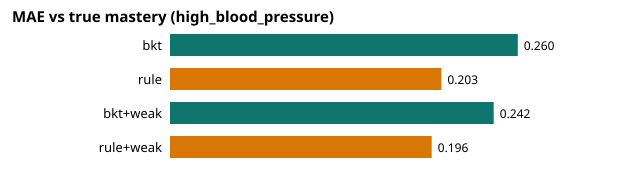
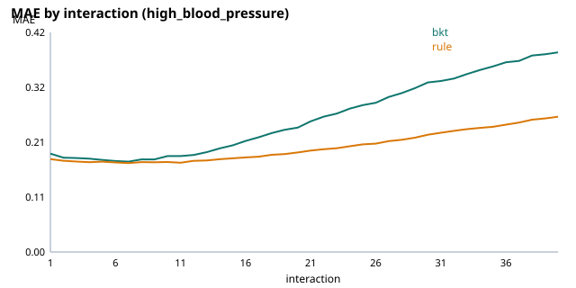
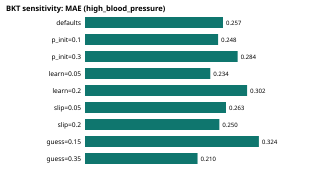

# E2: BKT vs rule on simulated students (design §11 E2)

200 students × 40 interactions per topic · seed 2026 · weak-signal tagging noise 8% (E1 report (eval\understand-tagging\results\report.md)) · forgetting 0.02/step · student slip ∈ [0.10, 0.25], guess ∈ [0.20, 0.40], learning ∈ [0.05, 0.20] (BKT defaults: slip 0.10, guess 0.25, learn 0.10).

Topics simulated: high_blood_pressure. Skipped (no complete item bank yet): asthma, migraine, pneumonia, type2_diabetes.

## high_blood_pressure

| Config | MAE | Next-answer AUC (oracle) | Band accuracy | Items reused (24 h rule) |
|---|---|---|---|---|
| bkt | 0.260 | 0.522 (0.621) | 43.3% | 4184 |
| rule | 0.203 | 0.551 (0.628) | 61.2% | 4914 |
| bkt+weak | 0.242 | 0.524 (0.613) | 46.5% | 4198 |
| rule+weak | 0.196 | 0.541 (0.631) | 63.1% | 4890 |

The oracle AUC predicts each answer from the student's true P(correct): the ceiling set by slip and guess. Items reused: every item of the KC was answered within 24 h (no simulated time passes), so the least recently answered one was asked again.

BKT − rule MAE per student: +0.057 (95% CI ± 0.006). Needed for BKT: ≤ −0.03 and AUC not lower (AUC difference -0.029).

**Decision:** `learner.knowledge: rule` (switch to rule). Weak evidence for rule: **keep (lowers MAE)** (0.203 off vs 0.196 on).

### Sensitivity of BKT (high_blood_pressure, 100 students, one parameter at a time)

| BKT parameters | MAE | AUC | Band accuracy |
|---|---|---|---|
| defaults | 0.257 | 0.526 | 43.7% |
| p_init=0.1 | 0.248 | 0.568 | 50.2% |
| p_init=0.3 | 0.284 | 0.532 | 39.9% |
| learn=0.05 | 0.234 | 0.524 | 47.6% |
| learn=0.2 | 0.302 | 0.550 | 37.0% |
| slip=0.05 | 0.263 | 0.531 | 41.8% |
| slip=0.2 | 0.250 | 0.535 | 45.1% |
| guess=0.15 | 0.324 | 0.533 | 34.8% |
| guess=0.35 | 0.210 | 0.537 | 53.1% |

Rule method on the same students for reference: see the table above. MAE range across the sweep: 0.210–0.324.

## Recommendation

`learner.knowledge: rule`

Runtime 191 s.
