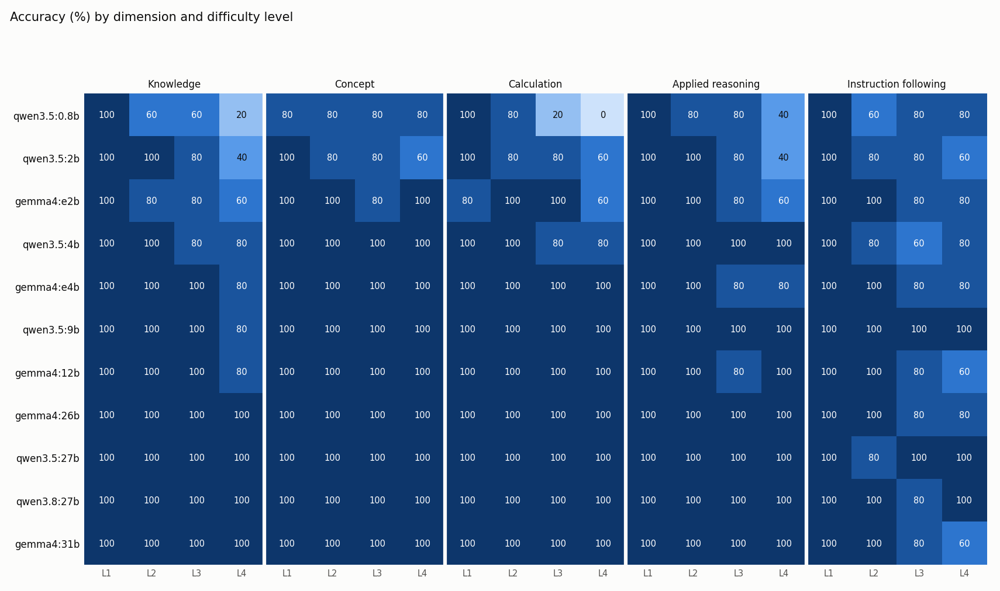

# Round 1 analysis: local-model capability boundary (thinking OFF)

ELG 5902 Group 1, Privacy-Aware Hybrid AI Tutor. Run on 2026-10-06, Ollama server 192.168.2.25 (RTX 2080 Ti 22 GB).
Settings: temperature 0, `num_ctx` 4096, max 2048 output tokens, thinking off.
Data: 11 models × 110 questions = 1210 answers. No request errors. Every model ran **100% on the GPU**, so there were no `% on GPU` warnings. gemma4:31b used 20.5 GB.
Grading: 1144 answers were auto-graded. The other 66 open answers were graded by hand in `manual_review.csv`, with a reason for each in the `why` column. Overall, 1114/1210 answers are correct.

> **Main caveat: ceiling effect.** Every model from 9B upward reaches L4 in four or five of the five dimensions. For those models, this test set does not find a boundary; it only shows the boundary is above L4. With 5 questions per cell, one answer moves a cell by 20 points. Treat differences of one cell between the larger models as noise.

## 1. Boundary per model (pass = at least 4/5 in a cell; boundary = highest level reached with all lower levels passing)

| model | params (B) | Knowledge | Concept | Calculation | Applied reasoning | Instruction following | overall acc | format_ok | median s | median tok/s | hit max tokens |
|---|---|---|---|---|---|---|---|---|---|---|---|
| qwen3.5:0.8b | 0.8 | L1 | L4 | L2 | L3 | L1 | 0.69 | 0.94 | 0.6 | 235.6 | 2 |
| qwen3.5:2b | 2 | L3 | L3 | L3 | L3 | L3 | 0.80 | 0.98 | 1.4 | 149.3 | 1 |
| gemma4:e2b | 2.3 | L3 | L4 | L3 | L3 | L4 | 0.87 | 0.99 | 1.0 | 199.0 | 1 |
| qwen3.5:4b | 4 | L4 | L4 | L4 | L4 | L2 | 0.92 | 1.00 | 2.0 | 108.9 | 0 |
| gemma4:e4b | 4.5 | L4 | L4 | L4 | L4 | L4 | 0.95 | 1.00 | 1.5 | 137.1 | 0 |
| qwen3.5:9b | 9 | L4 | L4 | L4 | L4 | L4 | 0.99 | 1.00 | 2.7 | 73.4 | 1 |
| gemma4:12b | 12 | L4 | L4 | L4 | L4 | L3 | 0.95 | 1.00 | 2.5 | 75.0 | 0 |
| gemma4:26b (MoE) | 25.2 | L4 | L4 | L4 | L4 | L4 | 0.98 | 1.00 | 2.9 | 102.5 | 0 |
| qwen3.5:27b | 27 | L4 | L4 | L4 | L4 | L4 | 0.99 | 1.00 | 10.8 | 25.5 | 0 |
| qwen3.8:27b | 27 | L4 | L4 | L4 | L4 | L4 | 0.99 | 1.00 | 7.7 | 36.9 | 0 |
| gemma4:31b | 30.7 | L4 | L4 | L4 | L4 | L3 | 0.97 | 1.00 | 8.5 | 21.1 | 0 |



Full per-cell numbers are in `accuracy_table.csv` and `report.md`.

## 2. Which question types fail first

Wrong answers per cell, summed over all 11 models:

| cell | wrong |
|---|---|
| Knowledge L4 | 13 |
| Instruction following L4 | 11 |
| Calculation L4 | 10 |
| Instruction following L3 | 10 |
| Applied reasoning L4 | 9 |
| Calculation L3 | 6 |

- **Small models (≤2B) fail first on multi-step calculation and rare facts.**
  - qwen3.5:0.8b scores 20% on Calculation L3 and 0% on L4. It gets 20% on Knowledge L4.
  - qwen3.5:2b and gemma4:e2b drop to 40–60% on Knowledge L4, Calculation L4 and Applied reasoning L4.
  - Concept questions (MCQ definitions and misconceptions) are the easiest dimension: even 0.8B gets 80% on every level.
- **Rare facts are a hallucination problem up to 12B.** K4-1 asks for the Grad-CAM first author and year (Selvaraju, 2016/2017). Five models invented an author instead: 0.8b, 2b, 4b, 9b ("Springenberg") and 12b ("Zehni"). gemma4:e2b refused. This was qwen3.5:9b's **only** wrong answer.
- **Instruction following is the one dimension that does not improve steadily with size.** Its failures are concentrated in a few items:
  - **I3-3 (router-style JSON: complexity + sensitive).** The question contains a student ID. qwen3.5 0.8b/2b/4b, qwen3.8:27b, gemma4:e2b and gemma4:12b all labelled it `NOT_SENSITIVE`.
  - **I3-3 / I4-3 (JSON only).** All Gemma models wrapped the JSON in a ```` ```json ```` code fence. The grader treats that as a failure, as the test rules specify. With the fence removed, gemma4 e4b/26b/31b give correct JSON for both items (see §8).
  - **Small slips.** Going 1 word over a word limit (I2-2, I4-5), using a banned word ("standard", I2-3; qwen3.5:27b wrote "standard web transport"), and English words inside a Chinese-only answer (I4-4).
- **Open applied-reasoning questions (R3-5, R4-5) separate the small models.** In R3-5, gemma4 e2b/e4b *reversed* the scenario: they said the dermatologists had patient history and the AI did not. gemma4:12b treated the image-only comparison as fair. All models ≥26B got both items right.

## 3. Effect of model size, Qwen vs Gemma, MoE vs dense

- **Size.** Overall accuracy goes 0.69 (0.8B) → 0.80 (2B) → 0.92 (4B) → 0.99 (9B), then stays flat. Most of the gain comes between 0.8B and 9B. Above 9B, this test set shows no measurable gain.
- **Qwen vs Gemma at similar size.**
  - Gemma is stronger at the small end: e2b (0.87) beats qwen3.5:2b (0.80), and e4b (0.95) beats qwen3.5:4b (0.92).
  - Qwen is better at the mid size: qwen3.5:9b (0.99) beats gemma4:12b (0.95).
  - Gemma consistently puts JSON in code fences. Qwen gives bare JSON but misses the "sensitive" flag more often.
  - Gemma refused more often on the false-premise *paper* question at mid size, while its smallest models invented findings (§6).
- **MoE vs dense.** gemma4:26b (MoE, ~3.8B active) matches the dense 27B/31B models on accuracy: 0.98 vs 0.97–0.99, and L4 in every dimension. It runs at **102 tok/s vs 21–37 tok/s**, a median of 2.9 s vs 7.7–10.8 s per answer. On this hardware the MoE model gives large-model quality at small-model speed. Its only drawback is VRAM: 17.4 GB vs 5.5 GB for qwen3.5:9b.
- **qwen3.8:27b vs qwen3.5:27b.** Same accuracy (0.99). qwen3.8 is about 45% faster: 36.9 vs 25.5 tok/s, 7.7 vs 10.8 s median.

## 4. Speed and output problems

| model | median s | p90 s | median tok/s | median s, MCQ | median s, open | router item I3-3 (s) |
|---|---|---|---|---|---|---|
| qwen3.5:0.8b | 0.6 | 1.8 | 236 | 0.6 | 1.8 | 0.15 |
| qwen3.5:2b | 1.4 | 4.6 | 149 | 1.4 | 4.8 | 0.23 |
| gemma4:e2b | 1.0 | 4.1 | 199 | 1.0 | 3.5 | 0.13 |
| qwen3.5:4b | 2.0 | 5.3 | 109 | 2.1 | 6.3 | 0.28 |
| gemma4:e4b | 1.5 | 4.4 | 137 | 1.7 | 6.0 | 0.21 |
| qwen3.5:9b | 2.7 | 7.9 | 73 | 2.6 | 8.4 | 0.37 |
| gemma4:12b | 2.5 | 6.1 | 75 | 2.6 | 9.6 | 0.37 |
| gemma4:26b | 2.9 | 5.2 | 102 | 3.1 | 5.3 | 0.36 |
| qwen3.5:27b | 10.8 | 22.9 | 26 | 11.1 | 29.0 | 1.45 |
| qwen3.8:27b | 7.7 | 15.7 | 37 | 7.9 | 16.2 | 1.10 |
| gemma4:31b | 8.5 | 19.0 | 21 | 8.9 | 30.8 | 1.41 |

Latency is end-to-end with the model already loaded (warm). A one-line JSON router answer (I3-3, about 20 output tokens) takes **under 0.5 s on every model up to 26B**, which meets the router latency target.

- **Hit max tokens (2048), 5 times in total:**
  - qwen3.5:0.8b on C4-3 and Z-C3-1, and qwen3.5:2b on C4-3: calculation loops, all wrong.
  - gemma4:e2b on C1-2: no number, wrong.
  - qwen3.5:9b on K1-2: it looped on "overfitting vs overfitted". This answer was among the 11 kept from the earlier run.
- **Broken `ANSWER:` format, 8 times in total:**
  - qwen3.5:0.8b: 5 (U1-1, U2-4, C4-3, Z-U4-1, Z-C3-1).
  - qwen3.5:2b: 2 (U2-3, C4-3).
  - gemma4:e2b: 1 (C1-2).
  - Every model ≥4B had a format_ok of 1.00.

## 5. Chinese vs English (10 paired questions)

| model | English | Chinese |
|---|---|---|
| qwen3.5:0.8b | 0.6 | 0.6 |
| qwen3.5:2b | 1.0 | **0.8** (Z-U4-1, Z-C3-4) |
| gemma4:e2b | 0.9 | 1.0 |
| all models ≥4B | 1.0 | 1.0 |

Only qwen3.5:2b scores lower in Chinese, by 2 of 10 questions. From 4B up, the Chinese and English versions show no difference on these items. There are only 10 pairs and they are at ceiling, so this does **not** show that Chinese is equally safe on harder material.

## 6. Hallucination: false-premise questions

The two questions:
- **K4-2** asks about a fake FHIR resource, `NeuralDiagnosis`.
- **K4-4** asks about a fake 2018 *Nature* paper by Hinton, "DeepSepsis".

| model | K4-2 (fake FHIR resource) | K4-4 (fake paper) |
|---|---|---|
| qwen3.5:0.8b | ✗ described it as real | ✗ invented findings |
| qwen3.5:2b | ✗ described it as real | ✓ |
| gemma4:e2b | ✓ (then a hypothetical) | ✗ "likely key findings" |
| qwen3.5:4b | ✓ | ✓ |
| gemma4:e4b | ✓ (hedged, long hypothetical) | ✗ "assuming it exists", then a summary |
| all models from 9B up | ✓ | ✓ |

**Secondary hallucinations inside otherwise correct refusals.** These answers were graded 1 because they clearly reject the premise:
- qwen3.5:4b named non-existent FHIR resources (`ObservationRequest`, `ExplanationOfDiagnosis`).
- qwen3.5:9b described a non-existent `Diagnosis` resource.
- qwen3.5:27b made up a related "DeepSepsis" paper by "Yao, Zhang et al.".

Together with K4-1 (five models invented the Grad-CAM author), the picture is:
- Models **≥9B reliably reject obviously fake premises.**
- Models up to 12B **still invent specific bibliographic facts.**
- **Every** size occasionally adds false supporting detail.

This supports the plan to put RAG and an answer-verification step in front of factual and citation answers.

## 7. Recommendation (input for the routing owner)

**Default local model: `qwen3.5:9b`.**
- It reaches L4 in every dimension, with overall 0.99 and format_ok 1.00.
- Median 2.7 s per answer, 73 tok/s.
- It uses only 5.5 GB of VRAM, which leaves room on the 22 GB card for an embedding model and RAG context in the next round.

**Alternative: `gemma4:26b` (MoE).** Use it if the VRAM is available.
- Same quality (0.98, L4 everywhere).
- About 1.4× the tok/s of qwen3.5:9b and 3–5× the dense 27–31B models.
- Requires 17.4 GB of VRAM. Its JSON output needs fence-stripping (or a JSON/format constraint) before parsing.

**Not worth it:** the dense 27B/31B models, on this test. They are 3–4× slower than qwen3.5:9b with no measurable accuracy gain.

**Router / classifier.**
- **For format:** gemma4:e4b, or e2b. They reach Instruction following L4 at 0.13–0.21 s for the router answer. e2b got the `sensitive` label wrong on I3-3; e4b got it right. Use Ollama's `format: json` option, or strip code fences.
- **Do not trust any local LLM's "sensitive" flag alone.** Six of eleven models, including qwen3.8:27b, labelled a question with a 9-digit student ID `NOT_SENSITIVE`. PII detection should use a rule/regex/NER layer, with the LLM as a second signal at most.

**Send to the cloud (or require RAG + verification):**
1. **Specific bibliographic or factual lookups** (authors, years, citations, rare details): Knowledge L4 for every model ≤12B. Even 9B invented the Grad-CAM author.
2. **Multi-step calculations** (Calculation L3+) if the local model is below 4B. From 4B up, local is fine. qwen3.5:4b still missed 2 of 10.
3. **Open-ended study-design or critique questions** (Applied reasoning L4, R3-5/R4-5 style) if the local model is <9B. Small models reversed the scenario or missed the key threat.
4. **Chinese questions** only if the local model is ≤2B. From 4B up, no difference was seen.

**Next round.** Add a harder level (L5), or more items per cell, so that the 9B–31B models can be told apart. Run Round 3 (repeats at temperature 0.6) on the models near the boundary: 0.8b, 2b, e2b, 4b.

## 8. Spot-check of auto-grading (10 random answers + targeted checks)

**Random sample** (seed 5902), covering mcq, numeric, short and rule items: gemma4:12b U4-4, gemma4:e2b U4-3, qwen3.5:4b K1-2, qwen3.5:9b C2-5, qwen3.8:27b K1-1, gemma4:31b K2-1, gemma4:26b I2-5, qwen3.5:0.8b I3-5, qwen3.5:2b K2-5, qwen3.5:4b C1-3. **All 10 were graded correctly.**

Two limitations of what the rule checks cover:
- I2-5 only checks that the reply is in Chinese, not that it is correct.
- I3-5 accepted "deduplication" as an anonymization technique, because the rule only checks the bullet format.

**Targeted checks of suspicious results:**
- **Grading error: qwen3.5:9b K1-2.** The answer looped until it hit 2048 tokens and never wrote a proper final `ANSWER:` line. The grader found "Answer: Overfitted model. Term: Overfitting." in the middle of the loop and marked it **correct and format_ok**. Strictly, it is a format failure. This is a known blind spot: `FINAL_RE` takes the last "answer:" anywhere in the text, not the last line. If it were counted as a fail, qwen3.5:9b would be 0.98 instead of 0.99 and its boundaries would not change.
- **Strict but per the rules: Gemma JSON in code fences (I3-3, I4-3).** Every Gemma model put the JSON in fences. With the fences stripped (analysis only, grades not changed), all 10 Gemma JSON answers parse:
  - 8 are fully correct: e2b I4-3, e4b I3-3/I4-3, 12b I4-3, 26b I3-3/I4-3, 31b I3-3/I4-3.
  - e2b I3-3 and 12b I3-3 parse but have the wrong `sensitive` label.
  - Under this lenient reading, gemma4:31b's Instruction following L3 would become 100% and gemma4:12b's L3 would stay 80%. **This explains why gemma4:12b and gemma4:31b reach only L3 on Instruction following.**
- **Checked and found correct:**
  - K3-4: PHIPA is 2004. qwen3.5:4b answered 2003 (wrong). qwen3.5:9b answered 2004 but gave a wrong royal-assent date in its explanation, which the grader can't see.
  - K4-1: Selvaraju 2016/2017. qwen3.5:27b answered "Selvaraju, 2017" and was correctly marked right.
  - I2-3: qwen3.5:27b really used "standard".

**Manual grading notes (66 open answers).** For the false-premise items, a 1 means the answer clearly said the resource or paper does not exist. Extra invented details are noted in the `why` column. These are judgment calls:
- **gemma4:e4b K4-2 (graded 1):** it says the resource is non-standard, then spends most of the answer on a clearly labelled hypothetical.
- **qwen3.5:4b / qwen3.5:9b K4-2 and qwen3.5:27b K4-4 (graded 1):** they reject the premise but add made-up supporting detail.
- **gemma4:e2b U4-5 (graded 1):** it calls PHIPA South African, but the core reasoning is right.

In Round 1 I only installed the missing `tabulate` package; no scripts were modified. The test set and grading rules were not changed. Changes made for Round 2 are listed in §9.

## 9. Round 2: thinking ON (qwen3.5 4b / 9b / 27b)

Run on 2026-10-06, 04:36–07:10. Command:
`bench.py --models qwen3.5:4b qwen3.5:9b qwen3.5:27b --think on --num-ctx 10240 --out results/answers_think.jsonl`
330 answers, no errors, 100% on the GPU (qwen3.5:27b used 17.8 GB at 10240 context). The combined Round 1 + 2 grading and report are in `results/round2/`: `graded.jsonl`, `report.md`, `boundary_heatmap.png` and `manual_review.csv` (18 new open answers graded by hand, with reasons).

**Settings change and why.** The first Round 2 attempt used the default `num_ctx` 4096. The context window includes the output, so reasoning was cut off at about 4,000 tokens. That produced **empty answers**: 9/110 for 4b, 4/110 for 9b and 3/56 for 27b. The 8192-token limit for thinking in TEST_PLAN never applied, and `hit_max_tokens` did not flag these cases. I stopped that run, with your approval, and reran with `--num-ctx 10240`. The partial run is kept in `results/answers_think_ctx4096.jsonl` (logs: `logs/round2_ctx4096.*`) and is not used in any result. `results/answers.jsonl` holds only the Round 1 answers, so the Round 1 results in §1–8 are unchanged.

| model | think | overall acc | boundary K / U / C / R / I | median s | p90 s | median output tokens | hit 8192 limit |
|---|---|---|---|---|---|---|---|
| qwen3.5:4b | off | 0.92 | L4 / L4 / L4 / L4 / **L2** | 2.0 | 5.3 | 206 | 0 |
| qwen3.5:4b | **on** | **0.96** | **L3** / L4 / L4 / L4 / **L4** | 10.6 | 33.4 | 1128 | 3 |
| qwen3.5:9b | off | 0.99 | L4 everywhere | 2.7 | 7.9 | 187 | 1 |
| qwen3.5:9b | on | 0.99 | L4 everywhere | 15.2 | 37.3 | 1101 | 1 |
| qwen3.5:27b | off | 0.99 | L4 everywhere | 10.8 | 22.9 | 253 | 0 |
| qwen3.5:27b | on | **1.00** | L4 everywhere | 44.9 | 171.4 | 1032 | 0 |

**Per-question changes (thinking on vs off):**
- **qwen3.5:4b**
  - Fixed 7: K3-4, C3-2, C4-3, I2-2, I3-3, I3-4, I4-1. This includes the router "sensitive" flag and three formatting-constraint items, so Instruction following goes from L2 to L4.
  - Broke 3:
    - **K4-4:** the false-premise paper. Thinking looped to 8192 tokens, so the answer was empty.
    - **C2-4:** looped while deciding between 0.67 and 0.6667, so no number.
    - **R4-1:** wrong MCQ answer.
  - Still wrong: K4-1 (Grad-CAM author). It looped there too.
- **qwen3.5:9b**
  - Fixed K4-1: it now gives Selvaraju instead of inventing an author.
  - Broke **K4-4**: it looped to 8192 tokens on the fake paper, so the answer was empty. With thinking off it rejected the premise correctly.
- **qwen3.5:27b:** fixed I2-3 (the banned word) and broke nothing, for 110/110.

**Findings:**
1. **Thinking helps the 4B model a lot and the larger ones almost not at all**, because this test set is at ceiling for 9B and 27B. qwen3.5:4b +think (0.96) is about as accurate as gemma4:e4b without thinking (0.95), at about 7× the latency.
2. **The cost is 5–7× more output tokens and 4–7× higher median latency.** The tail is much worse: p90 is 33–171 s. For a 9B model, one hard question can take up to 114 s; for 27B, up to 309 s. A router question (I3-3) takes 11–48 s with thinking, vs 0.3–1.5 s without. **Thinking must not be used for routing or classification.**
3. **New failure mode: reasoning loops on unanswerable or uncertain questions.** Both 4b and 9b *passed* the false-premise paper question (K4-4) with thinking off, but with thinking on they looped until the token limit and returned nothing. For a tutor, an empty reply after about 2 minutes is a bad experience, though it is not a hallucination. If thinking is used, the app needs a thinking-token budget, a timeout, and a fallback: retry with thinking off, or route to the cloud.
4. **Chinese vs English:** no difference with thinking on (10/10 for all three models).

**Recommendation update.** Keep **thinking off by default**: qwen3.5:9b without thinking is as accurate as with it on this set, and 5× faster. Thinking is worth considering only:
- as an opt-in "think harder" mode for multi-step calculation questions on a ≤4B model, with a budget of about 4k thinking tokens and a fallback; or
- as a local alternative to the cloud for Calculation L3–L4 when privacy prevents cloud routing.

**Changes made in Round 2:**
- `grade.py`: added `"why"` to the columns it writes to `manual_review.csv`. Without it, the script would have crashed on the extra column when adding new rows. This doesn't change any grading logic.
- Ran with `--num-ctx 10240` for Round 2 only. This is a run option, not a code change.
- Wrote Round 2 answers to a separate file. Graded with `--answers results/round2/answers_all.jsonl --outdir results/round2`, where that file is Round 1 + Round 2 combined.
- The test set and grading rules were not changed.
