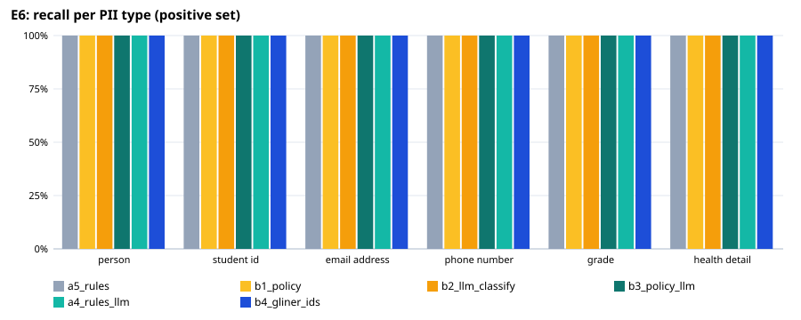
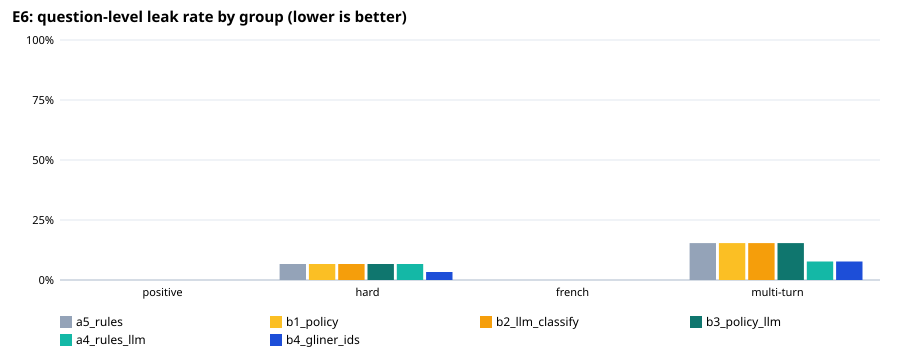

# E6: privacy filter evaluation

404 fictional questions (208 positive, 112 negative, 30 hard, 15 french, 21 multiturn, 18 out_of_scope); generated by `make_cases.py` from templates and a question bank written by the local model. An entity counts as protected when ≥ 80% of its characters are redacted (any overlap for health details).

## Expected vs actual — recommended configuration `a5_rules`

| Metric | Expected (ideal / marginal) | Actual | Verdict |
|---|---|---|---|
| Question-level leak rate, positive set | ≤ 1.0% / ≤ 5.0% | 0.0% | ✅ ideal |
| Lowest per-type recall, positive set | ≥ 95.0% / ≥ 90.0% | 100.0% | ✅ ideal |
| Over-redaction, negative set | ≤ 5.0% / ≤ 10.0% | 0.0% | ✅ ideal |
| Personal-health questions kept local (sensitivity) | ≥ 95.0% / ≥ 90.0% | 95.1% | ✅ ideal |
| Other questions left cloud-eligible (specificity) | ≥ 95.0% / ≥ 90.0% | 99.7% | ✅ ideal |
| Placeholder round trip restores the original text | ≥ 100.0% / ≥ 100.0% | 100.0% | ✅ ideal |
| Median latency per question (ms) | ≤ 100 ms / ≤ 300 ms | 5 ms | ✅ ideal |

## All configurations

| Configuration | Leak: positive | hard | French | multi-turn | Lowest type recall | Over-redaction | Health sens. / spec. | Out-of-scope caught | p50 / p95 |
|---|---|---|---|---|---|---|---|---|---|
| a5_rules | 0.0% | 6.7% | 0.0% | 15.4% | 100.0% | 0.0% | 95.1% / 99.7% | 10/18 | 5 / 7 ms |
| b1_policy | 0.0% | 6.7% | 0.0% | 15.4% | 100.0% | 0.0% | 95.1% / 74.8% | 10/18 | 5 / 6 ms |
| b2_llm_classify | 0.0% | 6.7% | 0.0% | 15.4% | 100.0% | 0.0% | 98.4% / 97.8% | 10/18 | 6 / 1438 ms |
| b3_policy_llm | 0.0% | 6.7% | 0.0% | 15.4% | 100.0% | 0.0% | 98.4% / 74.8% | 10/18 | 5 / 1248 ms |
| a4_rules_llm | 0.0% | 6.7% | 0.0% | 7.7% | 100.0% | 3.6% | 96.7% / 97.8% | 14/18 | 1448 / 2423 ms |
| b4_gliner_ids | 0.0% | 3.3% | 0.0% | 7.7% | 100.0% | 4.5% | 95.1% / 99.7% | 11/18 | 78 / 93 ms |

## Recall per type, positive set (95% Wilson interval)

| Type | a5_rules | b1_policy | b2_llm_classify | b3_policy_llm | a4_rules_llm | b4_gliner_ids |
|---|---|---|---|---|---|---|
| PERSON | 76/76 [95%–100%] | 76/76 [95%–100%] | 76/76 [95%–100%] | 76/76 [95%–100%] | 76/76 [95%–100%] | 76/76 [95%–100%] |
| STUDENT_ID | 46/46 [92%–100%] | 46/46 [92%–100%] | 46/46 [92%–100%] | 46/46 [92%–100%] | 46/46 [92%–100%] | 46/46 [92%–100%] |
| EMAIL_ADDRESS | 30/30 [89%–100%] | 30/30 [89%–100%] | 30/30 [89%–100%] | 30/30 [89%–100%] | 30/30 [89%–100%] | 30/30 [89%–100%] |
| PHONE_NUMBER | 20/20 [84%–100%] | 20/20 [84%–100%] | 20/20 [84%–100%] | 20/20 [84%–100%] | 20/20 [84%–100%] | 20/20 [84%–100%] |
| GRADE | 30/30 [89%–100%] | 30/30 [89%–100%] | 30/30 [89%–100%] | 30/30 [89%–100%] | 30/30 [89%–100%] | 30/30 [89%–100%] |
| HEALTH_DETAIL | 46/46 [92%–100%] | 46/46 [92%–100%] | 46/46 [92%–100%] | 46/46 [92%–100%] | 46/46 [92%–100%] | 46/46 [92%–100%] |

## Misses of `a5_rules` by group and variant

**positive** — 0 questions with a leak:
- none

**hard** — 2 questions with a leak:
- P345 [health_third_person_self]: HEALTH_DETAIL: I get them every week — “Asking for a friend (it's me): what helps with migraines? I get them every week.”
- P347 [grade_relative]: GRADE: 5 points below the class average — “I was 5 points below the class average. What is the DASH diet?”

**french** — 0 questions with a leak:
- none

**multiturn** — 2 questions with a leak:
- P370 [turn2]: HEALTH_DETAIL: I have it — “Ok so I have it since childhood.”
- P373 [turn2]: HEALTH_DETAIL: type 2 diabetes — “It's type 2 diabetes. What should she eat in general?”

**negative** — 0 over-redacted:
- none

**local-only decision** — 4 wrong:
- P031 [positive/other_name] expected cloud-eligible — “My friend Lucas Bergeron asked me this: Are there natural ways to lower it without meds?”
- P345 [hard/health_third_person_self] expected local — “Asking for a friend (it's me): what helps with migraines? I get them every week.”
- P370 [multiturn/turn2] expected local — “Ok so I have it since childhood.”
- P373 [multiturn/turn2] expected local — “It's type 2 diabetes. What should she eat in general?”

## Known gaps (out-of-scope set)

| Type | a5_rules | b1_policy | b2_llm_classify | b3_policy_llm | a4_rules_llm | b4_gliner_ids |
|---|---|---|---|---|---|---|
| address | 2/2 | 2/2 | 2/2 | 2/2 | 2/2 | 2/2 |
| age | 0/2 | 0/2 | 0/2 | 0/2 | 0/2 | 0/2 |
| clinic_mrn | 1/1 | 1/1 | 1/1 | 1/1 | 1/1 | 1/1 |
| date_of_birth | 2/2 | 2/2 | 2/2 | 2/2 | 2/2 | 2/2 |
| health_card | 2/2 | 2/2 | 2/2 | 2/2 | 2/2 | 2/2 |
| ip_address | 0/1 | 0/1 | 0/1 | 0/1 | 1/1 | 0/1 |
| license_plate | 0/1 | 0/1 | 0/1 | 0/1 | 1/1 | 0/1 |
| postal_code | 2/2 | 2/2 | 2/2 | 2/2 | 2/2 | 2/2 |
| school | 0/1 | 0/1 | 0/1 | 0/1 | 0/1 | 0/1 |
| sin | 1/1 | 1/1 | 1/1 | 1/1 | 1/1 | 1/1 |
| social_handle | 0/1 | 0/1 | 0/1 | 0/1 | 1/1 | 1/1 |
| url | 0/1 | 0/1 | 0/1 | 0/1 | 1/1 | 0/1 |
| workplace | 0/1 | 0/1 | 0/1 | 0/1 | 0/1 | 0/1 |
