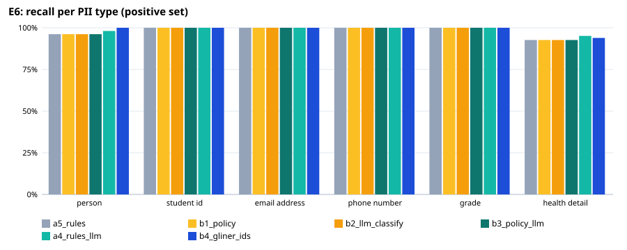
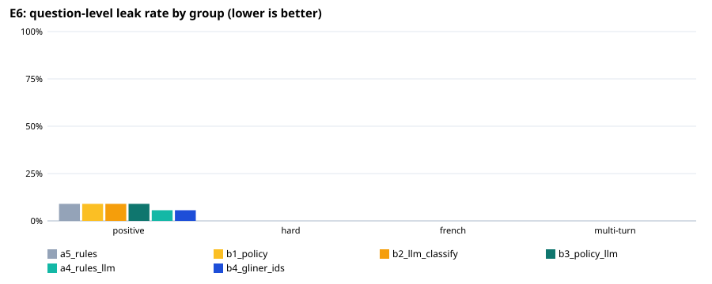

# E6: privacy filter evaluation

102 fictional questions (89 positive, 13 negative); `holdout.jsonl`: held-out set written by a different model after the rules were final (`make_holdout.py`), labels checked by hand. An entity counts as protected when ≥ 80% of its characters are redacted (any overlap for health details).

## Expected vs actual — recommended configuration `a5_rules`

| Metric | Expected (ideal / marginal) | Actual | Verdict |
|---|---|---|---|
| Question-level leak rate, positive set | ≤ 1.0% / ≤ 5.0% | 9.0% | ❌ not met |
| Lowest per-type recall, positive set | ≥ 95.0% / ≥ 90.0% | 92.7% | 🟡 marginal |
| Over-redaction, negative set | ≤ 5.0% / ≤ 10.0% | 0.0% | ✅ ideal |
| Personal-health questions kept local (sensitivity) | ≥ 95.0% / ≥ 90.0% | 95.2% | ✅ ideal |
| Other questions left cloud-eligible (specificity) | ≥ 95.0% / ≥ 90.0% | 100.0% | ✅ ideal |
| Placeholder round trip restores the original text | ≥ 100.0% / ≥ 100.0% | 100.0% | ✅ ideal |
| Median latency per question (ms) | ≤ 100 ms / ≤ 300 ms | 8 ms | ✅ ideal |

## All configurations

| Configuration | Leak: positive | hard | French | multi-turn | Lowest type recall | Over-redaction | Health sens. / spec. | Out-of-scope caught | p50 / p95 |
|---|---|---|---|---|---|---|---|---|---|
| a5_rules | 9.0% | 0.0% | 0.0% | 0.0% | 92.7% | 0.0% | 95.2% / 100.0% | 0/0 | 8 / 11 ms |
| b1_policy | 9.0% | 0.0% | 0.0% | 0.0% | 92.7% | 0.0% | 100.0% / 37.5% | 0/0 | 7 / 9 ms |
| b2_llm_classify | 9.0% | 0.0% | 0.0% | 0.0% | 92.7% | 0.0% | 100.0% / 80.0% | 0/0 | 9 / 1437 ms |
| b3_policy_llm | 9.0% | 0.0% | 0.0% | 0.0% | 92.7% | 0.0% | 100.0% / 37.5% | 0/0 | 8 / 1430 ms |
| a4_rules_llm | 5.6% | 0.0% | 0.0% | 0.0% | 95.1% | 7.7% | 96.8% / 97.5% | 0/0 | 2024 / 2892 ms |
| b4_gliner_ids | 5.6% | 0.0% | 0.0% | 0.0% | 93.9% | 23.1% | 95.2% / 100.0% | 0/0 | 90 / 106 ms |

## Recall per type, positive set (95% Wilson interval)

| Type | a5_rules | b1_policy | b2_llm_classify | b3_policy_llm | a4_rules_llm | b4_gliner_ids |
|---|---|---|---|---|---|---|
| PERSON | 50/52 [87%–99%] | 50/52 [87%–99%] | 50/52 [87%–99%] | 50/52 [87%–99%] | 51/52 [90%–100%] | 52/52 [93%–100%] |
| STUDENT_ID | 45/45 [92%–100%] | 45/45 [92%–100%] | 45/45 [92%–100%] | 45/45 [92%–100%] | 45/45 [92%–100%] | 45/45 [92%–100%] |
| EMAIL_ADDRESS | 10/10 [72%–100%] | 10/10 [72%–100%] | 10/10 [72%–100%] | 10/10 [72%–100%] | 10/10 [72%–100%] | 10/10 [72%–100%] |
| PHONE_NUMBER | 16/16 [81%–100%] | 16/16 [81%–100%] | 16/16 [81%–100%] | 16/16 [81%–100%] | 16/16 [81%–100%] | 16/16 [81%–100%] |
| GRADE | 9/9 [70%–100%] | 9/9 [70%–100%] | 9/9 [70%–100%] | 9/9 [70%–100%] | 9/9 [70%–100%] | 9/9 [70%–100%] |
| HEALTH_DETAIL | 76/82 [85%–97%] | 76/82 [85%–97%] | 76/82 [85%–97%] | 76/82 [85%–97%] | 78/82 [88%–98%] | 77/82 [87%–97%] |

## Misses of `a5_rules` by group and variant

**positive** — 8 questions with a leak:
- H014 [other_name]: PERSON: Marcus — “Marcus, my migraine attacks have been awful lately. Does the course material suggest prophylactic treatments or just acute management? Check page 45 for the symptoms list.”
- H052 [health_self]: HEALTH_DETAIL: blood gulter — “I think my blood gulter is shooting up. I need help with my health plan, my ID number is 300912345. What steps should I take?”
- H053 [health_self]: HEALTH_DETAIL: Metformin — “My doctor gave me a prescription for Metformin for my high blood sugar. Any good resources for new insulinn users?”
- H059 [health_family]: PERSON: Mateo — “Hey tutor. My friend Mateo is super stressed bc his aunt has been having terrible migraine headaches lately. She needs help keeping track of them.”
- H062 [health_family]: HEALTH_DETAIL: pneumonia — “My neighbor, Kai, has terrible coughs and fever. Doctors said it might be pneumonia. Should he skip class? His email is kai.singh@university.edu.”
- H068 [combo]: HEALTH_DETAIL: asthma — “Jae-Hoon G. (300987654) is struggling with asthma severity. Check my mail at jaehon.g@univ.ca.”
- H079 [general]: HEALTH_DETAIL: chronic pain — “My migraine is killing me lately, and I'm tired of it. I am Student 300990112. Any tips for managing the chronic pain?”
- H086 [general]: HEALTH_DETAIL: I might be having one right now — “Does anyone know the difference between acute vs chronic asthma exacerbation? I think I might be having one right now. My ID is 300101010.”

**hard** — 0 questions with a leak:
- none

**french** — 0 questions with a leak:
- none

**multiturn** — 0 questions with a leak:
- none

**negative** — 0 over-redacted:
- none

**local-only decision** — 3 wrong:
- H052 [positive/health_self] expected local — “I think my blood gulter is shooting up. I need help with my health plan, my ID number is 300912345. What steps should I take?”
- H068 [positive/combo] expected local — “Jae-Hoon G. (300987654) is struggling with asthma severity. Check my mail at jaehon.g@univ.ca.”
- H086 [positive/general] expected local — “Does anyone know the difference between acute vs chronic asthma exacerbation? I think I might be having one right now. My ID is 300101010.”

## Known gaps (out-of-scope set)

| Type | a5_rules | b1_policy | b2_llm_classify | b3_policy_llm | a4_rules_llm | b4_gliner_ids |
|---|---|---|---|---|---|---|
