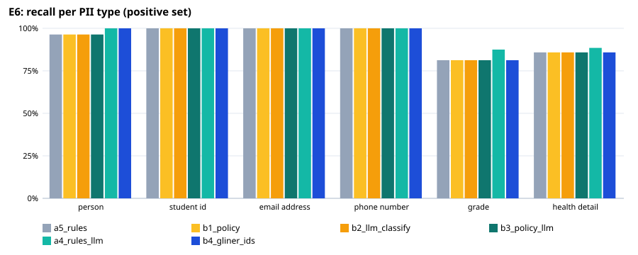
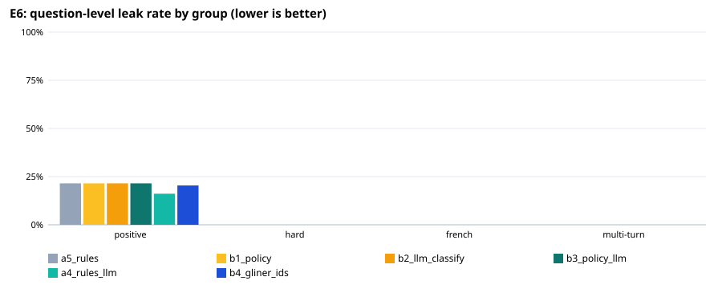

# E6: privacy filter evaluation

102 fictional questions (93 positive, 9 negative); `holdout2.jsonl`: held-out set written by a different model after the rules were final (`make_holdout.py`), labels checked by hand. An entity counts as protected when ≥ 80% of its characters are redacted (any overlap for health details).

## Expected vs actual — recommended configuration `a5_rules`

| Metric | Expected (ideal / marginal) | Actual | Verdict |
|---|---|---|---|
| Question-level leak rate, positive set | ≤ 1.0% / ≤ 5.0% | 21.5% | ❌ not met |
| Lowest per-type recall, positive set | ≥ 95.0% / ≥ 90.0% | 81.2% | ❌ not met |
| Over-redaction, negative set | ≤ 5.0% / ≤ 10.0% | 0.0% | ✅ ideal |
| Personal-health questions kept local (sensitivity) | ≥ 95.0% / ≥ 90.0% | 91.2% | 🟡 marginal |
| Other questions left cloud-eligible (specificity) | ≥ 95.0% / ≥ 90.0% | 90.9% | 🟡 marginal |
| Placeholder round trip restores the original text | ≥ 100.0% / ≥ 100.0% | 100.0% | ✅ ideal |
| Median latency per question (ms) | ≤ 100 ms / ≤ 300 ms | 8 ms | ✅ ideal |

## All configurations

| Configuration | Leak: positive | hard | French | multi-turn | Lowest type recall | Over-redaction | Health sens. / spec. | Out-of-scope caught | p50 / p95 |
|---|---|---|---|---|---|---|---|---|---|
| a5_rules | 21.5% | 0.0% | 0.0% | 0.0% | 81.2% | 0.0% | 91.2% / 90.9% | 0/0 | 8 / 11 ms |
| b1_policy | 21.5% | 0.0% | 0.0% | 0.0% | 81.2% | 0.0% | 100.0% / 40.9% | 0/0 | 7 / 9 ms |
| b2_llm_classify | 21.5% | 0.0% | 0.0% | 0.0% | 81.2% | 0.0% | 100.0% / 59.1% | 0/0 | 8 / 1443 ms |
| b3_policy_llm | 21.5% | 0.0% | 0.0% | 0.0% | 81.2% | 0.0% | 100.0% / 40.9% | 0/0 | 8 / 1436 ms |
| a4_rules_llm | 16.1% | 0.0% | 0.0% | 0.0% | 87.5% | 0.0% | 93.8% / 86.4% | 0/0 | 2024 / 3234 ms |
| b4_gliner_ids | 20.4% | 0.0% | 0.0% | 0.0% | 81.2% | 33.3% | 91.2% / 90.9% | 0/0 | 92 / 110 ms |

## Recall per type, positive set (95% Wilson interval)

| Type | a5_rules | b1_policy | b2_llm_classify | b3_policy_llm | a4_rules_llm | b4_gliner_ids |
|---|---|---|---|---|---|---|
| PERSON | 53/55 [88%–99%] | 53/55 [88%–99%] | 53/55 [88%–99%] | 53/55 [88%–99%] | 55/55 [93%–100%] | 55/55 [93%–100%] |
| STUDENT_ID | 41/41 [91%–100%] | 41/41 [91%–100%] | 41/41 [91%–100%] | 41/41 [91%–100%] | 41/41 [91%–100%] | 41/41 [91%–100%] |
| EMAIL_ADDRESS | 9/9 [70%–100%] | 9/9 [70%–100%] | 9/9 [70%–100%] | 9/9 [70%–100%] | 9/9 [70%–100%] | 9/9 [70%–100%] |
| PHONE_NUMBER | 19/19 [83%–100%] | 19/19 [83%–100%] | 19/19 [83%–100%] | 19/19 [83%–100%] | 19/19 [83%–100%] | 19/19 [83%–100%] |
| GRADE | 13/16 [57%–93%] | 13/16 [57%–93%] | 13/16 [57%–93%] | 13/16 [57%–93%] | 14/16 [64%–97%] | 13/16 [57%–93%] |
| HEALTH_DETAIL | 97/113 [78%–91%] | 97/113 [78%–91%] | 97/113 [78%–91%] | 97/113 [78%–91%] | 100/113 [81%–93%] | 97/113 [78%–91%] |

## Misses of `a5_rules` by group and variant

**positive** — 20 questions with a leak:
- T009 [own_name]: GRADE: 4.0 — “Is blood pressure a key indicator of other health crises? I'm Diego Sanchez. Grad level is 4.0. ID 300211034. Thanks.”
- T011 [other_name]: HEALTH_DETAIL: severe asthma — “Hey, has Michael Rodriguez been diagnosed with severe asthma? My classmate Ben Cho was asking, but I still don't get how inhalers work. I need help with Question 4 on the reading.”
- T013 [other_name]: HEALTH_DETAIL: has it — “I'm panicking trying to find the treatment options for pneumonia! My friend Omar Kazi said his mom has it. Could you explain the short-term recovery protocols from the lecture notes? My ID is 300459122.”
- T014 [other_name]: HEALTH_DETAIL: last attack — “Did anyone see the assignment about migraine triggers? My classmate, Sofia Mendoza, mentioned her last attack was bad. Also, I need to confirm if the physiological markers for migraine are the same as for tension headaches.”
- T017 [other_name]: HEALTH_DETAIL: having problems — “What are the long-term effects of consistently high blood pressure? Marcus Chen says his uncle is having problems. Also, does the textbook require citations for the hypertension case studies?”
- T026 [student_id]: HEALTH_DETAIL: asthma — “I started having these terrible shoulder aches. Maybe it's linked to my old asthma, 300555666.”
- T031 [contact]: HEALTH_DETAIL: migraine ache — “Worst migraine ache ever. I need to talk to someone ASAP. Please call me back at (403) 555-2341. It's completely messing up my studies.”
- T032 [contact]: HEALTH_DETAIL: pneumonia — “The doctor confirmed my lungs might have pneumonia. I'm sending the full medical details to somesh@email.com. Let me know if the grade implications are severe.”
- T041 [grade]: GRADE: B — “Please adjust my attendance. I've had pneumonia this winter. My student number 300998765 shows I'm doing okay, like a solid B.”
- T042 [grade]: GRADE: I failed it — “Is it possible to retake the exam? I failed it, which lowered my average to 3.1. My blood pressure meds are messing with my sleep, honestly.”
- T047 [health_self]: HEALTH_DETAIL: inhaler — “Hey, my doc said my asthma is getting worse lately, and the inhaler isn't helping much. Is the weekly health seminar due this week, or next?”
- T049 [health_self]: HEALTH_DETAIL: meds — “Is the deadline for the paper tomorrow? I've been dealing with severe migraine flashes since Tuesday and over-the-counter meds aren't cutting it.”
- T053 [health_self]: HEALTH_DETAIL: Type 2 diabetes — “Javier Santos here. My GP diagnosed me with Type 2 diabetes. Can you send me a link to the reading materials for the next unit?”
- T061 [health_family]: PERSON: Mariam; HEALTH_DETAIL: miigrn — “My aunt, Mariam, suffered a terrible miigrn last week. She was taking Triptan, but it didn't help the agony. She is exhausted.”
- T064 [health_family]: HEALTH_DETAIL: dabietes — “Jamal took a prescription for his dabietes yesterday. Said he needs to track his glucose levels very carefully now.”
- T075 [general]: HEALTH_DETAIL: chronic shortness of breath — “Hey, I'm confused about the severity classification for asthma. If a student like Aiya (300456123) is experiencing chronic shortness of breath, what diagnostic criteria applies?”
- T077 [general]: PERSON: Mateo — “My friend Mateo (555-123-4567) had a bad migraine last week. Is there a specific protocol we should study for managing severe tensional headaches?”
- T089 [eponym]: HEALTH_DETAIL: diastolic is 95 — “I'm so concerned about my blood pressure readings. My name is Anya Petrova and my current diastolic is 95. Please help me, 300200389.”
- T091 [eponym]: HEALTH_DETAIL: blood pressure — “300311290. I keep having these bad bursts of blood pressure. It's worse than usual. Please check my notes.”
- T097 [hypothetical]: HEALTH_DETAIL: results — “Does elevated blood pressure always mean serious hypertension? I'm worried about my results. I am Rahul Sharma, student 300011223.”

**hard** — 0 questions with a leak:
- none

**french** — 0 questions with a leak:
- none

**multiturn** — 0 questions with a leak:
- none

**negative** — 0 over-redacted:
- none

**local-only decision** — 9 wrong:
- T014 [positive/other_name] expected local — “Did anyone see the assignment about migraine triggers? My classmate, Sofia Mendoza, mentioned her last attack was bad. Also, I need to confirm if the physiological markers for migraine are the same as for tension headaches.”
- T017 [positive/other_name] expected local — “What are the long-term effects of consistently high blood pressure? Marcus Chen says his uncle is having problems. Also, does the textbook require citations for the hypertension case studies?”
- T031 [positive/contact] expected local — “Worst migraine ache ever. I need to talk to someone ASAP. Please call me back at (403) 555-2341. It's completely messing up my studies.”
- T053 [positive/health_self] expected local — “Javier Santos here. My GP diagnosed me with Type 2 diabetes. Can you send me a link to the reading materials for the next unit?”
- T075 [positive/general] expected local — “Hey, I'm confused about the severity classification for asthma. If a student like Aiya (300456123) is experiencing chronic shortness of breath, what diagnostic criteria applies?”
- T080 [positive/general] expected cloud-eligible — “I saw a case study on pneumonia where the patient, Jian Li (300990112), was given multiple antibiotics. Is that typical? Help pls!”
- T081 [positive/general] expected cloud-eligible — “Andrea Sanchez, Student 300123456, was discussing high blood pressure readings (155/95) in the discussion forum. Is this range considered Stage 2 hypertension?”
- T091 [positive/eponym] expected local — “300311290. I keep having these bad bursts of blood pressure. It's worse than usual. Please check my notes.”
- T097 [positive/hypothetical] expected local — “Does elevated blood pressure always mean serious hypertension? I'm worried about my results. I am Rahul Sharma, student 300011223.”

## Known gaps (out-of-scope set)

| Type | a5_rules | b1_policy | b2_llm_classify | b3_policy_llm | a4_rules_llm | b4_gliner_ids |
|---|---|---|---|---|---|---|
