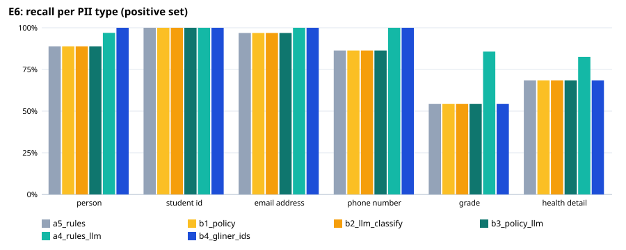
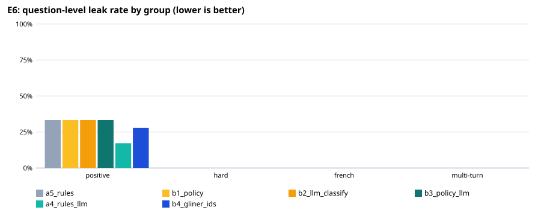

# E6: privacy filter evaluation

204 fictional questions (186 positive, 18 negative); `holdout3.jsonl`: held-out set written by a different model after the rules were final (`make_holdout.py`), labels checked by hand. An entity counts as protected when ≥ 80% of its characters are redacted (any overlap for health details).

## Expected vs actual — recommended configuration `a5_rules`

| Metric | Expected (ideal / marginal) | Actual | Verdict |
|---|---|---|---|
| Question-level leak rate, positive set | ≤ 1.0% / ≤ 5.0% | 33.3% | ❌ not met |
| Lowest per-type recall, positive set | ≥ 95.0% / ≥ 90.0% | 54.3% | ❌ not met |
| Over-redaction, negative set | ≤ 5.0% / ≤ 10.0% | 11.1% | ❌ not met |
| Personal-health questions kept local (sensitivity) | ≥ 95.0% / ≥ 90.0% | 76.3% | ❌ not met |
| Other questions left cloud-eligible (specificity) | ≥ 95.0% / ≥ 90.0% | 92.2% | 🟡 marginal |
| Placeholder round trip restores the original text | ≥ 100.0% / ≥ 100.0% | 100.0% | ✅ ideal |
| Median latency per question (ms) | ≤ 100 ms / ≤ 300 ms | 6 ms | ✅ ideal |

## All configurations

| Configuration | Leak: positive | hard | French | multi-turn | Lowest type recall | Over-redaction | Health sens. / spec. | Out-of-scope caught | p50 / p95 |
|---|---|---|---|---|---|---|---|---|---|
| a5_rules | 33.3% | 0.0% | 0.0% | 0.0% | 54.3% | 11.1% | 76.3% / 92.2% | 0/0 | 6 / 12 ms |
| b1_policy | 33.3% | 0.0% | 0.0% | 0.0% | 54.3% | 11.1% | 93.0% / 31.1% | 0/0 | 5 / 9 ms |
| b2_llm_classify | 33.3% | 0.0% | 0.0% | 0.0% | 54.3% | 11.1% | 98.2% / 80.0% | 0/0 | 11 / 1440 ms |
| b3_policy_llm | 33.3% | 0.0% | 0.0% | 0.0% | 54.3% | 11.1% | 99.1% / 31.1% | 0/0 | 6 / 1435 ms |
| a4_rules_llm | 17.2% | 0.0% | 0.0% | 0.0% | 82.6% | 22.2% | 87.7% / 88.9% | 0/0 | 2286 / 3270 ms |
| b4_gliner_ids | 28.0% | 0.0% | 0.0% | 0.0% | 54.3% | 16.7% | 76.3% / 92.2% | 0/0 | 83 / 118 ms |

## Recall per type, positive set (95% Wilson interval)

| Type | a5_rules | b1_policy | b2_llm_classify | b3_policy_llm | a4_rules_llm | b4_gliner_ids |
|---|---|---|---|---|---|---|
| PERSON | 88/99 [81%–94%] | 88/99 [81%–94%] | 88/99 [81%–94%] | 88/99 [81%–94%] | 96/99 [91%–99%] | 99/99 [96%–100%] |
| STUDENT_ID | 85/85 [96%–100%] | 85/85 [96%–100%] | 85/85 [96%–100%] | 85/85 [96%–100%] | 85/85 [96%–100%] | 85/85 [96%–100%] |
| EMAIL_ADDRESS | 31/32 [84%–99%] | 31/32 [84%–99%] | 31/32 [84%–99%] | 31/32 [84%–99%] | 32/32 [89%–100%] | 32/32 [89%–100%] |
| PHONE_NUMBER | 38/44 [73%–94%] | 38/44 [73%–94%] | 38/44 [73%–94%] | 38/44 [73%–94%] | 44/44 [92%–100%] | 44/44 [92%–100%] |
| GRADE | 19/35 [38%–70%] | 19/35 [38%–70%] | 19/35 [38%–70%] | 19/35 [38%–70%] | 30/35 [71%–94%] | 19/35 [38%–70%] |
| HEALTH_DETAIL | 102/149 [61%–75%] | 102/149 [61%–75%] | 102/149 [61%–75%] | 102/149 [61%–75%] | 123/149 [76%–88%] | 102/149 [61%–75%] |

## Misses of `a5_rules` by group and variant

**positive** — 62 questions with a leak:
- V022 [student_id]: HEALTH_DETAIL: migraine — “Aarav Patel here, stu# 300 882193. Dealing with a bad migraine.”
- V029 [contact]: HEALTH_DETAIL: glucose logs — “Hey, it's Yuki Tanaka. Can u check if my 300445128 glucose logs are okay? My email is y.tanaka99@provider.ca”
- V030 [contact]: PHONE_NUMBER: 4165550192 — “Aarav Gupta here. My asthma is acting up and I can't reach you at 4165550192.”
- V031 [contact]: HEALTH_DETAIL: pneumonia — “St. John's pneumonia results for student 300882103 are ready to discuss.”
- V034 [contact]: HEALTH_DETAIL: diabetes — “Check 300112994 for diabetes trends. - Amara Okafor”
- V036 [contact]: HEALTH_DETAIL: blood pressure spike — “Regarding the blood pressure spike for 300554321, please contact chen.wei@mail.com”
- V038 [grade]: GRADE: 72% — “My asthma symptoms are bad today, and I'm bummed about my 72% score. Call me at 416-555-0192.”
- V041 [grade]: GRADE: 88/100 — “Email me at fatima.al-sayed@univ.ca regarding my 88/100 on the blood pressure quiz.”
- V042 [grade]: GRADE: 95 — “300445566: I am so happy with my 95 grade for the diabetes lesson.”
- V043 [grade]: GRADE: C- — “Is there any way to improve my C-? S. Chen, 604-555-0122.”
- V044 [grade]: GRADE: 64 — “Pneumonia test results: 64. Student 300778899. Please help!”
- V045 [grade]: GRADE: 92 — “Lars Jensen, 300223344. My blood pressure reading was high, just like my 92 score.”
- V046 [grade]: GRADE: A — “Check the asthma grade for student 300554433 (Priya Sharma). It should be an A.”
- V053 [health_self]: HEALTH_DETAIL: headache — “Mateo Ricci says the headache is bad, maybe it's just a migraine? How do you treat them?”
- V054 [health_self]: HEALTH_DETAIL: 130 systolic — “Is 130 systolic too high? My reading just came back like that.”
- V062 [health_family]: PERSON: Mateo; HEALTH_DETAIL: dizzy — “Is it normal for blood pressure to spike? Mateo feels really dizzy.”
- V064 [health_family]: PERSON: liam — “can u help me? my friend liam has a high fever and bad cough”
- V069 [combo]: GRADE: 88% — “Score of 88% for student 300112233 (Amara Diallo).”
- V070 [combo]: HEALTH_DETAIL: migraines — “Dealing with bad migraines today. Call 604-555-0844 if you need me.”
- V073 [combo]: HEALTH_DETAIL: Pneumonia — “Pneumonia is hitting hard. Send updates to priya.sharma@uni.edu.”
- V074 [combo]: GRADE: 95; HEALTH_DETAIL: asthma — “Li Wei (300554433) got a 95 but is worried about the asthma flareup.”
- V099 [hypothetical]: HEALTH_DETAIL: migraine — “Kenji Tanaka's migraine is getting worse, should he avoid bright lights?”
- V106 [own_name]: HEALTH_DETAIL: stomach issues — “Hello, Maya Johnson here. I accidentally took ibuprofen during a migraine attack and now I'm worried about stomach issues, is that covered in the safety lecture?”
- V112 [own_name]: HEALTH_DETAIL: dizzy — “Hi, I'm Nina Petrova, phone 416-555-0892. I felt dizzy during the blood pressure lab, is that a common side effect of the simulation?”
- V113 [other_name]: PHONE_NUMBER: 555-0199; GRADE: 94% — “yo can u tell me the normal systolic range for blood pressure? my cousin Liam O'Connell asked if his 120/80 reading is good, his id is 300123456 and he calls 555-0199 sometimes. a+ grade was 94% last term btw.”
- V115 [other_name]: HEALTH_DETAIL: peak flow — “quick q: what's the difference between bronchoconstriction and inflammation in asthma? my dad, Rajesh Sharma, has a rescue inhaler and his peak flow is 400. he uses the code 300112233 for his records. email me at r.sharma.test@example.edu if you can explain.”
- V119 [other_name]: HEALTH_DETAIL: injects; HEALTH_DETAIL: 140 mg/dL — “is insulin injection timing critical for diabetics? my uncle, Kwame Mensah, says he injects before meals and his blood sugar is 140 mg/dL. his phone is 416-555-8899. his id is 300556677. he got a C+ on the lab report.”
- V120 [other_name]: EMAIL_ADDRESS: s.rossi.test@univ.example — “how do u diagnose asthma vs COPD? my friend, Sofia Rossi, has a history of smoking but her spirometry shows reversibility. her email is s.rossi.test@univ.example. her id is 300889900. she scored 75% on the exam.”
- V121 [other_name]: HEALTH_DETAIL: zigzag lines — “what are the signs of aura in migraine? my cousin, Arjun Singh, sees zigzag lines before the pain starts. his id is 300135791. he calls 604-555-2222. he got a 92% on the assignment.”
- V122 [other_name]: HEALTH_DETAIL: sputum; HEALTH_DETAIL: fatigued — “is chest congestion normal in pneumonia? my neighbor, Li Wei, says his sputum is yellow and he feels fatigued. his id is 300246810. he needs to reach 80% to stay on scholarship.”
- V126 [student_id]: PHONE_NUMBER: 555-0123 — “call me at 555-0123 if urgent, i'm wheezing like crazy right now”
- V129 [student_id]: HEALTH_DETAIL: dizzy — “ID 300-222-333, please ignore my high grade in chem but my blood pressure meds are making me dizzy”
- V130 [student_id]: PERSON: l. chen — “im l. chen, contact k.chen@edu.on.ca, my sugar levels are all over the place”
- V131 [contact]: PHONE_NUMBER: 555-0198 — “Hi, I think my migraines are getting worse. My student ID is 300123456. You can reach me at 555-0198.”
- V141 [grade]: GRADE: 62% — “Aisha here, 300912745. I failed the asthma quiz with a 62%, mostly because I was short of breath during the exam.”
- V143 [grade]: GRADE: A+ — “Jonas, 300765123, got an A+ in pneumonia care, but I'm stressed out because I have a persistent cough that won't go away.”
- V144 [grade]: GRADE: 75/100; HEALTH_DETAIL: heart rate — “Email me at sofia.mendez@univ.edu when you can. I’m confused about my 75/100 score on the BP practical because my heart rate was erratic.”
- V148 [grade]: PERSON: Marco; HEALTH_DETAIL: feverish — “Marco, ID 300889001. I got a 85/100 on pneumonia assessment, but I’m still feeling feverish and tired from my recent infection.”
- V149 [health_self]: PERSON: kim — “yo dr. kim said my bp is 140/90 and i get dizzy, is that high?”
- V150 [health_self]: HEALTH_DETAIL: metformin — “my glucose was 210 yesterday, taking metformin, any tips on food?”
- V151 [health_self]: HEALTH_DETAIL: albuterol — “using albuterol for my asthma attacks, how often is too often?”
- V153 [health_self]: HEALTH_DETAIL: green phlegm; HEALTH_DETAIL: pneumonia; HEALTH_DETAIL: amoxicillin — “coughing up green phlegm, doctor says pneumonia, when can i stop amoxicillin?”
- V156 [health_self]: HEALTH_DETAIL: type 1 — “hi, my email is j.kumar@university.edu, i have type 1, insulin pumps confusing, help?”
- V157 [health_self]: HEALTH_DETAIL: salmeterol; HEALTH_DETAIL: cough — “grade is in, but my wheezing keeps me up, salmeterol works, why do i still cough at night?”
- V159 [health_self]: HEALTH_DETAIL: fever; HEALTH_DETAIL: opacity; HEALTH_DETAIL: pneumonia — “fever 102, chest x-ray shows opacity, i think its pneumonia, what meds do i need?”
- V160 [health_self]: HEALTH_DETAIL: high cholesterol — “blood test says high cholesterol, i eat clean, statins scary, what else can i do for my heart?”
- V165 [health_family]: HEALTH_DETAIL: pneumonia — “Email me at j.tanaka@edu.ca, I need to know if my cousin's pneumonia test came back positive.”
- V169 [combo]: PERSON: leah; HEALTH_DETAIL: metformin — “hi dr, its leah (300123456), im on metformin”
- V170 [combo]: PHONE_NUMBER: 555-0192 — “can u check my bp 140/90? thanks, id 300987654, phone 555-0192”
- V171 [combo]: HEALTH_DETAIL: migraines — “im having bad migraines lately, student id 300111222, email user300@example.edu”
- V172 [combo]: GRADE: 85%; PERSON: arjun — “my asthma is acting up, grade 85%, name: arjun, id 300333444”
- V173 [combo]: HEALTH_DETAIL: coughing blood — “do i have pneumonia? coughing blood, id 300555666, contact 604-555-0143”
- V174 [combo]: PERSON: priya; GRADE: 92; HEALTH_DETAIL: albuterol — “hi, im priya (300777888), got 92 in last quiz, using albuterol daily”
- V176 [combo]: GRADE: 78; PERSON: diego — “just finished my assignment, grade 78, name: diego, id 300123123, phone 905-555-0876”
- V178 [general]: HEALTH_DETAIL: metformin — “my doc prescribed metformin 500mg twice daily, is that standard for T2D induction?”
- V179 [general]: PERSON: aiko tanaka — “looking for the contact info of dr. aiko tanaka for the asthma module”
- V185 [general]: HEALTH_DETAIL: dizzy; HEALTH_DETAIL: lisinopril — “feeling dizzy after taking lisinopril, normal side effect or should i worry?”
- V187 [general]: HEALTH_DETAIL: asthma — “student 300982345 needs an extension due to a severe asthma attack last week”
- V190 [eponym]: HEALTH_DETAIL: FEV1 — “my friend 300456789 got a bad score on the FEV1 test, is that asthma?”
- V192 [eponym]: PERSON: smith; PHONE_NUMBER: 555-0123 — “can i reach dr. smith at 555-0123? his email is smith.j@univ.ca”
- V193 [eponym]: HEALTH_DETAIL: systolic — “i have a headache and my systolic is 140, is that hypertension?”
- V196 [eponym]: HEALTH_DETAIL: pain — “why do migraines cause aura? its always before the pain hits me”

**hard** — 0 questions with a leak:
- none

**french** — 0 questions with a leak:
- none

**multiturn** — 0 questions with a leak:
- none

**negative** — 2 over-redacted:
- V089: PERSON: Beck — “Does the Beck's triad apply to pneumonia cases or just cardiac tamponade?”
- V091: PERSON: Whipple — “I'm seeing a lot of errors regarding the Whipple triad in my notes on hypoglycemia.”

**local-only decision** — 34 wrong:
- V022 [positive/student_id] expected local — “Aarav Patel here, stu# 300 882193. Dealing with a bad migraine.”
- V029 [positive/contact] expected local — “Hey, it's Yuki Tanaka. Can u check if my 300445128 glucose logs are okay? My email is y.tanaka99@provider.ca”
- V031 [positive/contact] expected local — “St. John's pneumonia results for student 300882103 are ready to discuss.”
- V032 [positive/contact] expected cloud-eligible — “Does Mateo Rossi have the latest BP readings? Call me back: 6042228741.”
- V034 [positive/contact] expected local — “Check 300112994 for diabetes trends. - Amara Okafor”
- V036 [positive/contact] expected local — “Regarding the blood pressure spike for 300554321, please contact chen.wei@mail.com”
- V042 [positive/grade] expected cloud-eligible — “300445566: I am so happy with my 95 grade for the diabetes lesson.”
- V054 [positive/health_self] expected local — “Is 130 systolic too high? My reading just came back like that.”
- V062 [positive/health_family] expected local — “Is it normal for blood pressure to spike? Mateo feels really dizzy.”
- V070 [positive/combo] expected local — “Dealing with bad migraines today. Call 604-555-0844 if you need me.”
- V072 [positive/combo] expected cloud-eligible — “Just saw my diabetes management grade was a B+.”
- V073 [positive/combo] expected local — “Pneumonia is hitting hard. Send updates to priya.sharma@uni.edu.”
- V074 [positive/combo] expected local — “Li Wei (300554433) got a 95 but is worried about the asthma flareup.”
- V077 [positive/general] expected cloud-eligible — “Mateo Rossi says he's struggling with the diabetes insulin dosage lesson.”
- V097 [positive/hypothetical] expected cloud-eligible — “Does Priya Sharma need to monitor her blood pressure daily if she has hypertension?”
- V099 [positive/hypothetical] expected local — “Kenji Tanaka's migraine is getting worse, should he avoid bright lights?”
- V104 [positive/own_name] expected cloud-eligible — “Hey, it's Elena Rossi. My number is 416-555-0199. I'm struggling with the asthma action plan chart, can we discuss that on Friday?”
- V109 [positive/own_name] expected cloud-eligible — “Hi Dr. Smith, it's Tom Baker, ID 300445566. I scored an A- on the final, but I still don't get why beta-blockers are first-line for hypertension.”
- V112 [positive/own_name] expected local — “Hi, I'm Nina Petrova, phone 416-555-0892. I felt dizzy during the blood pressure lab, is that a common side effect of the simulation?”
- V116 [positive/other_name] expected local — “i'm confused about migraine triggers. my sister, Elena Rodriguez, says bright light makes it worse and her pain score is 8/10. her id is 300445566. she scored 88% on the final.”
- V121 [positive/other_name] expected local — “what are the signs of aura in migraine? my cousin, Arjun Singh, sees zigzag lines before the pain starts. his id is 300135791. he calls 604-555-2222. he got a 92% on the assignment.”
- V122 [positive/other_name] expected local — “is chest congestion normal in pneumonia? my neighbor, Li Wei, says his sputum is yellow and he feels fatigued. his id is 300246810. he needs to reach 80% to stay on scholarship.”
- V144 [positive/grade] expected local — “Email me at sofia.mendez@univ.edu when you can. I’m confused about my 75/100 score on the BP practical because my heart rate was erratic.”
- V153 [positive/health_self] expected local — “coughing up green phlegm, doctor says pneumonia, when can i stop amoxicillin?”
- V159 [positive/health_self] expected local — “fever 102, chest x-ray shows opacity, i think its pneumonia, what meds do i need?”
- V160 [positive/health_self] expected local — “blood test says high cholesterol, i eat clean, statins scary, what else can i do for my heart?”
- V165 [positive/health_family] expected local — “Email me at j.tanaka@edu.ca, I need to know if my cousin's pneumonia test came back positive.”
- V169 [positive/combo] expected local — “hi dr, its leah (300123456), im on metformin”
- V171 [positive/combo] expected local — “im having bad migraines lately, student id 300111222, email user300@example.edu”
- V174 [positive/combo] expected local — “hi, im priya (300777888), got 92 in last quiz, using albuterol daily”
- V178 [positive/general] expected local — “my doc prescribed metformin 500mg twice daily, is that standard for T2D induction?”
- V185 [positive/general] expected local — “feeling dizzy after taking lisinopril, normal side effect or should i worry?”
- V187 [positive/general] expected local — “student 300982345 needs an extension due to a severe asthma attack last week”
- V196 [positive/eponym] expected local — “why do migraines cause aura? its always before the pain hits me”

## Known gaps (out-of-scope set)

| Type | a5_rules | b1_policy | b2_llm_classify | b3_policy_llm | a4_rules_llm | b4_gliner_ids |
|---|---|---|---|---|---|---|
