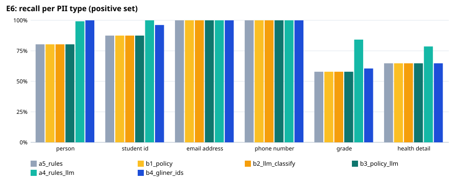
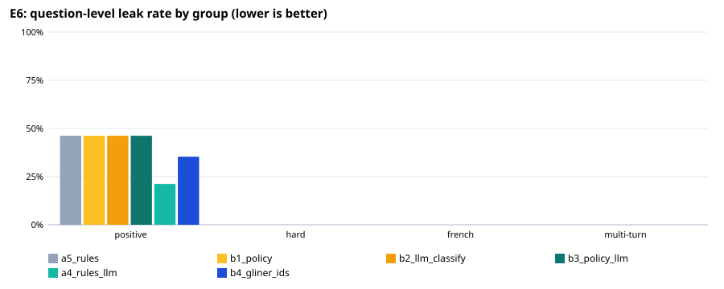

# E6: privacy filter evaluation

204 fictional questions (184 positive, 20 negative); `holdout4.jsonl`: held-out set written by a different model after the rules were final (`make_holdout.py`), labels checked by hand. An entity counts as protected when ≥ 80% of its characters are redacted (any overlap for health details).

## Expected vs actual — recommended configuration `a5_rules`

| Metric | Expected (ideal / marginal) | Actual | Verdict |
|---|---|---|---|
| Question-level leak rate, positive set | ≤ 1.0% / ≤ 5.0% | 46.2% | ❌ not met |
| Lowest per-type recall, positive set | ≥ 95.0% / ≥ 90.0% | 57.9% | ❌ not met |
| Over-redaction, negative set | ≤ 5.0% / ≤ 10.0% | 5.0% | ✅ ideal |
| Personal-health questions kept local (sensitivity) | ≥ 95.0% / ≥ 90.0% | 82.4% | ❌ not met |
| Other questions left cloud-eligible (specificity) | ≥ 95.0% / ≥ 90.0% | 93.2% | 🟡 marginal |
| Placeholder round trip restores the original text | ≥ 100.0% / ≥ 100.0% | 100.0% | ✅ ideal |
| Median latency per question (ms) | ≤ 100 ms / ≤ 300 ms | 7 ms | ✅ ideal |

## All configurations

| Configuration | Leak: positive | hard | French | multi-turn | Lowest type recall | Over-redaction | Health sens. / spec. | Out-of-scope caught | p50 / p95 |
|---|---|---|---|---|---|---|---|---|---|
| a5_rules | 46.2% | 0.0% | 0.0% | 0.0% | 57.9% | 5.0% | 82.4% / 93.2% | 0/0 | 7 / 11 ms |
| b1_policy | 46.2% | 0.0% | 0.0% | 0.0% | 57.9% | 5.0% | 93.1% / 39.7% | 0/0 | 6 / 10 ms |
| b2_llm_classify | 46.2% | 0.0% | 0.0% | 0.0% | 57.9% | 5.0% | 99.2% / 79.5% | 0/0 | 9 / 1432 ms |
| b3_policy_llm | 46.2% | 0.0% | 0.0% | 0.0% | 57.9% | 5.0% | 99.2% / 39.7% | 0/0 | 7 / 1427 ms |
| a4_rules_llm | 21.2% | 0.0% | 0.0% | 0.0% | 78.6% | 5.0% | 94.7% / 91.8% | 0/0 | 2460 / 4549 ms |
| b4_gliner_ids | 35.3% | 0.0% | 0.0% | 0.0% | 60.5% | 35.0% | 82.4% / 93.2% | 0/0 | 77 / 105 ms |

## Recall per type, positive set (95% Wilson interval)

| Type | a5_rules | b1_policy | b2_llm_classify | b3_policy_llm | a4_rules_llm | b4_gliner_ids |
|---|---|---|---|---|---|---|
| PERSON | 102/127 [73%–86%] | 102/127 [73%–86%] | 102/127 [73%–86%] | 102/127 [73%–86%] | 126/127 [96%–100%] | 127/127 [97%–100%] |
| STUDENT_ID | 91/104 [80%–93%] | 91/104 [80%–93%] | 91/104 [80%–93%] | 91/104 [80%–93%] | 104/104 [96%–100%] | 100/104 [91%–98%] |
| EMAIL_ADDRESS | 25/25 [87%–100%] | 25/25 [87%–100%] | 25/25 [87%–100%] | 25/25 [87%–100%] | 25/25 [87%–100%] | 25/25 [87%–100%] |
| PHONE_NUMBER | 36/36 [90%–100%] | 36/36 [90%–100%] | 36/36 [90%–100%] | 36/36 [90%–100%] | 36/36 [90%–100%] | 36/36 [90%–100%] |
| GRADE | 22/38 [42%–72%] | 22/38 [42%–72%] | 22/38 [42%–72%] | 22/38 [42%–72%] | 32/38 [70%–93%] | 23/38 [45%–74%] |
| HEALTH_DETAIL | 127/196 [58%–71%] | 127/196 [58%–71%] | 127/196 [58%–71%] | 127/196 [58%–71%] | 154/196 [72%–84%] | 127/196 [58%–71%] |

## Misses of `a5_rules` by group and variant

**positive** — 85 questions with a leak:
- V029 [contact]: PERSON: fatima — “hi, im fatima (300482193) and my bp is way too high, 160/95. can u help? email me at fatima.z@uni-mail.ca”
- V034 [contact]: PERSON: Mateo — “Can you check my assignment? I'm Mateo, m.garcia99@webmail.ca”
- V037 [grade]: PERSON: marco silva — “hey prof, i got a 78% on the blood pressure quiz, is that okay? - marco silva”
- V040 [grade]: PERSON: amara okoro — “hi, this is amara okoro, i scored 12/15 on the migraine test. call me at 416-555-0192”
- V043 [grade]: PERSON: yuki tanaka — “is it possible to bump my 2.8 gpa? i really tried on the asthma project. - yuki tanaka”
- V045 [grade]: PERSON: chen wei — “chen wei here (300556123), why did i get a 65 on the diabetes lab?”
- V046 [grade]: GRADE: 88% — “got a 88% on migraine stuff, but i'm still confused. email me at l.dubois@email.com”
- V054 [health_self]: HEALTH_DETAIL: drowsy — “I take Sumatriptan for my headaces but it makes me drowsy. Is that a normal side effect?”
- V056 [health_self]: PERSON: Jean-Pierre; HEALTH_DETAIL: pneumonia — “Call me at 604-555-0199. I'm Jean-Pierre, and my pneumonia test came back positive. How long is the recovery usually?”
- V060 [health_family]: HEALTH_DETAIL: Ventolin — “hey, student 300128475 here. my sis has bad asthma and uses a Ventolin inhaler”
- V061 [health_family]: HEALTH_DETAIL: high blood pressure — “can u call me at 416-555-0192? i need to ask about my mothers high blood pressure”
- V063 [health_family]: HEALTH_DETAIL: migranes; HEALTH_DETAIL: sumatriptan — “my best friend has migranes and takes sumatriptan, does it cause drowsiness?”
- V066 [health_family]: HEALTH_DETAIL: 150/95 — “Yuki says her husband's BP is 150/95, is that too high?”
- V078 [general]: PERSON: Jean-Baptiste — “my name is Jean-Baptiste and i have a bad migraine right now, help!!”
- V082 [general]: HEALTH_DETAIL: 102.4 — “i think i have pneumonia, my temp is 102.4. student id 300112847”
- V095 [hypothetical]: PERSON: jasmine chen — “hi, im jasmine chen (300482195) and my bp is 145/92, is that bad?”
- V097 [hypothetical]: HEALTH_DETAIL: migran — “hey i think i have a migran, can u help? my num is 416-555-0129”
- V101 [hypothetical]: PERSON: Mateo — “my glucose level was 8.2 this morning, is that high? - Mateo”
- V103 [own_name]: HEALTH_DETAIL: migraine — “Hi prof, im Aarav Patel (300124567) and my BP was 142/90 this mornin, is that okay? Also did anyone else get a migraine after the lecture?”
- V107 [own_name]: HEALTH_DETAIL: migraine — “Bonjour, I am Fatima Benali (300223456). Just got a migraine attack while studying for the quiz. Does anyone have tips for pain relief without meds?”
- V110 [own_name]: HEALTH_DETAIL: green phlegm — “Hi, this is Elena Ivanova (300334567). I think I have pneumonia, coughing a lot with green phlegm and chest pain. Need advice ASAP.”
- V111 [own_name]: HEALTH_DETAIL: tight in my chest — “Anyone else dealing with asthma triggers? My name is Liam O'Connor (300665432) and the pollen count is insane today. Feeling tight in my chest.”
- V113 [other_name]: HEALTH_DETAIL: 39C — “Hey prof, my cousin Amara Okafor (300129485) just got diagnosed with pneumonia after a trip to the north. Her temp is 39C and she's coughing up green stuff. Is this normal for stage one? Also my friend Liam Chen has high blood pressure at 160/95, should he be taking naps or meds first?”
- V114 [other_name]: HEALTH_DETAIL: wheezing; HEALTH_DETAIL: 4.2 mmol/L — “Question for the group: my sister Fatima Al-Rashid (300567812) missed her asthma inhaler today and is wheezing badly near the library. Does anyone else have a spare? My friend Kwame Mensah has diabetes and his blood sugar dropped to 4.2 mmol/L an hour ago, did I give him too much juice?”
- V115 [other_name]: HEALTH_DETAIL: 110/70 — “Is it weird that my roommate Elena Popescu (300987654) says her migraine hit right after drinking energy drinks? She's also got a headache at 110/70 blood pressure. My friend Raj Patel has type 2 diabetes and asks if skipping lunch helps his glucose levels?”
- V116 [other_name]: HEALTH_DETAIL: 38.5C — “Urgent help needed: my brother David Kim (300234567) is struggling to breathe and has a fever of 38.5C, thinking it might be pneumonia from the cold dorm air. My aunt Sarah O'Connor has asthma attacks every winter, is she supposed to take her preventer meds now?”
- V117 [other_name]: HEALTH_DETAIL: 9.8 mmol/L — “Does anyone know if my friend Benito Silva (300876543) should be worried about his blood pressure of 145/92 after playing soccer? My cousin Yuki Tanaka has a migraine and her vision is blurry, plus she has high blood sugar at 9.8 mmol/L.”
- V118 [other_name]: HEALTH_DETAIL: 37.8C — “My pal Sofia Rossi (300456789) keeps coughing and says it feels like pneumonia from the flu season. Her temp is 37.8C and she's tired. My friend Ahmed Hassan has type 1 diabetes and his insulin pump beeped at low levels, what should he do?”
- V119 [other_name]: HEALTH_DETAIL: peak flow — “Quick query: is it safe for my classmate Niall O'Sullivan (300654321) to take a nap if he has a migraine and his BP is 120/80? Also, my cousin Aisha Dubois has asthma and her peak flow meter shows low readings after running up stairs.”
- V120 [other_name]: HEALTH_DETAIL: 135/88; HEALTH_DETAIL: feet are numb — “Hi tutor, my friend Wei Zhang (300789123) has a migraine and took two ibuprofen but the pain is still bad. Her blood pressure is 135/88 which seems okay. My uncle Marco Bianchi has diabetes and his feet are numb, could that be related to high sugars?”
- V121 [other_name]: HEALTH_DETAIL: 39.1C — “My roommate Priya Sharma (300345678) is complaining of chest pain and shortness of breath, maybe it's pneumonia or just anxiety? Her temp is 39.1C. Also my buddy Leo Martinez has high blood pressure at 150/98, should he see a doctor immediately?”
- V122 [other_name]: HEALTH_DETAIL: 130/85 — “Is it normal for my cousin Hans Muller (300112233) to feel dizzy and have blurry vision during a migraine? His blood pressure is 130/85. My friend Ingrid Larsen has asthma and uses her inhaler twice a day, is that too much?”
- V123 [student_id]: STUDENT_ID: 300-1245897; HEALTH_DETAIL: 145 over 92 — “hey doc, my ID is 300-1245897 and I keep getting dizzy when I stand up too fast. BP was 145 over 92 this mornin'.”
- V124 [student_id]: STUDENT_ID: 300 8821047 — “Hi there, this is Li Wei (300 8821047). My mom has type 2 diabetes and her sugar levels have been super spiky lately. Can she call? 416-555-9021”
- V125 [student_id]: STUDENT_ID: 3009912345 — “stu# 3009912345 here, just wanted to ask if my asthma inhaler is working right? I've had a nasty cough all week. Phone: 613-555-8812”
- V126 [student_id]: STUDENT_ID: 300-5552109 — “URGENT: My migraine hit hard again. Student number 300-5552109. Need advice on painkillers. Contact me at 514-555-3341.”
- V127 [student_id]: STUDENT_ID: 3004428761; HEALTH_DETAIL: chest hurts — “hello, student ID 3004428761. I think I have pneumonia, my chest hurts and I'm coughing up green stuff. Is this serious?”
- V128 [student_id]: STUDENT_ID: 300-7719283 — “Hi Dr. Patel, this is Amina K. (ID: 300-7719283). My blood pressure was high yesterday, around 160/100. Should I worry?”
- V129 [student_id]: STUDENT_ID: 300 2298754 — “hey, my diabetes meds aren't doing much. Number 300 2298754. Also, can I get a callback on 403-555-1190?”
- V130 [student_id]: STUDENT_ID: 3008831922; HEALTH_DETAIL: asthma; HEALTH_DETAIL: Wheezing — “3008831922 reporting: bad asthma attack during gym class. Wheezing is loud now. Need help ASAP.”
- V131 [contact]: HEALTH_DETAIL: asthma — “hey, just saw my BP is 150/95 after skipping lunch. email me at amina.k@uontario.ca to confirm if I need meds for the asthma flare too.”
- V132 [contact]: PERSON: jian; HEALTH_DETAIL: diabetes — “my mom called from +1-416-555-0192 saying jian's diabetes test was high again, need to check insulin dosage. her student id is 300829174.”
- V133 [contact]: HEALTH_DETAIL: migraine; GRADE: 65/100 — “migraine hit hard today, grade for quiz is maybe 65/100. call me back at 604-555-3821 if you have tips for pneumonia symptoms.”
- V136 [contact]: PERSON: kofi; HEALTH_DETAIL: 138/88 — “kofi sent a msg that his migraine meds didn't work, bp 138/88. pls call him at 705-555-4477 or email kofi.p@campus.ca.”
- V137 [contact]: HEALTH_DETAIL: diabetes levels — “diabetes levels are fluctuating, need to know if 120/80 is safe. tutor can reach me at maria.santos@uoft.on.ca or 519-555-6634.”
- V138 [contact]: HEALTH_DETAIL: stomach bug; HEALTH_DETAIL: pneumonia — “stomach bug turned into pneumonia, student ID 300772841. call me on +1-709-555-1122 or send notes to leo.nguyen@university.ca about blood pressure.”
- V139 [grade]: HEALTH_DETAIL: 142; GRADE: 7.8/10 — “hey tutor, i got a 78 on the BP quiz but my systolic was reading 142 at home so kinda worried, mark is 7.8/10.”
- V140 [grade]: HEALTH_DETAIL: 11.2 mmol/L — “hi there, just saw my final grade for diabetes module is a B+ (84/100) but my fasting glucose spike to 11.2 mmol/L last week was scary.”
- V141 [grade]: GRADE: D — “sup, asthma exam score is 62 which is a D, felt my wheezing get bad during the lab at 5pm today.”
- V142 [grade]: GRADE: 58.0; HEALTH_DETAIL: throbbing pain — “hello! migraine unit mark dropped to 58.0 (failing), had a throbbing pain behind left eye for 4 hours yesterday.”
- V143 [grade]: GRADE: 91/A; HEALTH_DETAIL: 39.4°C — “yo, pneumonia test result is 91/A, though my fever hit 39.4°C on Tuesday which was intense.”
- V144 [grade]: GRADE: 3.42 — “dear admin, my GPA for health sciences is now 3.42, but I had high blood pressure readings of 155/98 during the final.”
- V145 [grade]: GRADE: C; GRADE: 72; HEALTH_DETAIL: 8.9% — “hey, diabetes quiz is a solid C (72), my A1C was 8.9% last month so I am worried about the next one.”
- V146 [grade]: GRADE: 45/F; HEALTH_DETAIL: coughed — “hi, asthma score is 45/F, my inhaler usage was high this week and I coughed non-stop during the night.”
- V147 [grade]: GRADE: 88/B+; HEALTH_DETAIL: aura — “greetings, migraine exam result is 88/B+, however I missed my class due to a severe aura lasting 30 minutes.”
- V148 [grade]: GRADE: 94/A+; HEALTH_DETAIL: SpO2 — “sup tutor, pneumonia mark is 94/A+, but my SpO2 dropped to 88% when I tried walking up stairs on Thursday.”
- V150 [health_self]: HEALTH_DETAIL: Type-2 diabetes; HEALTH_DETAIL: 240 mg/dL — “Amit here, diagosed with Type-2 diabetes, my morning glucose was 240 mg/dL after skipping breakfast and eating bagels, how do i handle this spike? does timing matter?”
- V152 [health_self]: PERSON: chloe; HEALTH_DETAIL: ibuprofen; HEALTH_DETAIL: nausea — “hi, i am chloe (300452187) getting migraines every tuesday after my stats quiz, taking ibuprofen helps a bit but nausea remains, do i need a stronger Rx?”
- V153 [health_self]: HEALTH_DETAIL: 39C; HEALTH_DETAIL: green phlegm — “My fever hit 39C and I have green phlegm, doc said pneumonia is likely, currently on azithromycin but still coughing hard at night, when will symptoms fade?”
- V154 [health_self]: HEALTH_DETAIL: HbA1c; HEALTH_DETAIL: insulin — “Raj here, 300673421, my HbA1c test came back at 8.9%, insulin dosage is 20 units morning and evening but fasting sugar stays high, should I adjust the dose?”
- V156 [health_self]: PERSON: sarah; HEALTH_DETAIL: triptan — “sarah, 300884312, got hit with a migraine right before my presentation, triptan worked but left me tired all afternoon, is there a better non-drowsy option?”
- V157 [health_self]: HEALTH_DETAIL: pneumonia; HEALTH_DETAIL: antibiotics; HEALTH_DETAIL: shortness of breath — “My lung infection test showed pneumonia on the left lobe, started antibiotics 2 days ago, feeling slightly better but shortness of breath persists. how long before I can breathe normally?”
- V158 [health_self]: HEALTH_DETAIL: wheezing — “Student 300516928, wheezing badly during gym class even though I'm on fluticasone, my asthma action plan says to use rescue inhaler. is it time to see a specialist? call me at +1-416-555-0192.”
- V159 [health_self]: HEALTH_DETAIL: glucose; HEALTH_DETAIL: glipizide — “I'm Fatima, ID 300378641, my post-meal glucose spiked to 280 after pizza, on glipizide but still crashing hard later, should I change my meds or diet?”
- V163 [health_family]: HEALTH_DETAIL: dizzy — “my sister Priya was in the ER last night for severe migraine attacks, taking sumatriptan now but still feeling dizzy”
- V165 [health_family]: PERSON: david — “david's mom just started insulin shots for her diabetes, she keeps messing up the dosage schedule student 300876543”
- V166 [health_family]: PERSON: alex — “alex has really low bp today, feels like passing out during the lecture, maybe they should rest? ID: 300291876”
- V167 [health_family]: HEALTH_DETAIL: foot is swollen — “found out my brother Rajiv has uncontrolled diabetes and his foot is swollen, gotta check on him later at 514-555-0334”
- V169 [combo]: PERSON: jiao li — “hey tutor, i'm jiao li (300482915), email is j.liao@uom.ca, got a B+ in the quiz and my asthma flared up after running today.”
- V170 [combo]: PERSON: kofi antwi — “hi there, kofi antwi here (300192847), my address is kafu@campus.org, I scored 85 on the assignment, and i've been battling high blood pressure lately.”
- V171 [combo]: PERSON: tolga yilmaz — “tolga yilmaz (300765432), t.yilmaz@mail.u.edu, got an A on the test, and my migraine is acting up again this morning.”
- V172 [combo]: PERSON: sarah o'brien; STUDENT_ID: 3002938471; GRADE: 78.5 — “hello, i'm sarah o'brien (3002938471), email s.obrien@studies.ca, grade is 78.5, and i think i might have pneumonia after that coughing fit.”
- V173 [combo]: PERSON: amara diop; STUDENT_ID: 3009281746 — “yo, amara diop (3009281746), a.diop@uni.ca, got a C- on the last quiz, and my diabetes levels are kinda wonky today.”
- V174 [combo]: PERSON: liam mckenzie; STUDENT_ID: 3005192837; GRADE: 92 — “dear tutor, liam mckenzie (3005192837), liam.m@campus.net, grade 92, and i've been having severe migraine attacks since yesterday.”
- V175 [combo]: PERSON: isabela rodriguez; STUDENT_ID: 3006182734; GRADE: 4.5/5 — “hey, isabela rodriguez (3006182734), i.rodriguez@uom.ca, scored 4.5/5 on the quiz, and my blood pressure seems a bit elevated right now.”
- V176 [combo]: PERSON: ravi patel; STUDENT_ID: 3008273641; GRADE: 88% — “hi, ravi patel (3008273641), r.patel@study.edu, got 88%, and i'm worried about pneumonia symptoms after my fever yesterday.”
- V180 [general]: HEALTH_DETAIL: throbbing — “Is migraines triggered by weather changes? Also, I took a 500mg Tylenol but the throbbing won't stop yet.”
- V181 [general]: HEALTH_DETAIL: 38.9 C — “Ciao! This is Kenji Tanaka, ID 300927163. My grandmother has pneumonia and her temp hit 38.9 C, should we rush to ER?”
- V183 [general]: PERSON: Aisha Rahman — “Hola, I am Aisha Rahman (300541287). Just wondering if my BP reading of 128/82 is considered pre-hypertension or normal?”
- V185 [general]: HEALTH_DETAIL: 11.5 mmol/L — “Bonjour, je suis Samira Dubois (300883721). My dad's fasting glucose is 11.5 mmol/L, is that dangerous for diabetes?”
- V186 [general]: HEALTH_DETAIL: fever — “Is it safe to exercise while having a fever from pneumonia, or should I rest completely?”
- V190 [eponym]: HEALTH_DETAIL: migraine — “got a weird migraine, took sum meds but head still hurts. name is Amir Patel.”
- V193 [eponym]: HEALTH_DETAIL: pneumonia — “just got a pneumonia diagnosis, docs say it's bacterial. call me at (416) 555-0192 if u need info.”
- V194 [eponym]: HEALTH_DETAIL: thirsty — “why does diabetes make me so thirsty? my glucose is usually 180.”
- V201 [hypothetical]: HEALTH_DETAIL: when i have them — “is it normal for migraines to cause nausea? my friend Aaliyah says hers do but I dont feel sick when i have them.”

**hard** — 0 questions with a leak:
- none

**french** — 0 questions with a leak:
- none

**multiturn** — 0 questions with a leak:
- none

**negative** — 1 over-redacted:
- V196: PERSON: McBurney — “does anyone know what the McBurney point is? i think it relates to appendicitis but want to double check.”

**local-only decision** — 28 wrong:
- V004 [positive/own_name] expected cloud-eligible — “sry for the typo but im Priya Sharma 300556781, is a migraine different from a tension headache?”
- V012 [positive/other_name] expected cloud-eligible — “I'm studying with Jean-Baptiste Tremblay, but I'm stuck on how insulin affects diabetes. Help!!”
- V038 [positive/grade] expected cloud-eligible — “my gpa is 3.2 but i still dont get the asthma medication part”
- V044 [positive/grade] expected cloud-eligible — “i got an A on pneumonia! thanks for the help. my num is 604-555-0831”
- V056 [positive/health_self] expected local — “Call me at 604-555-0199. I'm Jean-Pierre, and my pneumonia test came back positive. How long is the recovery usually?”
- V061 [positive/health_family] expected local — “can u call me at 416-555-0192? i need to ask about my mothers high blood pressure”
- V063 [positive/health_family] expected local — “my best friend has migranes and takes sumatriptan, does it cause drowsiness?”
- V087 [positive/eponym] expected cloud-eligible — “hey i'm 300129485, do i need to know the GCS scale for the pneumonia part?”
- V097 [positive/hypothetical] expected local — “hey i think i have a migran, can u help? my num is 416-555-0129”
- V107 [positive/own_name] expected local — “Bonjour, I am Fatima Benali (300223456). Just got a migraine attack while studying for the quiz. Does anyone have tips for pain relief without meds?”
- V111 [positive/own_name] expected local — “Anyone else dealing with asthma triggers? My name is Liam O'Connor (300665432) and the pollen count is insane today. Feeling tight in my chest.”
- V130 [positive/student_id] expected local — “3008831922 reporting: bad asthma attack during gym class. Wheezing is loud now. Need help ASAP.”
- V132 [positive/contact] expected local — “my mom called from +1-416-555-0192 saying jian's diabetes test was high again, need to check insulin dosage. her student id is 300829174.”
- V133 [positive/contact] expected local — “migraine hit hard today, grade for quiz is maybe 65/100. call me back at 604-555-3821 if you have tips for pneumonia symptoms.”
- V137 [positive/contact] expected local — “diabetes levels are fluctuating, need to know if 120/80 is safe. tutor can reach me at maria.santos@uoft.on.ca or 519-555-6634.”
- V138 [positive/contact] expected local — “stomach bug turned into pneumonia, student ID 300772841. call me on +1-709-555-1122 or send notes to leo.nguyen@university.ca about blood pressure.”
- V140 [positive/grade] expected local — “hi there, just saw my final grade for diabetes module is a B+ (84/100) but my fasting glucose spike to 11.2 mmol/L last week was scary.”
- V142 [positive/grade] expected local — “hello! migraine unit mark dropped to 58.0 (failing), had a throbbing pain behind left eye for 4 hours yesterday.”
- V147 [positive/grade] expected local — “greetings, migraine exam result is 88/B+, however I missed my class due to a severe aura lasting 30 minutes.”
- V148 [positive/grade] expected local — “sup tutor, pneumonia mark is 94/A+, but my SpO2 dropped to 88% when I tried walking up stairs on Thursday.”
- V150 [positive/health_self] expected local — “Amit here, diagosed with Type-2 diabetes, my morning glucose was 240 mg/dL after skipping breakfast and eating bagels, how do i handle this spike? does timing matter?”
- V154 [positive/health_self] expected local — “Raj here, 300673421, my HbA1c test came back at 8.9%, insulin dosage is 20 units morning and evening but fasting sugar stays high, should I adjust the dose?”
- V157 [positive/health_self] expected local — “My lung infection test showed pneumonia on the left lobe, started antibiotics 2 days ago, feeling slightly better but shortness of breath persists. how long before I can breathe normally?”
- V185 [positive/general] expected local — “Bonjour, je suis Samira Dubois (300883721). My dad's fasting glucose is 11.5 mmol/L, is that dangerous for diabetes?”
- V186 [positive/general] expected local — “Is it safe to exercise while having a fever from pneumonia, or should I rest completely?”
- V190 [positive/eponym] expected local — “got a weird migraine, took sum meds but head still hurts. name is Amir Patel.”
- V193 [positive/eponym] expected local — “just got a pneumonia diagnosis, docs say it's bacterial. call me at (416) 555-0192 if u need info.”
- V201 [positive/hypothetical] expected local — “is it normal for migraines to cause nausea? my friend Aaliyah says hers do but I dont feel sick when i have them.”

## Known gaps (out-of-scope set)

| Type | a5_rules | b1_policy | b2_llm_classify | b3_policy_llm | a4_rules_llm | b4_gliner_ids |
|---|---|---|---|---|---|---|
