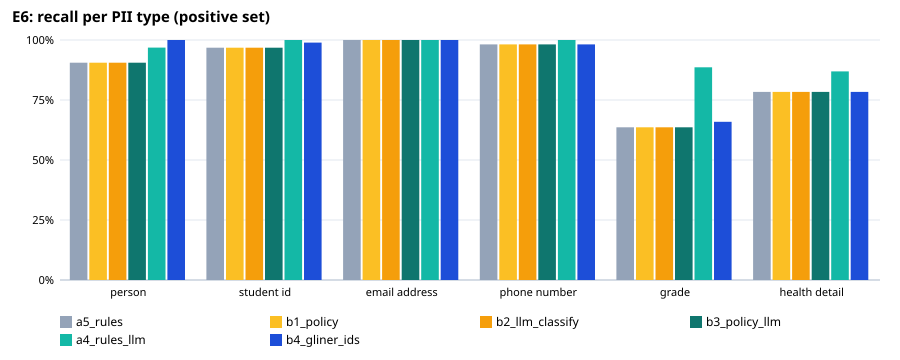
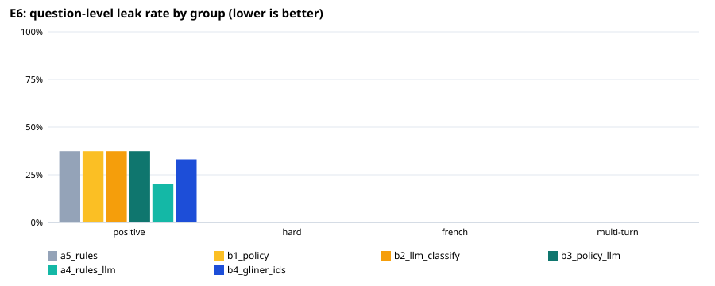

# E6: privacy filter evaluation

202 fictional questions (163 positive, 39 negative); `holdout5.jsonl`: held-out set written by a different model after the rules were final (`make_holdout.py`), labels checked by hand. An entity counts as protected when ≥ 80% of its characters are redacted (any overlap for health details).

## Expected vs actual — recommended configuration `a5_rules`

| Metric | Expected (ideal / marginal) | Actual | Verdict |
|---|---|---|---|
| Question-level leak rate, positive set | ≤ 1.0% / ≤ 5.0% | 37.4% | ❌ not met |
| Lowest per-type recall, positive set | ≥ 95.0% / ≥ 90.0% | 63.6% | ❌ not met |
| Over-redaction, negative set | ≤ 5.0% / ≤ 10.0% | 12.8% | ❌ not met |
| Personal-health questions kept local (sensitivity) | ≥ 95.0% / ≥ 90.0% | 92.9% | 🟡 marginal |
| Other questions left cloud-eligible (specificity) | ≥ 95.0% / ≥ 90.0% | 89.3% | ❌ not met |
| Placeholder round trip restores the original text | ≥ 100.0% / ≥ 100.0% | 100.0% | ✅ ideal |
| Median latency per question (ms) | ≤ 100 ms / ≤ 300 ms | 7 ms | ✅ ideal |

## All configurations

| Configuration | Leak: positive | hard | French | multi-turn | Lowest type recall | Over-redaction | Health sens. / spec. | Out-of-scope caught | p50 / p95 |
|---|---|---|---|---|---|---|---|---|---|
| a5_rules | 37.4% | 0.0% | 0.0% | 0.0% | 63.6% | 12.8% | 92.9% / 89.3% | 0/0 | 7 / 12 ms |
| b1_policy | 37.4% | 0.0% | 0.0% | 0.0% | 63.6% | 12.8% | 96.1% / 53.3% | 0/0 | 6 / 11 ms |
| b2_llm_classify | 37.4% | 0.0% | 0.0% | 0.0% | 63.6% | 12.8% | 98.4% / 76.0% | 0/0 | 9 / 1426 ms |
| b3_policy_llm | 37.4% | 0.0% | 0.0% | 0.0% | 63.6% | 12.8% | 99.2% / 50.7% | 0/0 | 8 / 1427 ms |
| a4_rules_llm | 20.2% | 0.0% | 0.0% | 0.0% | 86.9% | 23.1% | 96.1% / 84.0% | 0/0 | 2075 / 4521 ms |
| b4_gliner_ids | 33.1% | 0.0% | 0.0% | 0.0% | 65.9% | 43.6% | 92.9% / 89.3% | 0/0 | 84 / 107 ms |

## Recall per type, positive set (95% Wilson interval)

| Type | a5_rules | b1_policy | b2_llm_classify | b3_policy_llm | a4_rules_llm | b4_gliner_ids |
|---|---|---|---|---|---|---|
| PERSON | 86/95 [83%–95%] | 86/95 [83%–95%] | 86/95 [83%–95%] | 86/95 [83%–95%] | 92/95 [91%–99%] | 95/95 [96%–100%] |
| STUDENT_ID | 90/93 [91%–99%] | 90/93 [91%–99%] | 90/93 [91%–99%] | 90/93 [91%–99%] | 93/93 [96%–100%] | 92/93 [94%–100%] |
| EMAIL_ADDRESS | 16/16 [81%–100%] | 16/16 [81%–100%] | 16/16 [81%–100%] | 16/16 [81%–100%] | 16/16 [81%–100%] | 16/16 [81%–100%] |
| PHONE_NUMBER | 54/55 [90%–100%] | 54/55 [90%–100%] | 54/55 [90%–100%] | 54/55 [90%–100%] | 55/55 [93%–100%] | 54/55 [90%–100%] |
| GRADE | 28/44 [49%–76%] | 28/44 [49%–76%] | 28/44 [49%–76%] | 28/44 [49%–76%] | 39/44 [76%–95%] | 29/44 [51%–78%] |
| HEALTH_DETAIL | 156/199 [72%–84%] | 156/199 [72%–84%] | 156/199 [72%–84%] | 156/199 [72%–84%] | 173/199 [82%–91%] | 156/199 [72%–84%] |

## Misses of `a5_rules` by group and variant

**positive** — 61 questions with a leak:
- V016 [other_name]: HEALTH_DETAIL: sick — “Can u help w/ the diabetes insulin chart? Chloe Lefebvre is out sick today.”
- V035 [contact]: PERSON: anuki — “hi, i'm anuki. i'm worried about my asthma meds. email me at anuki.t@webmail.ca”
- V044 [grade]: GRADE: 91% — “Hans here (300992831). I'm tracking my pneumonia recovery. Got a 91% today.”
- V045 [grade]: GRADE: C — “The asthma section was tough... i barely managed a C.”
- V048 [health_self]: HEALTH_DETAIL: 8.2% — “I got my A1C results back today and it's 8.2%. Can you explain insulin types?”
- V050 [health_self]: HEALTH_DETAIL: migraine — “Dealing with a massive migraine and can't see well. How does the brain process pain?”
- V052 [health_self]: HEALTH_DETAIL: sugar — “I'm a diabetic student (ID: 300554122) and my sugar peaked. What are the long-term effects of hyperglycemia?”
- V054 [health_self]: HEALTH_DETAIL: weak — “Is it normal to have a fever with pneumonia? I'm feeling really weak.”
- V058 [health_self]: HEALTH_DETAIL: nauseous — “I have a severe migraine and I'm nauseous. What are the common triggers for this?”
- V060 [health_family]: HEALTH_DETAIL: diagnosed — “Does anyone know how to manage high blood pressure for seniors? My dad (Mr. Tanaka) just got diagnosed.”
- V063 [health_family]: PERSON: Mateo — “Id 300442198. My cousin Mateo is having bad migraines and can't sleep.”
- V064 [health_family]: HEALTH_DETAIL: sugar — “Is there a way to help my grandma with her sugar? She has diabetes and it's hard for her.”
- V066 [health_family]: HEALTH_DETAIL: pain — “Just checking if anyone knows a good doc for chronic migraines. My sister is in a lot of pain.”
- V071 [combo]: GRADE: B+ — “Is the B+ grade final for me? I'm Mateo Rodriguez, 300447212. Also, I'm managing type 2 diabetes.”
- V091 [eponym]: HEALTH_DETAIL: 101F — “student 300482911 here. i have a migraine and my temp is 101F. is that normal?”
- V103 [own_name]: PERSON: Maya Chen — “Hey Dr. Patel, this is Maya Chen student id 300123456, my blood pressure has been all over the place lately, like 138/85 yesterday and 142/88 today. What can I do?”
- V104 [own_name]: HEALTH_DETAIL: peak flow — “Hola, soy Alejandro Gómez, student id 300987654, mi número de teléfono es 613-555-1234. I'm worried because I have asthma, my last reading was 95% on my peak flow meter and I think I need a spacer.”
- V108 [own_name]: HEALTH_DETAIL: 38.7°C — “Greetings, I'm Priya Nair, student id 300778899. Contact me at 416-555-0777. I was diagnosed with pneumonia last week, still coughing a lot and fever 38.7°C. What should I do?”
- V111 [own_name]: HEALTH_DETAIL: 7.8% — “Hi, it's Aisha Al‑Mansour, student id 300889900. My phone is 604-555-0666. I was told I might have diabetes, my latest A1C was 7.8%. Any diet tips?”
- V117 [other_name]: HEALTH_DETAIL: 38.2°C — “Hey Dr. Kim, can u explain migraine triggers? My brother Arjun Singh’s headaches get worse after bright lights. His doctor said maybe it’s tension. Also my roommate Zoe Chen has pneumonia and her temperature is 38.2°C. Phone: 416-555-0456 Student: 300888999”
- V119 [other_name]: HEALTH_DETAIL: peak flow — “Yo Dr. Lee, can you clarify asthma steps for my friend Noah O’Connor? He said his peak flow dropped to 350 after basketball. Also my cousin Mei Chen’s pneumonia got worse, now she’s on oxygen. Phone: 416-555-0678 Student ID: 300444555”
- V122 [student_id]: GRADE: 178.6/100 — “hey 300123456 stu no 178.6/100 my doc said my bp is kinda high and i need meds”
- V123 [student_id]: HEALTH_DETAIL: asthma — “ID: 300-987 654, asthma flares when i run. i use my inhaler twice a day”
- V124 [student_id]: STUDENT_ID: 3005550123 — “Student No: 3005550123 I'm from Tokyo and i have diabetes type 2, need to watch sugar”
- V125 [student_id]: HEALTH_DETAIL: migraine — “stu# 300-222 333 can't sleep due to migraine. tried cold pack, helps a bit”
- V127 [student_id]: STUDENT_ID: 300-7778889; GRADE: grade A — “hello, my name is Aisha Khan and i am student 300-7778889 with grade A. i have asthma and need a spacer”
- V130 [contact]: HEALTH_DETAIL: sneezing fit — “hey 300123456 email test@univ.edu i have a sneezing fit today and my blood pressure was high 150/95”
- V132 [contact]: PHONE_NUMBER: 4165551234 — “Student #300987654 here, 4165551234 is my number, i think i am getting pneumonia symptoms”
- V134 [contact]: HEALTH_DETAIL: headache — “311222333- 613-555-7777 - 300111222 - headache and a 168/110 reading on my arm”
- V136 [contact]: HEALTH_DETAIL: 38°C — “300999888 email: rosa_garcia@healthmail.ca i had a 38°C fever and a bad cough tonight”
- V138 [grade]: GRADE: 88 — “Hey prof, this is Maya Patel, id 300123456, i got 88 on the blood pressure quiz, hope i can keep my asthma under control. My phone is 613-555-1234, gpa 3.6.”
- V139 [grade]: GRADE: 73 — “Yo! Luis Gómez here (id 300987654). Scored 73 on diabetes unit. Phone: 416-777-9045. my migraines have been acting up lately. GPA 2.9”
- V140 [grade]: GRADE: 91 — “hi! this is Aisha Al-Mansouri, student 300555121, got 91 in the pneumonia case study. call me at 604-555-7890 if needed. I’m worried about my blood pressure numbers.”
- V141 [grade]: GRADE: 84 — “Hello, I'm Jalen Okoro (id 300332211). My score for asthma management is 84. My number: 514-555-0143. My GPA is 3.2 and I have diabetes.”
- V143 [grade]: GRADE: 78 — “hi there, it's Kofi Mensah (id 300221333). I got 78 in the blood pressure module. Phone: 416-555-3311. I have asthma flare‑ups occasionally. GPA 3.0”
- V147 [grade]: GRADE: 62 — “hi! This is Diego Ramirez, student 300777444, got 62 on the blood pressure worksheet. Phone: 416-555-2211. I'm recovering from pneumonia and my GPA is 2.6.”
- V149 [health_self]: HEALTH_DETAIL: 310 — “my asthma got worse after that field trip, i use my rescue inhaler twice a day and today peak flow was 310”
- V150 [health_self]: HEALTH_DETAIL: fasting glucose; HEALTH_DETAIL: thirsty — “i think i might have diabetes, my fasting glucose was 112 last week and i feel really thirsty a lot”
- V153 [health_self]: HEALTH_DETAIL: metformin — “my diabetes type 2 is usually under control, but this week i missed a dose of metformin 500mg and my blood sugar hit 180”
- V154 [health_self]: HEALTH_DETAIL: 101.4 — “hey folks, i just had a weird cough and the nurse said it could be pneumonia, i got a prescription for azithromycin 250mg and my temperature is 101.4 now”
- V157 [health_self]: HEALTH_DETAIL: antihistamine — “i got a weird rash on my arm after the lab work, the doctor said it might be a reaction, i’m on antihistamine 10mg and it’s getting better”
- V158 [health_self]: HEALTH_DETAIL: rizatriptan — “i’ve been having headaches every night for the past week, i think it’s a migraine, i take rizatriptan 10mg and my doctor suggested trying a low sodium diet”
- V160 [health_family]: HEALTH_DETAIL: lisinopril; HEALTH_DETAIL: 138/85 — “My cousin from Vietnam just told me her doctor added lisinopril to her routine because her blood pressure spiked after the flight. She said 138/85 now but it's okay.”
- V162 [health_family]: HEALTH_DETAIL: pneumonia — “Our neighbour from Nigeria told us his mom got a fever and cough that lasted a week, then the doctor said it was pneumonia. She’s on azithromycin now and we hope she’s better soon.”
- V163 [health_family]: HEALTH_DETAIL: HbA1c — “I’m freaking out because my roommate from Canada just said his dad was diagnosed with type 2 diabetes. He mentioned a HbA1c of 7.2 and needs to watch carbs.”
- V165 [health_family]: HEALTH_DETAIL: 150/95 — “Just got a text from my uncle in Germany about his brother’s chronic high blood pressure. He’s on amlodipine and his latest reading was 150/95. The doctor said to cut back on salt.”
- V166 [health_family]: HEALTH_DETAIL: ceftriaxone — “Our tutor’s assistant from Kenya mentioned her cousin’s pneumonia diagnosis and that they’re using ceftriaxone now. She’s hopeful because the fever is going down after two days.”
- V167 [health_family]: HEALTH_DETAIL: asthma — “My roommate’s friend from the Philippines told us his nephew was diagnosed with asthma at age 4. He uses a fluticasone nasal spray daily and his parents are tracking his peak flow.”
- V168 [combo]: PERSON: Maya Chen; GRADE: 88 — “hey im Maya Chen, student 300123456, my email is maya.chen@example.com and i got an 88 in the course. also i have asthma and my peak flow is 450 L/min sometimes drops during workouts”
- V169 [combo]: PERSON: rafael o'connor; GRADE: b- — “yo its rafael o'connor, id 300987654, i drop u my email raf.oconnor@pretend.ca phone 416 555-0123 grade b- and i use my inhaler a lot for migraines”
- V170 [combo]: GRADE: a-; HEALTH_DETAIL: 132/85 — “hiii dr. aisha al-mansouri id 300112233 email ash.a@health.univ.ca grade a- i have high blood pressure and my last reading was 132/85 mmHg”
- V171 [combo]: PERSON: li wei — “hey guys, i am li wei, id 300456789, my email is li.wei@email.com grade 92 i was diagnosed with pneumonia last week and i’m on antibiotics”
- V172 [combo]: PERSON: omar a. al-saud; STUDENT_ID: 30055512345; GRADE: grade a; HEALTH_DETAIL: wheezy — “what up, i m omar a. al-saud, id 30055512345 email omar.a@mydomain.ca phone 604-555-6789 grade a i have asthma and i get wheezy when i run”
- V173 [combo]: PERSON: zoe — “hi i am zoe, student 300321654 email zoe.z@canada.edu grade 78 i have type 2 diabetes and my recent hba1c was 7.2 percent”
- V174 [combo]: PERSON: rui costa; GRADE: a-; HEALTH_DETAIL: 145 over 90 — “hey, i m rui costa, id 300777001 email rui.costa@email.com grade a- i was told i have high blood pressure and the cuff reads 145 over 90”
- V176 [general]: HEALTH_DETAIL: 1500 peak flow — “what's the typical inhaler dose for asthma flare? my friend had a 1500 peak flow last week”
- V188 [eponym]: HEALTH_DETAIL: sprained foot — “Can you explain the Ottawa ankle rules for my sprained foot? My student id is 300987654 and I've been getting weird chest tightness (maybe asthma) but no wheeze.”
- V191 [eponym]: HEALTH_DETAIL: CAP — “Quick check: I've been diagnosed with CAP (community acquired pneumonia) by Dr. R. Patel. My student number 300888777 and email stu12345@univ.edu are saved.”
- V193 [eponym]: HEALTH_DETAIL: blood glucose — “My blood glucose log shows 132 after breakfast, my doctor referenced the ADA guidelines and the 2022 update. Also my student id 300776600 and phone 416-555-0198.”
- V194 [eponym]: HEALTH_DETAIL: Kawasaki disease — “Hey team, I've been dealing with the 2021 Kawasaki disease (Kawasaki syndrome) for my kid and need the Z score for LVEF. My student ID is 300999001.”
- V195 [hypothetical]: HEALTH_DETAIL: sweating — “hey, my cousin in Vancouver has weird spikes 162/95 and sweating, not sure if it's stress or something else”

**hard** — 0 questions with a leak:
- none

**french** — 0 questions with a leak:
- none

**multiturn** — 0 questions with a leak:
- none

**negative** — 5 over-redacted:
- V075: HEALTH_DETAIL: oxygen levels — “How often should a patient with pneumonia monitor their oxygen levels?”
- V096: HEALTH_DETAIL: 150/95 — “I'm worried about a patient with a blood pressure of 150/95. Is that high?”
- V098: HEALTH_DETAIL: migraine, HEALTH_DETAIL: headache — “How do I tell if someone has a migraine or just a bad headache?”
- V175: HEALTH_DETAIL: 130 over 80, HEALTH_DETAIL: bp reading — “hey doc, can I ask if 130 over 80 is a good bp reading? also heard metformin 500mg is common for sugar control”
- V177: HEALTH_DETAIL: pneumonia — “i got pneumonia vaccine last year, any recommendations for the next shot?”

**local-only decision** — 17 wrong:
- V016 [positive/other_name] expected local — “Can u help w/ the diabetes insulin chart? Chloe Lefebvre is out sick today.”
- V018 [positive/other_name] expected cloud-eligible — “Ayesha Khan and I need help w/ blood pressure meds. My student num is 300774122.”
- V034 [positive/contact] expected cloud-eligible — “tutor? i dont get the insulin part for diabetes. i'm student 300991283.”
- V050 [positive/health_self] expected local — “Dealing with a massive migraine and can't see well. How does the brain process pain?”
- V054 [positive/health_self] expected local — “Is it normal to have a fever with pneumonia? I'm feeling really weak.”
- V060 [positive/health_family] expected local — “Does anyone know how to manage high blood pressure for seniors? My dad (Mr. Tanaka) just got diagnosed.”
- V066 [positive/health_family] expected local — “Just checking if anyone knows a good doc for chronic migraines. My sister is in a lot of pain.”
- V075 [negative/general] expected cloud-eligible — “How often should a patient with pneumonia monitor their oxygen levels?”
- V093 [positive/eponym] expected cloud-eligible — “Hi, i'm Mateo Silva. My phone is 416-555-0192. I'm struggling with the insulin sensitivity concept.”
- V096 [negative/hypothetical] expected cloud-eligible — “I'm worried about a patient with a blood pressure of 150/95. Is that high?”
- V098 [negative/hypothetical] expected cloud-eligible — “How do I tell if someone has a migraine or just a bad headache?”
- V125 [positive/student_id] expected local — “stu# 300-222 333 can't sleep due to migraine. tried cold pack, helps a bit”
- V175 [negative/general] expected cloud-eligible — “hey doc, can I ask if 130 over 80 is a good bp reading? also heard metformin 500mg is common for sugar control”
- V176 [positive/general] expected local — “what's the typical inhaler dose for asthma flare? my friend had a 1500 peak flow last week”
- V177 [negative/general] expected cloud-eligible — “i got pneumonia vaccine last year, any recommendations for the next shot?”
- V193 [positive/eponym] expected local — “My blood glucose log shows 132 after breakfast, my doctor referenced the ADA guidelines and the 2022 update. Also my student id 300776600 and phone 416-555-0198.”
- V194 [positive/eponym] expected local — “Hey team, I've been dealing with the 2021 Kawasaki disease (Kawasaki syndrome) for my kid and need the Z score for LVEF. My student ID is 300999001.”

## Known gaps (out-of-scope set)

| Type | a5_rules | b1_policy | b2_llm_classify | b3_policy_llm | a4_rules_llm | b4_gliner_ids |
|---|---|---|---|---|---|---|
