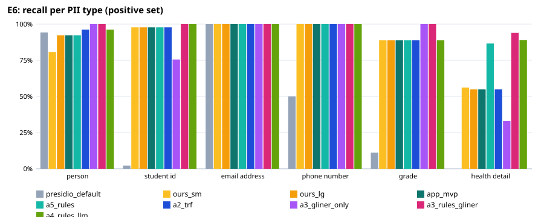
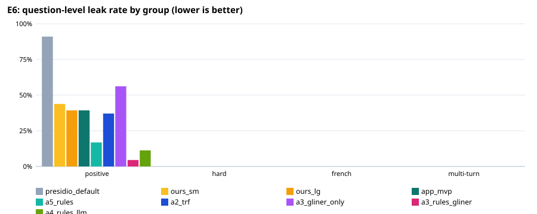

# E6: privacy filter evaluation

102 fictional questions (89 positive, 13 negative); `holdout.jsonl`: held-out set written by a different model after the rules were final (`make_holdout.py`), labels checked by hand. An entity counts as protected when ≥ 80% of its characters are redacted (any overlap for health details).

## Expected vs actual — recommended configuration `a5_rules`

| Metric | Expected (ideal / marginal) | Actual | Verdict |
|---|---|---|---|
| Question-level leak rate, positive set | ≤ 1.0% / ≤ 5.0% | 16.9% | ❌ not met |
| Lowest per-type recall, positive set | ≥ 95.0% / ≥ 90.0% | 86.6% | ❌ not met |
| Over-redaction, negative set | ≤ 5.0% / ≤ 10.0% | 0.0% | ✅ ideal |
| Personal-health questions kept local (sensitivity) | ≥ 95.0% / ≥ 90.0% | 90.3% | 🟡 marginal |
| Other questions left cloud-eligible (specificity) | ≥ 95.0% / ≥ 90.0% | 100.0% | ✅ ideal |
| Placeholder round trip restores the original text | ≥ 100.0% / ≥ 100.0% | 100.0% | ✅ ideal |
| Median latency per question (ms) | ≤ 100 ms / ≤ 300 ms | 7 ms | ✅ ideal |

## All configurations

| Configuration | Leak: positive | hard | French | multi-turn | Lowest type recall | Over-redaction | Health sens. / spec. | Out-of-scope caught | p50 / p95 |
|---|---|---|---|---|---|---|---|---|---|
| presidio_default | 91.0% | 0.0% | 0.0% | 0.0% | 0.0% | 7.7% | 0.0% / 100.0% | 0/0 | 7 / 9 ms |
| ours_sm | 43.8% | 0.0% | 0.0% | 0.0% | 56.1% | 0.0% | 56.5% / 100.0% | 0/0 | 6 / 8 ms |
| ours_lg | 39.3% | 0.0% | 0.0% | 0.0% | 54.9% | 0.0% | 56.5% / 100.0% | 0/0 | 7 / 9 ms |
| app_mvp | 39.3% | 0.0% | 0.0% | 0.0% | 54.9% | 0.0% | 56.5% / 100.0% | 0/0 | 7 / 8 ms |
| a5_rules | 16.9% | 0.0% | 0.0% | 0.0% | 86.6% | 0.0% | 90.3% / 100.0% | 0/0 | 7 / 8 ms |
| a2_trf | 37.1% | 0.0% | 0.0% | 0.0% | 54.9% | 0.0% | 56.5% / 100.0% | 0/0 | 24 / 34 ms |
| a3_gliner_only | 56.2% | 0.0% | 0.0% | 0.0% | 32.9% | 46.2% | 41.9% / 77.5% | 0/0 | 87 / 101 ms |
| a3_rules_gliner | 4.5% | 0.0% | 0.0% | 0.0% | 93.9% | 46.2% | 96.8% / 77.5% | 0/0 | 101 / 114 ms |
| a4_rules_llm | 11.2% | 0.0% | 0.0% | 0.0% | 88.9% | 7.7% | 93.5% / 92.5% | 0/0 | 457 / 895 ms |

## Recall per type, positive set (95% Wilson interval)

| Type | presidio_default | ours_sm | ours_lg | app_mvp | a5_rules | a2_trf | a3_gliner_only | a3_rules_gliner | a4_rules_llm |
|---|---|---|---|---|---|---|---|---|---|
| PERSON | 49/52 [84%–98%] | 42/52 [68%–89%] | 48/52 [82%–97%] | 48/52 [82%–97%] | 48/52 [82%–97%] | 50/52 [87%–99%] | 52/52 [93%–100%] | 52/52 [93%–100%] | 50/52 [87%–99%] |
| STUDENT_ID | 1/45 [0%–12%] | 44/45 [88%–100%] | 44/45 [88%–100%] | 44/45 [88%–100%] | 44/45 [88%–100%] | 44/45 [88%–100%] | 34/45 [61%–86%] | 45/45 [92%–100%] | 45/45 [92%–100%] |
| EMAIL_ADDRESS | 10/10 [72%–100%] | 10/10 [72%–100%] | 10/10 [72%–100%] | 10/10 [72%–100%] | 10/10 [72%–100%] | 10/10 [72%–100%] | 10/10 [72%–100%] | 10/10 [72%–100%] | 10/10 [72%–100%] |
| PHONE_NUMBER | 8/16 [28%–72%] | 16/16 [81%–100%] | 16/16 [81%–100%] | 16/16 [81%–100%] | 16/16 [81%–100%] | 16/16 [81%–100%] | 16/16 [81%–100%] | 16/16 [81%–100%] | 16/16 [81%–100%] |
| GRADE | 1/9 [2%–44%] | 8/9 [56%–98%] | 8/9 [56%–98%] | 8/9 [56%–98%] | 8/9 [56%–98%] | 8/9 [56%–98%] | 9/9 [70%–100%] | 9/9 [70%–100%] | 8/9 [56%–98%] |
| HEALTH_DETAIL | 0/82 [0%–4%] | 46/82 [45%–66%] | 45/82 [44%–65%] | 45/82 [44%–65%] | 71/82 [78%–92%] | 45/82 [44%–65%] | 27/82 [24%–44%] | 77/82 [87%–97%] | 73/82 [80%–94%] |

## Ablation (a5_rules minus one component; change in percentage points, + = worse for leak/over-redaction)

| Removed | Leak positive | Leak hard | Leak French | Over-redaction | Health sens. | Health spec. | Out-of-scope caught |
|---|---|---|---|---|---|---|---|
| − address | +0.0 | +0.0 | +0.0 | +0.0 | +0.0 | +0.0 | +0 |
| − date_of_birth | +0.0 | +0.0 | +0.0 | +0.0 | +0.0 | +0.0 | +0 |
| − fr_grade | +0.0 | +0.0 | +0.0 | +0.0 | +0.0 | +0.0 | +0 |
| − fr_health | +0.0 | +0.0 | +0.0 | +0.0 | +0.0 | +0.0 | +0 |
| − fr_person | +0.0 | +0.0 | +0.0 | +0.0 | +0.0 | +0.0 | +0 |
| − grade | +9.0 | +0.0 | +0.0 | +0.0 | +0.0 | +0.0 | +0 |
| − health_card | +0.0 | +0.0 | +0.0 | +0.0 | +0.0 | +0.0 | +0 |
| − health_detail | +30.3 | +0.0 | +0.0 | +0.0 | -37.1 | +0.0 | +0 |
| − health_extra | +22.5 | +0.0 | +0.0 | +0.0 | -33.9 | +0.0 | +0 |
| − id_number | +0.0 | +0.0 | +0.0 | +0.0 | +0.0 | +0.0 | +0 |
| − phone_na | +7.9 | +0.0 | +0.0 | +0.0 | +0.0 | +0.0 | +0 |
| − postal_code | +0.0 | +0.0 | +0.0 | +0.0 | +0.0 | +0.0 | +0 |
| − student_id | +42.7 | +0.0 | +0.0 | +0.0 | +0.0 | +0.0 | +0 |
| − zh_person | +0.0 | +0.0 | +0.0 | +0.0 | +0.0 | +0.0 | +0 |
| − identity terms | +0.0 | +0.0 | +0.0 | +0.0 | +0.0 | +0.0 | +0 |
| − person clean-up | -1.1 | +0.0 | +0.0 | +7.7 | +0.0 | +0.0 | +0 |
| − staff allow-list | +0.0 | +0.0 | +0.0 | +0.0 | +0.0 | +0.0 | +0 |

## Misses of `a5_rules` by group and variant

**positive** — 15 questions with a leak:
- H012 [other_name]: PERSON: Zara — “Zara, I'm totally lost on the question about blood pressure variability. Could you check chapter 5? I need to finish this by my deadline or Mr. Patel will be mad.”
- H014 [other_name]: PERSON: Marcus — “Marcus, my migraine attacks have been awful lately. Does the course material suggest prophylactic treatments or just acute management? Check page 45 for the symptoms list.”
- H018 [other_name]: PERSON: Sofia — “My aunt, Sofia, asked me about the metabolic changes in diabetes. Could you point me to a resource that explains the long-term effects? Need to ace this test, 300987654.”
- H027 [student_id]: STUDENT_ID: 300333111 — “Hey, can I send you my records? My ID is 300333111-2. I'm struggling with my diabetes lately. Best, Jian.”
- H033 [contact]: HEALTH_DETAIL: pneumonia — “I'm feeling a bit run down. I think this might be pneumonia. My name is Aisha Khan. Send me an email at aisha.khan.health@school.ca.”
- H043 [grade]: GRADE: D — “Mrs. Adewale, I think my final exam mark for the hypertension unit was just a D. Can you check? My email is j.smith@university.edu.”
- H052 [health_self]: HEALTH_DETAIL: blood gulter — “I think my blood gulter is shooting up. I need help with my health plan, my ID number is 300912345. What steps should I take?”
- H053 [health_self]: HEALTH_DETAIL: Metformin — “My doctor gave me a prescription for Metformin for my high blood sugar. Any good resources for new insulinn users?”
- H059 [health_family]: PERSON: Mateo — “Hey tutor. My friend Mateo is super stressed bc his aunt has been having terrible migraine headaches lately. She needs help keeping track of them.”
- H060 [health_family]: HEALTH_DETAIL: pill — “300784112 - Does anyone know if the medication for high blood pressure usually causes dizziness? My mom took a pill today and seemed kinda wobbly.”
- H062 [health_family]: HEALTH_DETAIL: coughs; HEALTH_DETAIL: fever; HEALTH_DETAIL: pneumonia — “My neighbor, Kai, has terrible coughs and fever. Doctors said it might be pneumonia. Should he skip class? His email is kai.singh@university.edu.”
- H068 [combo]: HEALTH_DETAIL: asthma — “Jae-Hoon G. (300987654) is struggling with asthma severity. Check my mail at jaehon.g@univ.ca.”
- H079 [general]: HEALTH_DETAIL: chronic pain — “My migraine is killing me lately, and I'm tired of it. I am Student 300990112. Any tips for managing the chronic pain?”
- H086 [general]: HEALTH_DETAIL: I might be having one right now — “Does anyone know the difference between acute vs chronic asthma exacerbation? I think I might be having one right now. My ID is 300101010.”
- H088 [eponym]: HEALTH_DETAIL: Asthma symptoms — “Asthma symptoms are back. Can you check my prescription? Call me at (604) 555-1923. I'm Aisha Khan.”

**hard** — 0 questions with a leak:
- none

**french** — 0 questions with a leak:
- none

**multiturn** — 0 questions with a leak:
- none

**negative** — 0 over-redacted:
- none

**local-only decision** — 6 wrong:
- H033 [positive/contact] expected local — “I'm feeling a bit run down. I think this might be pneumonia. My name is Aisha Khan. Send me an email at aisha.khan.health@school.ca.”
- H052 [positive/health_self] expected local — “I think my blood gulter is shooting up. I need help with my health plan, my ID number is 300912345. What steps should I take?”
- H060 [positive/health_family] expected local — “300784112 - Does anyone know if the medication for high blood pressure usually causes dizziness? My mom took a pill today and seemed kinda wobbly.”
- H062 [positive/health_family] expected local — “My neighbor, Kai, has terrible coughs and fever. Doctors said it might be pneumonia. Should he skip class? His email is kai.singh@university.edu.”
- H068 [positive/combo] expected local — “Jae-Hoon G. (300987654) is struggling with asthma severity. Check my mail at jaehon.g@univ.ca.”
- H086 [positive/general] expected local — “Does anyone know the difference between acute vs chronic asthma exacerbation? I think I might be having one right now. My ID is 300101010.”

## Known gaps (out-of-scope set)

| Type | presidio_default | ours_sm | ours_lg | app_mvp | a5_rules | a2_trf | a3_gliner_only | a3_rules_gliner | a4_rules_llm |
|---|---|---|---|---|---|---|---|---|---|
