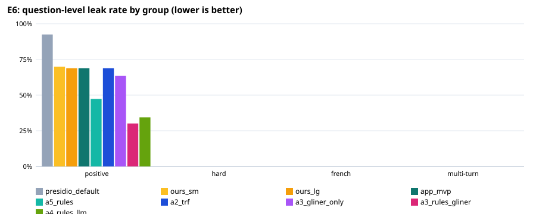

# E6: privacy filter evaluation

102 fictional questions (93 positive, 9 negative); `holdout2.jsonl`: held-out set written by a different model after the rules were final (`make_holdout.py`), labels checked by hand. An entity counts as protected when ≥ 80% of its characters are redacted (any overlap for health details).

## Expected vs actual — recommended configuration `a5_rules`

| Metric | Expected (ideal / marginal) | Actual | Verdict |
|---|---|---|---|
| Question-level leak rate, positive set | ≤ 1.0% / ≤ 5.0% | 47.3% | ❌ not met |
| Lowest per-type recall, positive set | ≥ 95.0% / ≥ 90.0% | 43.8% | ❌ not met |
| Over-redaction, negative set | ≤ 5.0% / ≤ 10.0% | 0.0% | ✅ ideal |
| Personal-health questions kept local (sensitivity) | ≥ 95.0% / ≥ 90.0% | 75.0% | ❌ not met |
| Other questions left cloud-eligible (specificity) | ≥ 95.0% / ≥ 90.0% | 100.0% | ✅ ideal |
| Placeholder round trip restores the original text | ≥ 100.0% / ≥ 100.0% | 100.0% | ✅ ideal |
| Median latency per question (ms) | ≤ 100 ms / ≤ 300 ms | 7 ms | ✅ ideal |

## All configurations

| Configuration | Leak: positive | hard | French | multi-turn | Lowest type recall | Over-redaction | Health sens. / spec. | Out-of-scope caught | p50 / p95 |
|---|---|---|---|---|---|---|---|---|---|
| presidio_default | 92.5% | 0.0% | 0.0% | 0.0% | 0.0% | 0.0% | 0.0% / 100.0% | 0/0 | 7 / 10 ms |
| ours_sm | 69.9% | 0.0% | 0.0% | 0.0% | 35.4% | 0.0% | 43.8% / 100.0% | 0/0 | 7 / 8 ms |
| ours_lg | 68.8% | 0.0% | 0.0% | 0.0% | 35.4% | 0.0% | 43.8% / 100.0% | 0/0 | 7 / 9 ms |
| app_mvp | 68.8% | 0.0% | 0.0% | 0.0% | 35.4% | 0.0% | 43.8% / 100.0% | 0/0 | 7 / 9 ms |
| a5_rules | 47.3% | 0.0% | 0.0% | 0.0% | 43.8% | 0.0% | 75.0% / 100.0% | 0/0 | 7 / 9 ms |
| a2_trf | 68.8% | 0.0% | 0.0% | 0.0% | 35.4% | 0.0% | 43.8% / 100.0% | 0/0 | 28 / 37 ms |
| a3_gliner_only | 63.4% | 0.0% | 0.0% | 0.0% | 33.6% | 44.4% | 40.0% / 54.5% | 0/0 | 70 / 101 ms |
| a3_rules_gliner | 30.1% | 0.0% | 0.0% | 0.0% | 73.5% | 44.4% | 76.2% / 54.5% | 0/0 | 90 / 108 ms |
| a4_rules_llm | 34.4% | 0.0% | 0.0% | 0.0% | 74.3% | 0.0% | 85.0% / 90.9% | 0/0 | 627 / 1016 ms |

## Recall per type, positive set (95% Wilson interval)

| Type | presidio_default | ours_sm | ours_lg | app_mvp | a5_rules | a2_trf | a3_gliner_only | a3_rules_gliner | a4_rules_llm |
|---|---|---|---|---|---|---|---|---|---|
| PERSON | 52/55 [85%–98%] | 42/55 [64%–86%] | 50/55 [80%–96%] | 50/55 [80%–96%] | 50/55 [80%–96%] | 53/55 [88%–99%] | 55/55 [93%–100%] | 55/55 [93%–100%] | 55/55 [93%–100%] |
| STUDENT_ID | 0/41 [0%–9%] | 40/41 [87%–100%] | 40/41 [87%–100%] | 40/41 [87%–100%] | 40/41 [87%–100%] | 40/41 [87%–100%] | 34/41 [69%–91%] | 41/41 [91%–100%] | 41/41 [91%–100%] |
| EMAIL_ADDRESS | 9/9 [70%–100%] | 9/9 [70%–100%] | 9/9 [70%–100%] | 9/9 [70%–100%] | 9/9 [70%–100%] | 9/9 [70%–100%] | 9/9 [70%–100%] | 9/9 [70%–100%] | 9/9 [70%–100%] |
| PHONE_NUMBER | 8/19 [23%–64%] | 19/19 [83%–100%] | 19/19 [83%–100%] | 19/19 [83%–100%] | 19/19 [83%–100%] | 19/19 [83%–100%] | 19/19 [83%–100%] | 19/19 [83%–100%] | 19/19 [83%–100%] |
| GRADE | 0/16 [0%–19%] | 7/16 [23%–67%] | 7/16 [23%–67%] | 7/16 [23%–67%] | 7/16 [23%–67%] | 7/16 [23%–67%] | 15/16 [72%–99%] | 15/16 [72%–99%] | 13/16 [57%–93%] |
| HEALTH_DETAIL | 0/113 [0%–3%] | 40/113 [27%–45%] | 40/113 [27%–45%] | 40/113 [27%–45%] | 72/113 [55%–72%] | 40/113 [27%–45%] | 38/113 [26%–43%] | 83/113 [65%–81%] | 84/113 [66%–81%] |

## Ablation (a5_rules minus one component; change in percentage points, + = worse for leak/over-redaction)

| Removed | Leak positive | Leak hard | Leak French | Over-redaction | Health sens. | Health spec. | Out-of-scope caught |
|---|---|---|---|---|---|---|---|
| − address | +0.0 | +0.0 | +0.0 | +0.0 | +0.0 | +0.0 | +0 |
| − date_of_birth | +0.0 | +0.0 | +0.0 | +0.0 | +0.0 | +0.0 | +0 |
| − fr_grade | +0.0 | +0.0 | +0.0 | +0.0 | +0.0 | +0.0 | +0 |
| − fr_health | +0.0 | +0.0 | +0.0 | +0.0 | +0.0 | +0.0 | +0 |
| − fr_person | +0.0 | +0.0 | +0.0 | +0.0 | +0.0 | +0.0 | +0 |
| − grade | +5.4 | +0.0 | +0.0 | +0.0 | +0.0 | +0.0 | +0 |
| − health_card | +0.0 | +0.0 | +0.0 | +0.0 | +0.0 | +0.0 | +0 |
| − health_detail | +22.6 | +0.0 | +0.0 | +0.0 | -27.5 | +0.0 | +0 |
| − health_extra | +21.5 | +0.0 | +0.0 | +0.0 | -31.2 | +0.0 | +0 |
| − id_number | +0.0 | +0.0 | +0.0 | +0.0 | +0.0 | +0.0 | +0 |
| − phone_na | +3.2 | +0.0 | +0.0 | +0.0 | +0.0 | +0.0 | +0 |
| − postal_code | +0.0 | +0.0 | +0.0 | +0.0 | +0.0 | +0.0 | +0 |
| − student_id | +25.8 | +0.0 | +0.0 | +0.0 | +0.0 | +0.0 | +0 |
| − zh_person | +0.0 | +0.0 | +0.0 | +0.0 | +0.0 | +0.0 | +0 |
| − identity terms | +0.0 | +0.0 | +0.0 | +0.0 | +0.0 | +0.0 | +0 |
| − person clean-up | -1.1 | +0.0 | +0.0 | +0.0 | +0.0 | +0.0 | +0 |
| − staff allow-list | +0.0 | +0.0 | +0.0 | +0.0 | +0.0 | +0.0 | +0 |

## Misses of `a5_rules` by group and variant

**positive** — 44 questions with a leak:
- T008 [own_name]: HEALTH_DETAIL: head pain — “My name is Wei Lin. I had terrible head pain this week. Is chronic migraine always genetic? Student ID 300778899.”
- T009 [own_name]: GRADE: 4.0 — “Is blood pressure a key indicator of other health crises? I'm Diego Sanchez. Grad level is 4.0. ID 300211034. Thanks.”
- T011 [other_name]: HEALTH_DETAIL: severe asthma — “Hey, has Michael Rodriguez been diagnosed with severe asthma? My classmate Ben Cho was asking, but I still don't get how inhalers work. I need help with Question 4 on the reading.”
- T013 [other_name]: HEALTH_DETAIL: has it — “I'm panicking trying to find the treatment options for pneumonia! My friend Omar Kazi said his mom has it. Could you explain the short-term recovery protocols from the lecture notes? My ID is 300459122.”
- T014 [other_name]: HEALTH_DETAIL: last attack — “Did anyone see the assignment about migraine triggers? My classmate, Sofia Mendoza, mentioned her last attack was bad. Also, I need to confirm if the physiological markers for migraine are the same as for tension headaches.”
- T017 [other_name]: HEALTH_DETAIL: having problems — “What are the long-term effects of consistently high blood pressure? Marcus Chen says his uncle is having problems. Also, does the textbook require citations for the hypertension case studies?”
- T020 [other_name]: HEALTH_DETAIL: diabetes — “Does hyperglycemia management follow a specific protocol, Mark Dubois asked me about. My neighbor, Mrs. Gupta, has diabetes. Can we go through the dietary recommendations again? She needs to know how to manage her blood sugar.”
- T022 [student_id]: STUDENT_ID: 300-987654 — “Hi Dr, I am Chen Mei. My asthma is really bad lately. Please call me at (416) 555-0192. My ID is 300-987654.”
- T023 [student_id]: HEALTH_DETAIL: migraine — “My headache is awful, I think it might be a major migraine. My name is Isabella Rossi, and my stu# is 300777889. Need advice ASAP.”
- T026 [student_id]: HEALTH_DETAIL: shoulder aches; HEALTH_DETAIL: asthma — “I started having these terrible shoulder aches. Maybe it's linked to my old asthma, 300555666.”
- T031 [contact]: HEALTH_DETAIL: migraine ache — “Worst migraine ache ever. I need to talk to someone ASAP. Please call me back at (403) 555-2341. It's completely messing up my studies.”
- T032 [contact]: HEALTH_DETAIL: pneumonia — “The doctor confirmed my lungs might have pneumonia. I'm sending the full medical details to somesh@email.com. Let me know if the grade implications are severe.”
- T034 [contact]: HEALTH_DETAIL: sugar control — “My sugar control is poor lately, and my blood pressure is high. Can you call me at 604-555-0199 to discuss possible adjustments?”
- T036 [contact]: HEALTH_DETAIL: migrain — “Hey prof, my migrain is acting up aint goin away. Can u text me? My mobile is +1-212-555-9000. Pls read my case notes.”
- T038 [grade]: HEALTH_DETAIL: Headache; HEALTH_DETAIL: migraine — “Ugh, I got a B+ for the midterm. Headache is kicking my ass lately, probably a bad migraine. ID is 300845129.”
- T039 [grade]: GRADE: 2.8; HEALTH_DETAIL: blood pressure readings — “Can we talk about my low GPA? It's only a 2.8 right now. I was really struggling with the blood pressure readings over the past month. Call me at (403) 555-0198.”
- T040 [grade]: GRADE: 95% — “Jorge, I hit a 95% on the latest assignment, but my asthma is acting up. I'm 300112345. I hope I don't fail if I can't breathe properly.”
- T041 [grade]: GRADE: B — “Please adjust my attendance. I've had pneumonia this winter. My student number 300998765 shows I'm doing okay, like a solid B.”
- T042 [grade]: GRADE: I failed it — “Is it possible to retake the exam? I failed it, which lowered my average to 3.1. My blood pressure meds are messing with my sleep, honestly.”
- T043 [grade]: GRADE: D+; GRADE: 3.8; HEALTH_DETAIL: high sugar levels — “My GPA feels awful, like I'm hovering around a D+. My cousin Elena said she got a 3.8, but I'm still dealing with my high sugar levels from diabetes.”
- T047 [health_self]: HEALTH_DETAIL: inhaler — “Hey, my doc said my asthma is getting worse lately, and the inhaler isn't helping much. Is the weekly health seminar due this week, or next?”
- T049 [health_self]: HEALTH_DETAIL: meds — “Is the deadline for the paper tomorrow? I've been dealing with severe migraine flashes since Tuesday and over-the-counter meds aren't cutting it.”
- T050 [health_self]: HEALTH_DETAIL: Amoxil — “My doctor confirmed I have pneumonia, and I'm taking antibiotics (Amoxil). Can I submit my assignment even if I've missed three days?”
- T051 [health_self]: HEALTH_DETAIL: tremors — “I'm 300489123, and I've been experiencing strange tremors lately. When is the next review date for course requirements?”
- T053 [health_self]: HEALTH_DETAIL: Type 2 diabetes — “Javier Santos here. My GP diagnosed me with Type 2 diabetes. Can you send me a link to the reading materials for the next unit?”
- T054 [health_self]: HEALTH_DETAIL: migraine — “If I need to reschedule my appointment because of this crazy migraine, what's the general policy for late submission?”
- T055 [health_self]: HEALTH_DETAIL: test results; HEALTH_DETAIL: low oxygen saturation — “I just got test results showing low oxygen saturation. Is there an office hours session I can attend next week?”
- T059 [health_family]: PERSON: Sofia; HEALTH_DETAIL: sugar levels — “My cousin, Sofia, has been struggling with her diabetes lately. Her sugar levels are really high and she needs help figuring out her insulin dose. I am 300123456.”
- T060 [health_family]: HEALTH_DETAIL: breathing — “Liam's breathing is so bad. I think his asthma is flaring up again near his apartment. He called me at 604-333-2222 yesterday.”
- T061 [health_family]: PERSON: Mariam; HEALTH_DETAIL: miigrn — “My aunt, Mariam, suffered a terrible miigrn last week. She was taking Triptan, but it didn't help the agony. She is exhausted.”
- T062 [health_family]: HEALTH_DETAIL: blood pressure — “I heard Mrs. Patel's blood pressure has been elevated for months. Apparently, it's stressing her out a lot.”
- T063 [health_family]: HEALTH_DETAIL: pneumonia — “Did you know Kenji's dad had to get checked for pneumonia? He had a really rough cough and fever. His student ID is 300987654.”
- T064 [health_family]: HEALTH_DETAIL: prescription; HEALTH_DETAIL: dabietes — “Jamal took a prescription for his dabietes yesterday. Said he needs to track his glucose levels very carefully now.”
- T065 [health_family]: HEALTH_DETAIL: headaches — “Elara keeps having these severe headaches and she's always dizzy. She's trying to reduce her migraine triggers. You can reach her at (403) 777-0011.”
- T067 [combo]: GRADE: B+; PERSON: Ayesha S. — “Hi, my bp has been spikey lately. Can you look at my grade, it's only a B+? - Ayesha S.”
- T073 [combo]: GRADE: 89%; HEALTH_DETAIL: sleep issues — “Ezequiel needs an extension. His grade is 89%, and he has major sleep issues related to his health.”
- T075 [general]: PERSON: Aiya; HEALTH_DETAIL: chronic shortness of breath — “Hey, I'm confused about the severity classification for asthma. If a student like Aiya (300456123) is experiencing chronic shortness of breath, what diagnostic criteria applies?”
- T077 [general]: PERSON: Mateo — “My friend Mateo (555-123-4567) had a bad migraine last week. Is there a specific protocol we should study for managing severe tensional headaches?”
- T089 [eponym]: HEALTH_DETAIL: diastolic is 95 — “I'm so concerned about my blood pressure readings. My name is Anya Petrova and my current diastolic is 95. Please help me, 300200389.”
- T091 [eponym]: HEALTH_DETAIL: blood pressure — “300311290. I keep having these bad bursts of blood pressure. It's worse than usual. Please check my notes.”
- T092 [eponym]: HEALTH_DETAIL: A1C — “The diabetes management chapter mentioned the HOMA-IR index. Does this apply if my A1C is over 8? I'm worried.”
- T093 [eponym]: HEALTH_DETAIL: sugar levels — “My Name is Kenji Sato, and I need guidance on my sugar levels. I've been reading about the pathophysiology of insuln resistance. My student number is 300404521.”
- T094 [eponym]: HEALTH_DETAIL: head pain — “I'm experiencing intense head pain and nausea. I'm thinking it's a migraine. Contact me if you need more details. Call 204-456-7890.”
- T097 [hypothetical]: HEALTH_DETAIL: results — “Does elevated blood pressure always mean serious hypertension? I'm worried about my results. I am Rahul Sharma, student 300011223.”

**hard** — 0 questions with a leak:
- none

**french** — 0 questions with a leak:
- none

**multiturn** — 0 questions with a leak:
- none

**negative** — 0 over-redacted:
- none

**local-only decision** — 20 wrong:
- T008 [positive/own_name] expected local — “My name is Wei Lin. I had terrible head pain this week. Is chronic migraine always genetic? Student ID 300778899.”
- T014 [positive/other_name] expected local — “Did anyone see the assignment about migraine triggers? My classmate, Sofia Mendoza, mentioned her last attack was bad. Also, I need to confirm if the physiological markers for migraine are the same as for tension headaches.”
- T017 [positive/other_name] expected local — “What are the long-term effects of consistently high blood pressure? Marcus Chen says his uncle is having problems. Also, does the textbook require citations for the hypertension case studies?”
- T026 [positive/student_id] expected local — “I started having these terrible shoulder aches. Maybe it's linked to my old asthma, 300555666.”
- T031 [positive/contact] expected local — “Worst migraine ache ever. I need to talk to someone ASAP. Please call me back at (403) 555-2341. It's completely messing up my studies.”
- T036 [positive/contact] expected local — “Hey prof, my migrain is acting up aint goin away. Can u text me? My mobile is +1-212-555-9000. Pls read my case notes.”
- T038 [positive/grade] expected local — “Ugh, I got a B+ for the midterm. Headache is kicking my ass lately, probably a bad migraine. ID is 300845129.”
- T039 [positive/grade] expected local — “Can we talk about my low GPA? It's only a 2.8 right now. I was really struggling with the blood pressure readings over the past month. Call me at (403) 555-0198.”
- T051 [positive/health_self] expected local — “I'm 300489123, and I've been experiencing strange tremors lately. When is the next review date for course requirements?”
- T053 [positive/health_self] expected local — “Javier Santos here. My GP diagnosed me with Type 2 diabetes. Can you send me a link to the reading materials for the next unit?”
- T054 [positive/health_self] expected local — “If I need to reschedule my appointment because of this crazy migraine, what's the general policy for late submission?”
- T055 [positive/health_self] expected local — “I just got test results showing low oxygen saturation. Is there an office hours session I can attend next week?”
- T062 [positive/health_family] expected local — “I heard Mrs. Patel's blood pressure has been elevated for months. Apparently, it's stressing her out a lot.”
- T071 [positive/combo] expected local — “I'm worried about my astma and my grade is C. My email is kenji.h@school.edu.”
- T073 [positive/combo] expected local — “Ezequiel needs an extension. His grade is 89%, and he has major sleep issues related to his health.”
- T075 [positive/general] expected local — “Hey, I'm confused about the severity classification for asthma. If a student like Aiya (300456123) is experiencing chronic shortness of breath, what diagnostic criteria applies?”
- T091 [positive/eponym] expected local — “300311290. I keep having these bad bursts of blood pressure. It's worse than usual. Please check my notes.”
- T092 [positive/eponym] expected local — “The diabetes management chapter mentioned the HOMA-IR index. Does this apply if my A1C is over 8? I'm worried.”
- T093 [positive/eponym] expected local — “My Name is Kenji Sato, and I need guidance on my sugar levels. I've been reading about the pathophysiology of insuln resistance. My student number is 300404521.”
- T097 [positive/hypothetical] expected local — “Does elevated blood pressure always mean serious hypertension? I'm worried about my results. I am Rahul Sharma, student 300011223.”

## Known gaps (out-of-scope set)

| Type | presidio_default | ours_sm | ours_lg | app_mvp | a5_rules | a2_trf | a3_gliner_only | a3_rules_gliner | a4_rules_llm |
|---|---|---|---|---|---|---|---|---|---|
